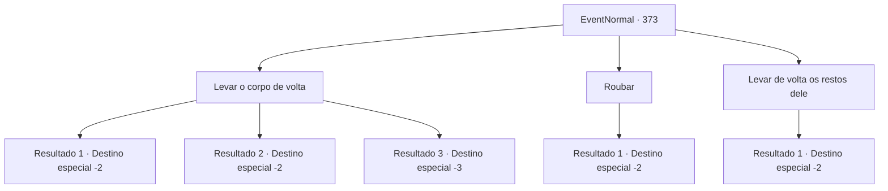

# Eventos normais · 373

[Índice da tabela](index.md) · [Índice geral](../index.md)

ID: `pt:EventNormal:373` · Fonte: `EventNormal4` · Versão: 1.2.47.

Mapeamento estático dos arquivos; a disponibilidade e a execução dependem do estado da run.

## Texto do evento

*Sem texto no arquivo.*

## Dados de entrada

```json
{
  "id": 373,
  "grade": 1,
  "place": "",
  "required": ""
}
```

## Mapa das escolhas



## Escolhas e resultados

### Escolha 1

Levar o corpo de volta

Requisitos e outros campos da escolha:

```json
{
  "required": ""
}
```

#### Resultado 1.1

Você desce do ninho da manticora com o corpo do aventureiro morto. O caminho de volta para a aldeia carregando um cadáver é ainda mais difícil do que caçar a manticora, mas você vê luzes depois de suportar a dor por um tempo. Ao chegar na vila, o companheiro do aventureiro morto, aquele que lhe pediu a missão de resgate, vem checar seu aliado. Ele derrama lágrimas quando descobre que está morto. 

 "Oh, não... Por que, amigo... por que...!"

 Ele escova os olhos violentamente com um pano esfarrapado e agradece. Ele vasculha sua mochila e lhe entrega algumas moedas de ouro. 

 "Obrigado, por vingar meu irmão de armas...! E você até trouxe de volta o corpo dele... deve ter sido exaustivo. Obrigada!"

 Com o aventureiro de olhos marejados ainda agradecendo, você deita o cadáver na frente dele.

Continuação registrada: [Destino especial `-2`](../destinos-especiais.md).

```json
{
  "required": "",
  "chance": "1|0_13_1|0_5_1",
  "nextEvent": -2,
  "type": 0,
  "reward": "0_3_3|0_4_100"
}
```

#### Resultado 1.2

Você tenta descer do ninho da manticora com o corpo do aventureiro morto, mas a fadiga leva a melhor sobre você. Você perde o equilíbrio e cai do penhasco. Infelizmente, você deixa o corpo e encontra um pequeno lenço que poderia servir como seus restos mortais. 

 Alguns momentos depois, ao retornar à vila, o aventureiro que lhe contou tudo isso se aproxima de você. Você lhe entrega o lenço e diz que o amigo dele já estava morto quando você chegou lá. Você também dá a ele a presa da manticora. 

 "Ah, não... Por que, amigo... por que...!"

 Ele escova os olhos violentamente com um pano esfarrapado e agradece. Ele vasculha sua mochila e lhe entrega algumas moedas de ouro. 

 "Obrigado, por vingar meu irmão de armas...! Obrigada!"

 Ele mostra sua gratidão e segue para as montanhas, provavelmente para trazer de volta o corpo de seu companheiro.

Continuação registrada: [Destino especial `-2`](../destinos-especiais.md).

```json
{
  "required": "1_0_2",
  "chance": "22",
  "nextEvent": -2,
  "type": 1,
  "reward": "0_0_-1|0_3_3|0_4_50"
}
```

#### Resultado 1.3

Você tenta descer do ninho da manticora com o corpo do aventureiro morto, mas a fadiga leva a melhor sobre você. Você perde o equilíbrio e cai do penhasco.

Continuação registrada: [Destino especial `-3`](../destinos-especiais.md).

```json
{
  "required": "2_0_2",
  "chance": "22",
  "nextEvent": -3,
  "type": 1,
  "reward": "0_0_-1"
}
```

### Escolha 2

Roubar

Requisitos e outros campos da escolha:

```json
{
  "required": "2_3_-15"
}
```

#### Resultado 2.1

Não deveria haver ninguém assistindo. Você olha ao seu redor para ter certeza de que ninguém está lá e saqueia o aventureiro morto de sua armadura e ouro.

Continuação registrada: [Destino especial `-2`](../destinos-especiais.md).

```json
{
  "required": "",
  "chance": "1",
  "nextEvent": -2,
  "type": 2,
  "reward": "0_3_-3|3_177_1|0_4_20"
}
```

### Escolha 3

Levar de volta os restos dele

Requisitos e outros campos da escolha:

```json
{
  "required": ""
}
```

#### Resultado 3.1

Você procura o aventureiro morto e encontra um pequeno lenço que poderia servir como seus restos mortais. 

 Alguns momentos depois, ao retornar à vila, o aventureiro que lhe contou tudo isso se aproxima de você. Você lhe entrega o lenço e diz que o amigo dele já estava morto quando você chegou lá. Você também dá a ele a presa da manticora. 

 "Ah, não... Por que, amigo... por que...!"

 Ele escova os olhos violentamente com um pano esfarrapado e agradece. Ele vasculha sua mochila e lhe entrega algumas moedas de ouro. 

 "Obrigado, por vingar meu irmão de armas...! Obrigada!"

 Ele mostra sua gratidão e segue para as montanhas, provavelmente para trazer de volta o corpo de seu companheiro.

Continuação registrada: [Destino especial `-2`](../destinos-especiais.md).

```json
{
  "required": "",
  "chance": "1",
  "nextEvent": -2,
  "type": 2,
  "reward": "0_3_3|0_4_50"
}
```

## Referências que chegam a este evento

- [Evento 372 · escolha 1 · resultado 1](0372.md#escolha-1)
