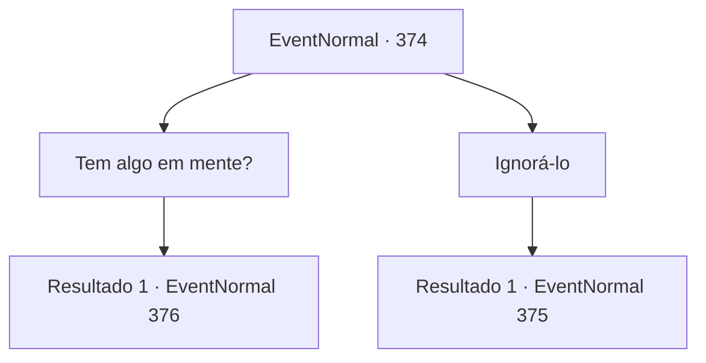

# Eventos normais · 374

[Índice da tabela](index.md) · [Índice geral](../index.md)

ID: `pt:EventNormal:374` · Fonte: `EventNormal4` · Versão: 1.2.47.

Mapeamento estático dos arquivos; a disponibilidade e a execução dependem do estado da run.

## Texto do evento

Está quase na hora do pôr do sol. Você está procurando um lugar para dormir em uma cidade chamada 'Dil Luar', construída no topo de uma colina natural. Então, você ouve alguém soltando um suspiro profundo. Vem de um homem de meia-idade bebendo sozinho nas ruelas. Quando ele te vê, ele solta um suspiro ainda mais longo.

## Dados de entrada

```json
{
  "id": 374,
  "grade": 1,
  "place": "",
  "required": "5_238_0"
}
```

## Mapa das escolhas



## Escolhas e resultados

### Escolha 1

Tem algo em mente?

Requisitos e outros campos da escolha:

```json
{
  "required": ""
}
```

#### Resultado 1.1

O homem de meia-idade se aproxima de você em resposta, pois estava esperando alguém perguntar. Ele esfrega os olhos manchados de vermelho e fala. 

 "Eu acho, eu acho... não posso deixar de suspeitar da minha esposa. Você se importa?"|drawing_tavern| Ele guia você para 'Silver Sturgeon', uma pousada próxima, tomando uma mesa no canto. Ele vai para a cozinha e volta com algumas bebidas e lanches. 

 "Nome é Vernon. Eu administro a pousada, como você pode ver. Do dia ao amanhecer, negócios ocupados."

 O lugar lotado corrobora sua afirmação. Depois de beber um copo de cerveja, o estalajadeiro continua. 

 "Minha esposa é uma verdadeira beleza, ao contrário de mim. Eu sempre pensei que tinha sorte de tê-la como minha amante. Mas... com o passar do tempo, nossa casa ficou cada vez mais bagunçada, e agora acho que ela nem se importa com nosso único filho. Meu palpite diz que ela está tendo um caso secreto com outra pessoa."

 Ele diz que acha que sua esposa o está traindo e pede que você confirme sua suspeita. 

Continuação registrada: [Evento 376](0376.md) na mesma tabela.

```json
{
  "required": "",
  "chance": "1",
  "nextEvent": 376,
  "type": 2,
  "reward": ""
}
```

### Escolha 2

Ignorá-lo

Requisitos e outros campos da escolha:

```json
{
  "required": ""
}
```

#### Resultado 2.1

Você faz o seu melhor para desviar o olhar, ignorando o homem e passando por ele. Ao passar pelo beco, você encontra uma pousada. Dormir aqui parece bom.

Continuação registrada: [Evento 375](0375.md) na mesma tabela.

```json
{
  "required": "",
  "chance": "1",
  "nextEvent": 375,
  "type": 2,
  "reward": "5_238_9"
}
```

## Referências que chegam a este evento

Nenhum `nextEvent` positivo da mesma tabela aponta para este nó. Isso não prova que seja inacessível: sorteio e estado de história podem selecioná-lo.

