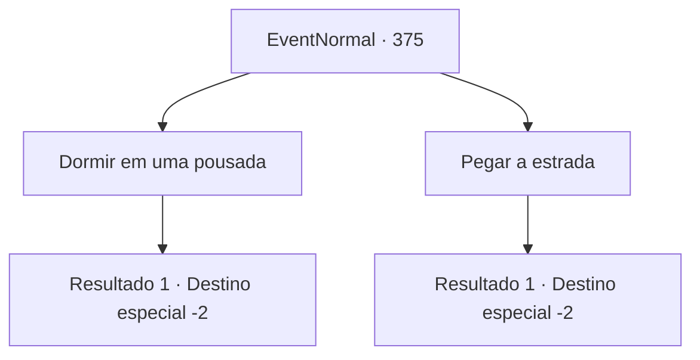

# Eventos normais · 375

[Índice da tabela](index.md) · [Índice geral](../index.md)

ID: `pt:EventNormal:375` · Fonte: `EventNormal4` · Versão: 1.2.47.

Mapeamento estático dos arquivos; a disponibilidade e a execução dependem do estado da run.

## Texto do evento

*Sem texto no arquivo.*

## Dados de entrada

```json
{
  "id": 375,
  "grade": 1,
  "place": "",
  "required": ""
}
```

## Mapa das escolhas



## Escolhas e resultados

### Escolha 1

Dormir em uma pousada

Requisitos e outros campos da escolha:

```json
{
  "required": "1_4_10"
}
```

#### Resultado 1.1

Você entra na pousada e paga por um quarto. O interior é amplo e o primeiro andar está lotado de clientes. Exausto, você vai direto para o seu quarto e para a cama, caindo no sono. 

 No dia seguinte, você encontra o homem de meia-idade nas ruelas, desta vez bêbado e dormindo. Você passa furtivamente por ele, indo para outro lugar.

Continuação registrada: [Destino especial `-2`](../destinos-especiais.md).

```json
{
  "required": "",
  "chance": "1",
  "nextEvent": -2,
  "type": 2,
  "reward": "0_0_1|0_1_1|0_4_-10"
}
```

### Escolha 2

Pegar a estrada

Requisitos e outros campos da escolha:

```json
{
  "required": ""
}
```

#### Resultado 2.1

Você monta uma barraca improvisada no beco estreito e se deita. Você pode sentir a superfície rochosa dura, mas é o suficiente para deixá-lo dormir. 

 No dia seguinte, você encontra outros como você ao redor de sua barraca, aqueles que não têm onde dormir. Você caminha cuidadosamente, tentando o seu melhor para não pisar em nenhum deles, saindo do beco.

Continuação registrada: [Destino especial `-2`](../destinos-especiais.md).

```json
{
  "required": "",
  "chance": "1",
  "nextEvent": -2,
  "type": 2,
  "reward": ""
}
```

## Referências que chegam a este evento

- [Evento 374 · escolha 2 · resultado 1](0374.md#escolha-2)
