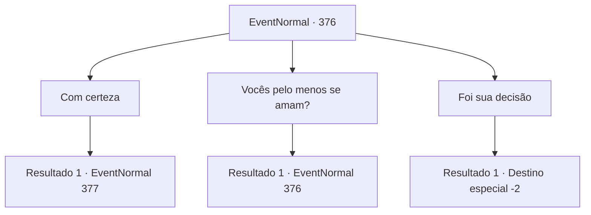

# Eventos normais · 376

[Índice da tabela](index.md) · [Índice geral](../index.md)

ID: `pt:EventNormal:376` · Fonte: `EventNormal4` · Versão: 1.2.47.

Mapeamento estático dos arquivos; a disponibilidade e a execução dependem do estado da run.

## Texto do evento

*Sem texto no arquivo.*

## Dados de entrada

```json
{
  "id": 376,
  "grade": 1,
  "place": "",
  "required": ""
}
```

## Mapa das escolhas



## Escolhas e resultados

### Escolha 1

Com certeza

Requisitos e outros campos da escolha:

```json
{
  "required": ""
}
```

#### Resultado 1.1

Ele ouve sua resposta e acena lentamente. 

 "Obrigada. Aquela casa com o telhado verde, lá no morro. Essa é a minha casa. Fique de olho nisso e verifique se alguém entra. Este é o seu pagamento, adiantado."

 Depois de terminar, Vernon lhe entrega um pouco de ouro, suspira e volta para a cozinha. A casa dele fica a cerca de 30 minutos da pousada. A casa foi construída no topo de uma colina. Não é um castelo super amplo, mas a julgar pela estética, provavelmente é uma casa cara.

Continuação registrada: [Evento 377](0377.md) na mesma tabela.

```json
{
  "required": "",
  "chance": "1",
  "nextEvent": 377,
  "type": 2,
  "reward": "0_4_30"
}
```

### Escolha 2

Vocês pelo menos se amam?

Requisitos e outros campos da escolha:

```json
{
  "required": "5_238_0"
}
```

#### Resultado 2.1

Você pergunta a ele se você ama a esposa dele. Ele fica em silêncio por um tempo e se abre. 

 "Eu amo minha esposa... mas não acho que minha esposa me ame. É por isso que estou ficando cada vez mais desconfiado."


Continuação registrada: [Evento 376](0376.md) na mesma tabela.

```json
{
  "required": "",
  "chance": "1",
  "nextEvent": 376,
  "type": 2,
  "reward": "5_238_1"
}
```

### Escolha 3

Foi sua decisão

Requisitos e outros campos da escolha:

```json
{
  "required": ""
}
```

#### Resultado 3.1

Você diz a Vernon que foi decisão dele se casar com sua esposa. Você diz que ele deve resistir e assumir a responsabilidade por suas ações. Ele fica lá em silêncio, ouvindo você. Ele então se levanta lentamente. 

 "Entendo... Você não está errado. Foi realmente minha decisão. Obrigado por ouvir um velho, amigo. O dia está acabando... por que você não passa a noite aqui."

 Você não recusa sua hospitalidade. Você tem mais alguns lanches, pega a chave dele e cai no sono no seu quarto. 

 No dia seguinte, você desce até o primeiro andar da pousada. Você vê alguns clientes tomando café da manhã, mas não consegue encontrar o estalajadeiro em lugar nenhum. Você se afasta da pousada, de volta às suas aventuras.

Continuação registrada: [Destino especial `-2`](../destinos-especiais.md).

```json
{
  "required": "",
  "chance": "1",
  "nextEvent": -2,
  "type": 2,
  "reward": "5_238_9"
}
```

## Referências que chegam a este evento

- [Evento 374 · escolha 1 · resultado 1](0374.md#escolha-1)
- [Evento 376 · escolha 2 · resultado 1](0376.md#escolha-2)
