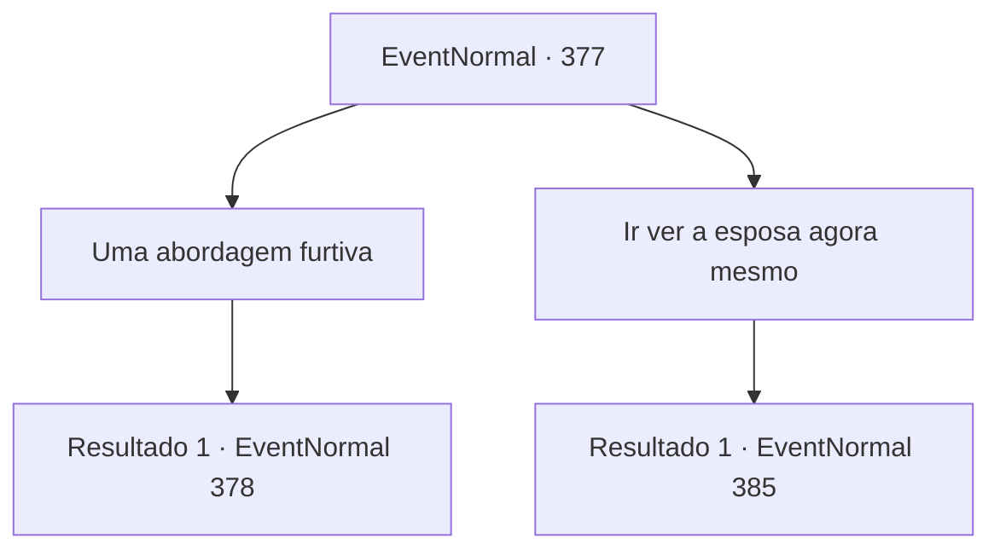

# Eventos normais · 377

[Índice da tabela](index.md) · [Índice geral](../index.md)

ID: `pt:EventNormal:377` · Fonte: `EventNormal4` · Versão: 1.2.47.

Mapeamento estático dos arquivos; a disponibilidade e a execução dependem do estado da run.

## Texto do evento

*Sem texto no arquivo.*

## Dados de entrada

```json
{
  "id": 377,
  "grade": 1,
  "place": "",
  "required": ""
}
```

## Mapa das escolhas



## Escolhas e resultados

### Escolha 1

Uma abordagem furtiva

Requisitos e outros campos da escolha:

```json
{
  "required": ""
}
```

#### Resultado 1.1

Você vai disfarçado, perto da casa de Vernon. Logo, a porta se abre e uma mulher que parece a esposa de Vernon sai da casa. Ela imediatamente começa a descer as colinas. Você se mistura aos pedestres, seguindo-a. Você a testemunha entrando em uma cabana localizada nos arredores da cidade. A cabana é construída com pau-brasil, e ao seu redor você pode ver mós e escorredores com couro animal. Você fica perto da cabine e escuta. Você pode ouvir alguns ruídos não tão familiares de dentro. 

Continuação registrada: [Evento 378](0378.md) na mesma tabela.

```json
{
  "required": "",
  "chance": "1",
  "nextEvent": 378,
  "type": 2,
  "reward": ""
}
```

### Escolha 2

Ir ver a esposa agora mesmo

Requisitos e outros campos da escolha:

```json
{
  "required": ""
}
```

#### Resultado 2.1

Você decide fazer uma visita à esposa imediatamente. Quando você bate na porta, a esposa de Vernon se revela. Olhando para você, ela cautelosamente pergunta quem você é. 

 "Quem é Você...?"


Continuação registrada: [Evento 385](0385.md) na mesma tabela.

```json
{
  "required": "",
  "chance": "1",
  "nextEvent": 385,
  "type": 2,
  "reward": ""
}
```

## Referências que chegam a este evento

- [Evento 376 · escolha 1 · resultado 1](0376.md#escolha-1)
