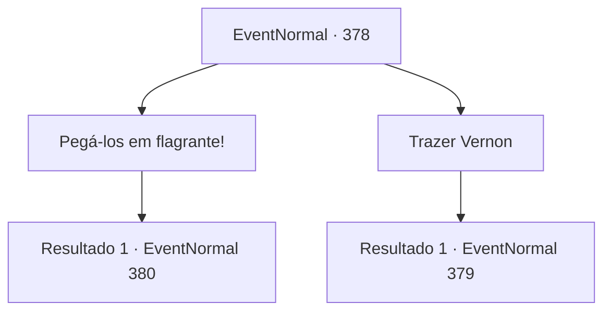

# Eventos normais · 378

[Índice da tabela](index.md) · [Índice geral](../index.md)

ID: `pt:EventNormal:378` · Fonte: `EventNormal4` · Versão: 1.2.47.

Mapeamento estático dos arquivos; a disponibilidade e a execução dependem do estado da run.

## Texto do evento

*Sem texto no arquivo.*

## Dados de entrada

```json
{
  "id": 378,
  "grade": 1,
  "place": "",
  "required": ""
}
```

## Mapa das escolhas



## Escolhas e resultados

### Escolha 1

Pegá-los em flagrante!

Requisitos e outros campos da escolha:

```json
{
  "required": ""
}
```

#### Resultado 1.1

Você chuta a porta surrada da velha cabana. A porta se abre facilmente, e dentro você vê a esposa de Vernon se divertindo com um homem que parece o dono da cabana. 

 "Argh!? Quem... quem é você!"

 A esposa de Vernon grita, e o homem rapidamente levanta as calças.

Continuação registrada: [Evento 380](0380.md) na mesma tabela.

```json
{
  "required": "",
  "chance": "1",
  "nextEvent": 380,
  "type": 2,
  "reward": ""
}
```

### Escolha 2

Trazer Vernon

Requisitos e outros campos da escolha:

```json
{
  "required": ""
}
```

#### Resultado 2.1

Você volta rapidamente para Silver Sturgeon. Você então conta a Vernon o que testemunhou. Vernon suspira profundamente e segue você. Quando ele chega na cabine, ele abre a porta da cabine. Infelizmente, ele testemunha em primeira mão a cena de sua esposa se divertindo com outro homem. 

 "Ufa... Ei. EI."

 Eles nem sabem que a porta está aberta. Quando eles vêem Vernon, seus olhos se arregalam de espanto. Os dois se vestem apressadamente, mas Vernon age primeiro. Ele caminha até o homem e dá um soco em seu rosto. Com um baque alto, ele cai no chão. 

 "H... Querida! Espere..!! Eu posso explicar..."

 Vernon olha para você e pede para você sair da cabana.

Continuação registrada: [Evento 379](0379.md) na mesma tabela.

```json
{
  "required": "",
  "chance": "1",
  "nextEvent": 379,
  "type": 2,
  "reward": ""
}
```

## Referências que chegam a este evento

- [Evento 377 · escolha 1 · resultado 1](0377.md#escolha-1)
