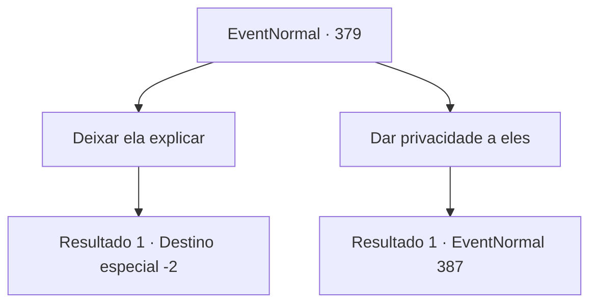

# Eventos normais · 379

[Índice da tabela](index.md) · [Índice geral](../index.md)

ID: `pt:EventNormal:379` · Fonte: `EventNormal4` · Versão: 1.2.47.

Mapeamento estático dos arquivos; a disponibilidade e a execução dependem do estado da run.

## Texto do evento

*Sem texto no arquivo.*

## Dados de entrada

```json
{
  "id": 379,
  "grade": 1,
  "place": "",
  "required": ""
}
```

## Mapa das escolhas



## Escolhas e resultados

### Escolha 1

Deixar ela explicar

Requisitos e outros campos da escolha:

```json
{
  "required": ""
}
```

#### Resultado 1.1

Você acalma Vernon e pede a ele que ouça o lado da história dela. Com mãos trêmulas, ele agarra uma cadeira e se senta. A esposa de Vernon desaba em lágrimas e fala. 

 "Querido... eu sinto muito, muito, muito. Mas eu... estava tão sozinha. Tudo o que você se importa é com a estalagem, e você nem se importava em perguntar como eu me sentia, ou o que eu queria...! Então... eu não pude deixar de procurar alguém em quem pudesse depender."

 Ela enxuga as lágrimas e continua. 

 "Eu... está tudo bem, é minha culpa, mas é meio que sua culpa também! Você nem faz ideia de como é solitário e patético estar presa nesta casa com uma criança?! É.. É uma maldita prisão!"

 Enquanto ouve sua esposa falar, o rosto de Vernon fica cada vez mais vermelho. Ele então se força a se levantar da cadeira. 

 "Pahahaha.... Sim. Então é minha culpa. É minha culpa... Fui um idiota completo por pensar em você como meu amor eterno. Nem pense em voltar para esta casa. Nem pense em ver minha filha novamente! Se você entrar de volta na minha vida, eu vou literalmente mandar te matar!!"

 Vernon despeja sua raiva em sua esposa e sai furioso. Você o segue para fora da cabana, e depois de andar um pouco, Vernon se senta perto de uma árvore, olhando para baixo. 

 "Você... Você não precisava ver tudo isso. Desculpe, e obrigado. Graças a você, me livrei de um peso na cabeça. Por favor, pegue isso."

 Ele lhe entrega algum ouro e o anel de seu dedo. 

 "Dê para alguém, venda, faça o que quiser com isso."

 Após terminar, Vernon fecha os olhos e se apoia na árvore. Você se afasta, deixando Vernon para trás.

Continuação registrada: [Destino especial `-2`](../destinos-especiais.md).

```json
{
  "required": "",
  "chance": "1",
  "nextEvent": -2,
  "type": 2,
  "reward": "5_238_2|0_4_50|3_46_1"
}
```

### Escolha 2

Dar privacidade a eles

Requisitos e outros campos da escolha:

```json
{
  "required": ""
}
```

#### Resultado 2.1

Você espera por Vernon do lado de fora da cabana. Depois de um tumulto, a porta da cabine se abre com um rangido. Mas não é Vernon que sai, é o outro homem. Ele está segurando uma faca de cozinha ensanguentada nas mãos. Parece que o sangue é de Vernon. 

 "Você... Se não fosse por você bastardo...!!"

 Ele corre para você com os olhos vermelhos de sangue.

Continuação registrada: [Evento 387](0387.md) na mesma tabela.

```json
{
  "required": "",
  "chance": "1",
  "nextEvent": 387,
  "type": 2,
  "reward": "6_3_2",
  "place": 4
}
```

## Referências que chegam a este evento

- [Evento 378 · escolha 2 · resultado 1](0378.md#escolha-2)
