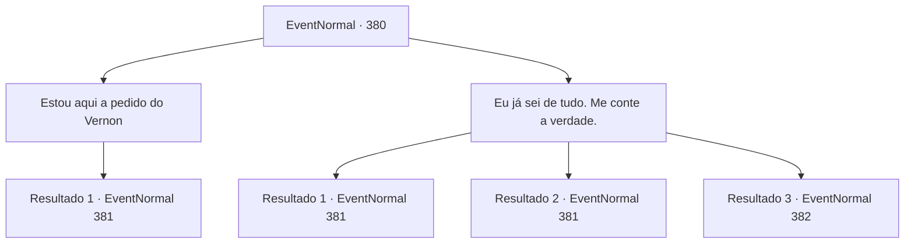

# Eventos normais · 380

[Índice da tabela](index.md) · [Índice geral](../index.md)

ID: `pt:EventNormal:380` · Fonte: `EventNormal4` · Versão: 1.2.47.

Mapeamento estático dos arquivos; a disponibilidade e a execução dependem do estado da run.

## Texto do evento

*Sem texto no arquivo.*

## Dados de entrada

```json
{
  "id": 380,
  "grade": 1,
  "place": "",
  "required": ""
}
```

## Mapa das escolhas



## Escolhas e resultados

### Escolha 1

Estou aqui a pedido do Vernon

Requisitos e outros campos da escolha:

```json
{
  "required": ""
}
```

#### Resultado 1.1

Você a notifica de que está aqui a pedido de Vernon. A esposa de Vernon revira os olhos antes de finalmente falar. 

 "Hum... você gentilmente manteria isso em segredo...? Você não tem nada a ver com isso. Por favor, eu te imploro. Se aquele idiota do Vernon descobrir, ele vai me matar...!"

 Ela propõe 50 de ouro pelo negócio.

Continuação registrada: [Evento 381](0381.md) na mesma tabela.

```json
{
  "required": "",
  "chance": "1",
  "nextEvent": 381,
  "type": 2,
  "reward": "5_239_1"
}
```

### Escolha 2

Eu já sei de tudo. Me conte a verdade.

Requisitos e outros campos da escolha:

```json
{
  "required": ""
}
```

#### Resultado 2.1

Você diz à esposa de Vernon que você já sabe de tudo, e que ela permanecerá viva apenas se confessar a verdade. Reforçada, ela concorda em conversar. 

 "E... espere. Por favor, deixe-me explicar... eu tenho uma razão para fazer isso, você sabe..."

 Ela continua sobre como sua traição era inevitável. De qualquer forma, ela basicamente admitiu ter se enganado. 

 "Hum... você gentilmente manteria isso em segredo...? Você não tem nada a ver com isso. Por favor, eu te imploro. Se aquele idiota do Vernon descobrir, ele vai me matar...!"

 Ela propõe 100 de ouro pelo acordo.

Continuação registrada: [Evento 381](0381.md) na mesma tabela.

```json
{
  "required": "21_1_2",
  "chance": "1|0_12_1",
  "nextEvent": 381,
  "type": 0,
  "reward": "5_239_2"
}
```

#### Resultado 2.2

Você diz à esposa de Vernon que você já sabe de tudo, e que ela permanecerá viva apenas se confessar a verdade. Assustada, ela concorda em conversar. 

 "E... espere. Por favor, deixe-me explicar... eu tenho uma razão para fazer isso, você sabe..."

 Ela continua sobre como sua traição era inevitável. De qualquer forma, ela basicamente admitiu ter se enganado. 

 "Hum... você gentilmente manteria isso em segredo...? Você não tem nada a ver com isso. Por favor, eu te imploro. Se aquele idiota do Vernon descobrir, ele vai me matar...!"

 Ela propõe 100 de ouro pelo acordo.

Continuação registrada: [Evento 381](0381.md) na mesma tabela.

```json
{
  "required": "20_1_2",
  "chance": "1|0_12_2",
  "nextEvent": 381,
  "type": 0,
  "reward": "5_239_2"
}
```

#### Resultado 2.3

Você diz à esposa de Vernon que você já sabe de tudo, e que ela permanecerá viva apenas se confessar a verdade. Então, o homem ao lado dela o interrompe com uma faca de cozinha nas mãos. 

 "Desapareça, seu idiota!"

 Ele grita de raiva, enlouquecendo com a faca.

Continuação registrada: [Evento 382](0382.md) na mesma tabela.

```json
{
  "required": "",
  "chance": "13",
  "nextEvent": 382,
  "type": 1,
  "reward": "6_3_2",
  "place": 4
}
```

## Referências que chegam a este evento

- [Evento 378 · escolha 1 · resultado 1](0378.md#escolha-1)
