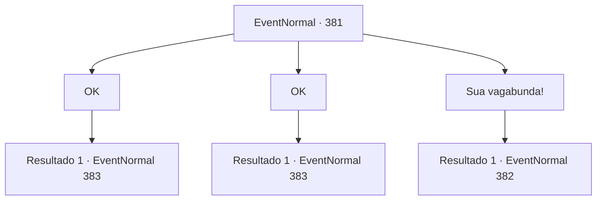

# Eventos normais · 381

[Índice da tabela](index.md) · [Índice geral](../index.md)

ID: `pt:EventNormal:381` · Fonte: `EventNormal4` · Versão: 1.2.47.

Mapeamento estático dos arquivos; a disponibilidade e a execução dependem do estado da run.

## Texto do evento

*Sem texto no arquivo.*

## Dados de entrada

```json
{
  "id": 381,
  "grade": 1,
  "place": "",
  "required": ""
}
```

## Mapa das escolhas



## Escolhas e resultados

### Escolha 1

OK

Requisitos e outros campos da escolha:

```json
{
  "required": "5_239_1"
}
```

#### Resultado 1.1

Você decide aceitar o pedido dela. A mulher agradece e lhe entrega o ouro prometido. Ela então lhe diz para levá-la até Silver Sturgeon, onde Vernon estará esperando. 

 Alguns minutos depois, você chega ao Silver Sturgeon com a esposa de Vernon. Vernon sai da cozinha, levando você e sua esposa para dentro da cozinha. Ele olha para você e sua esposa, e fala. 

 "Hm... Surpresa de ver vocês dois juntos."

 A esposa de Vernon de repente grita de raiva. 

 "VOCÊS! Você tem alguma idéia de como eu trabalho duro em nossa casa? E tudo que você faz é levantar SUSPEITAS?! O QUE VOCÊ TEM!!"

 Vernon olha em seus olhos em resposta. Ele está esperando sua resposta. 

Continuação registrada: [Evento 383](0383.md) na mesma tabela.

```json
{
  "required": "",
  "chance": "1",
  "nextEvent": 383,
  "type": 2,
  "reward": "0_4_50"
}
```

### Escolha 2

OK

Requisitos e outros campos da escolha:

```json
{
  "required": "5_239_2"
}
```

#### Resultado 2.1

Você decide aceitar o pedido dela. A mulher agradece e lhe entrega o ouro prometido. Ela então lhe diz para levá-la até Silver Sturgeon, onde Vernon estará esperando. 

 Alguns minutos depois, você chega ao Silver Sturgeon com a esposa de Vernon. Vernon sai da cozinha, levando você e sua esposa para dentro da cozinha. Ele olha para você e sua esposa, e fala. 

 "Hm... Surpresa de ver vocês dois juntos."

 A esposa de Vernon de repente grita de raiva. 

 "VOCÊS! Você tem alguma idéia de como eu trabalho duro em nossa casa? E tudo que você faz é levantar SUSPEITAS?! O QUE VOCÊ TEM!!"

 Vernon olha em seus olhos em resposta. Ele está esperando sua resposta. 

Continuação registrada: [Evento 383](0383.md) na mesma tabela.

```json
{
  "required": "",
  "chance": "1",
  "nextEvent": 383,
  "type": 2,
  "reward": "0_4_100"
}
```

### Escolha 3

Sua vagabunda!

Requisitos e outros campos da escolha:

```json
{
  "required": ""
}
```

#### Resultado 3.1

Você rejeita a proposta dela. Humilhada ela se senta chorando, e o homem se aproxima de você com uma faca de cozinha. 

 "Sem você, ninguém saberá desse assunto!"

 Ele corre para você com sangue nos olhos.

Continuação registrada: [Evento 382](0382.md) na mesma tabela.

```json
{
  "required": "",
  "chance": "1",
  "nextEvent": 382,
  "type": 2,
  "reward": "6_3_2",
  "place": 4
}
```

## Referências que chegam a este evento

- [Evento 380 · escolha 1 · resultado 1](0380.md#escolha-1)
- [Evento 380 · escolha 2 · resultado 1](0380.md#escolha-2)
- [Evento 380 · escolha 2 · resultado 2](0380.md#escolha-2)
