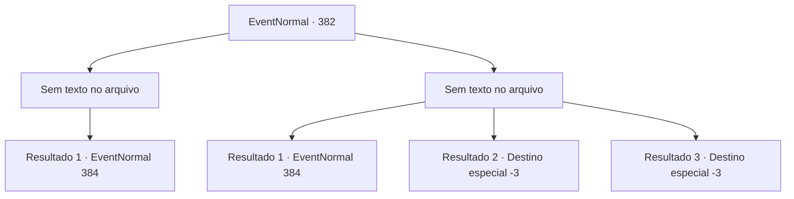

# Eventos normais · 382

[Índice da tabela](index.md) · [Índice geral](../index.md)

ID: `pt:EventNormal:382` · Fonte: `EventNormal4` · Versão: 1.2.47.

Mapeamento estático dos arquivos; a disponibilidade e a execução dependem do estado da run.

## Texto do evento

*Sem texto no arquivo.*

## Dados de entrada

```json
{
  "id": 382,
  "grade": 1,
  "place": "",
  "required": ""
}
```

## Mapa das escolhas



## Escolhas e resultados

### Escolha 1

*Sem texto no arquivo; o papel dessa opção depende da interface do jogo.*

Requisitos e outros campos da escolha:

```json
{
  "required": ""
}
```

#### Resultado 1.1

Você derrotou o homem de forma justa, e ele agora está rolando no chão de dor. Você deixa para trás ele e a esposa de Vernon, que está chorando no chão agora, e volta para o Silver Sturgeon. 

 Alguns momentos depois, você chega ao Silver Sturgeon, onde Vernon está esperando. Vernon leva você até o canto da pousada, trazendo um copo de cerveja e alguns petiscos. 

 "Então, como foi...? Meu palpite está errado? Ou..."


Continuação registrada: [Evento 384](0384.md) na mesma tabela.

```json
{
  "required": "",
  "chance": "1",
  "nextEvent": 384,
  "type": 2,
  "reward": ""
}
```

### Escolha 2

*Sem texto no arquivo; o papel dessa opção depende da interface do jogo.*

Requisitos e outros campos da escolha:

```json
{
  "required": ""
}
```

#### Resultado 2.1

Você mal escapa do homem empunhando a faca. Então você corre de volta para o Silver Sturgeon. 

 Alguns momentos depois, você chega ao Silver Sturgeon, onde Vernon está esperando. Vernon leva você até o canto da pousada, trazendo um copo de cerveja e alguns petiscos. 

 "Então, como foi...? Meu palpite está errado? Ou..."


Continuação registrada: [Evento 384](0384.md) na mesma tabela.

```json
{
  "required": "1_0_2|1_1_2",
  "chance": "1",
  "nextEvent": 384,
  "type": 2,
  "reward": "0_0_-1|0_1_-1"
}
```

#### Resultado 2.2

Você é morto pelo estranho com a faca.

Continuação registrada: [Destino especial `-3`](../destinos-especiais.md).

```json
{
  "required": "2_0_2",
  "chance": "1",
  "nextEvent": -3,
  "type": 2,
  "reward": "0_0_-1|0_1_-1"
}
```

#### Resultado 2.3

Você é morto pelo estranho com a faca.

Continuação registrada: [Destino especial `-3`](../destinos-especiais.md).

```json
{
  "required": "2_1_2",
  "chance": "1",
  "nextEvent": -3,
  "type": 2,
  "reward": "0_0_-1|0_1_-1"
}
```

## Referências que chegam a este evento

- [Evento 380 · escolha 2 · resultado 3](0380.md#escolha-2)
- [Evento 381 · escolha 3 · resultado 1](0381.md#escolha-3)
