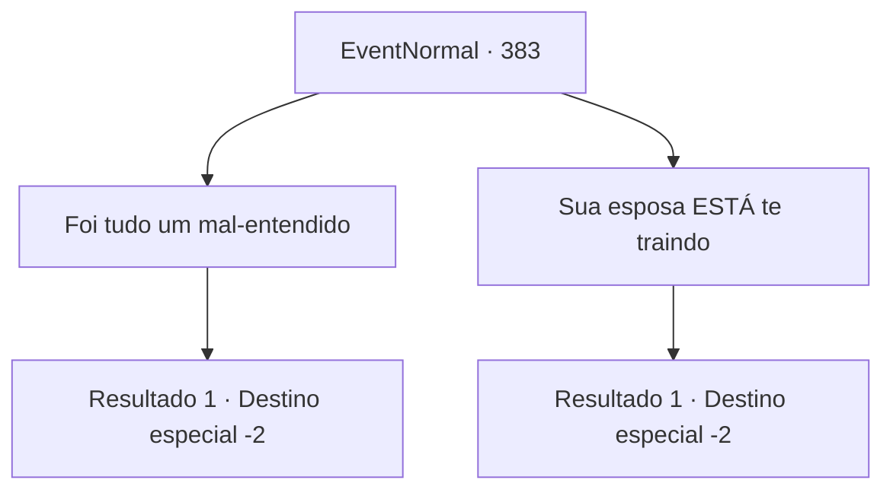

# Eventos normais · 383

[Índice da tabela](index.md) · [Índice geral](../index.md)

ID: `pt:EventNormal:383` · Fonte: `EventNormal4` · Versão: 1.2.47.

Mapeamento estático dos arquivos; a disponibilidade e a execução dependem do estado da run.

## Texto do evento

*Sem texto no arquivo.*

## Dados de entrada

```json
{
  "id": 383,
  "grade": 1,
  "place": "",
  "required": ""
}
```

## Mapa das escolhas



## Escolhas e resultados

### Escolha 1

Foi tudo um mal-entendido

Requisitos e outros campos da escolha:

```json
{
  "required": ""
}
```

#### Resultado 1.1

Você diz a Vernon para confiar em sua esposa, e que ela tem trabalhado muito duro em casa o dia todo, dedicando-se a cuidar da casa e da criança. Em resposta, a voz da esposa de Vernon só fica mais alta, dizendo como era difícil para ela, quando Vernon estava trabalhando fora o dia todo, todos os dias. 

 "...Eu vejo. Me desculpe, querida."

 Ele abaixa a cabeça em um pedido de desculpas. Ele também pede desculpas a você, dizendo que não deveria tê-lo arrastado para tudo isso. Ele lhe entrega uma pequena bolsa cheia de ouro. Você sai da pousada com sua recompensa.

Continuação registrada: [Destino especial `-2`](../destinos-especiais.md).

```json
{
  "required": "",
  "chance": "1",
  "nextEvent": -2,
  "type": 2,
  "reward": "0_4_20|5_238_3"
}
```

### Escolha 2

Sua esposa ESTÁ te traindo

Requisitos e outros campos da escolha:

```json
{
  "required": ""
}
```

#### Resultado 2.1

Apesar de seu acordo com a esposa de Vernon, você diz a verdade a Vernon. Os olhos da esposa se dilatam em resposta, com uma exclamação cheia de espanto. Ela grita em pânico que você está mentindo. Mas Vernon se recusa a ouvir mais. Depois de beber cerveja em seu copo, Vernon grita, tão alto que seria o suficiente para quebrar as janelas da pousada. <link=shake>

 "SAIA!! NÃO QUERO VER VOCÊ NUNCA MAIS!!!"

</link> A esposa de Vernon pega as calças de Vernon, implorando para ele ficar com ela, mas os sentimentos de Vernon por ela se foram há muito tempo. Os funcionários de Vernon a expulsam da pousada, e Vernon pega um escudo que estava pendurado na parede e o entrega a você. Ele também tira um anel do dedo e dá a você também. 

 "...Jogue fora, venda, faça como quiser. De qualquer forma, obrigado por ajudar."

 Ele volta a se sentar com uma expressão complicada, e você deixa Vernon, saindo da pousada.

Continuação registrada: [Destino especial `-2`](../destinos-especiais.md).

```json
{
  "required": "",
  "chance": "1",
  "nextEvent": -2,
  "type": 2,
  "reward": "0_3_1|3_209_1|3_46_1|5_238_4"
}
```

## Referências que chegam a este evento

- [Evento 381 · escolha 1 · resultado 1](0381.md#escolha-1)
- [Evento 381 · escolha 2 · resultado 1](0381.md#escolha-2)
- [Evento 386 · escolha 1 · resultado 1](0386.md#escolha-1)
