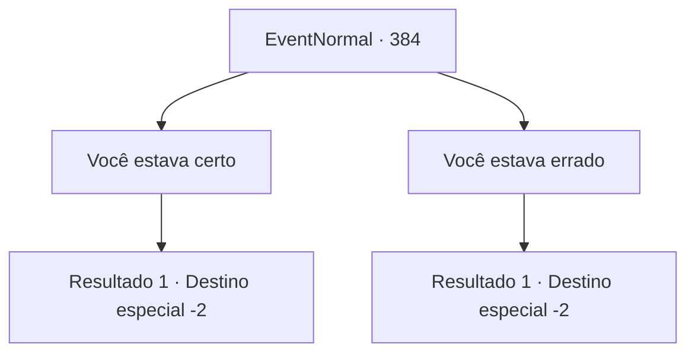

# Eventos normais · 384

[Índice da tabela](index.md) · [Índice geral](../index.md)

ID: `pt:EventNormal:384` · Fonte: `EventNormal4` · Versão: 1.2.47.

Mapeamento estático dos arquivos; a disponibilidade e a execução dependem do estado da run.

## Texto do evento

*Sem texto no arquivo.*

## Dados de entrada

```json
{
  "id": 384,
  "grade": 1,
  "place": "",
  "required": ""
}
```

## Mapa das escolhas



## Escolhas e resultados

### Escolha 1

Você estava certo

Requisitos e outros campos da escolha:

```json
{
  "required": ""
}
```

#### Resultado 1.1

Você diz a verdade a Vernon, que o palpite dele estava certo. Ele parece deprimido por um segundo, antes de enxugar as lágrimas dos olhos. 

 "*suspiro*... Sim. Eu vi isso chegando. O comportamento dela ultimamente... a casa bagunçada... até pelo que meu filho disse... Finalmente eu encaro a verdade, e parece que minha mente está clara novamente. Obrigado, aventureiro."

 Vernon pega um escudo que estava pendurado na parede e o entrega a você, dizendo que é sua recompensa. Ele também tira um anel do dedo e dá a você também. 

 "...Jogue fora, venda, faça como quiser. De qualquer forma, obrigado por ajudar."

 Ele volta a se sentar com uma expressão complicada, e você deixa Vernon, saindo da pousada.

Continuação registrada: [Destino especial `-2`](../destinos-especiais.md).

```json
{
  "required": "",
  "chance": "1",
  "nextEvent": -2,
  "type": 2,
  "reward": "0_3_3|3_209_1|3_46_1|5_238_4"
}
```

### Escolha 2

Você estava errado

Requisitos e outros campos da escolha:

```json
{
  "required": ""
}
```

#### Resultado 2.1

Você diz a Vernon para confiar em sua esposa, e que ela tem trabalhado muito duro em casa o dia todo, dedicando-se a cuidar da casa e da criança. Sua expressão ainda carrega suspeitas, mas ele logo balança a cabeça. Ele lhe entrega uma pequena bolsa de ouro, dizendo que não deveria tê-la arrastado para tudo isso. Você sai da pousada com sua recompensa.

Continuação registrada: [Destino especial `-2`](../destinos-especiais.md).

```json
{
  "required": "",
  "chance": "1",
  "nextEvent": -2,
  "type": 2,
  "reward": "0_4_20|5_238_3"
}
```

## Referências que chegam a este evento

- [Evento 382 · escolha 1 · resultado 1](0382.md#escolha-1)
- [Evento 382 · escolha 2 · resultado 1](0382.md#escolha-2)
