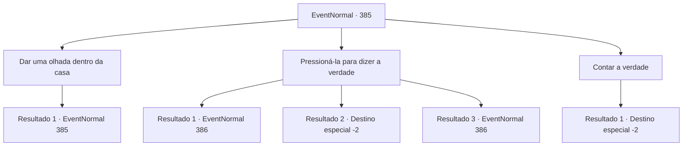

# Eventos normais · 385

[Índice da tabela](index.md) · [Índice geral](../index.md)

ID: `pt:EventNormal:385` · Fonte: `EventNormal4` · Versão: 1.2.47.

Mapeamento estático dos arquivos; a disponibilidade e a execução dependem do estado da run.

## Texto do evento

*Sem texto no arquivo.*

## Dados de entrada

```json
{
  "id": 385,
  "grade": 1,
  "place": "",
  "required": ""
}
```

## Mapa das escolhas



## Escolhas e resultados

### Escolha 1

Dar uma olhada dentro da casa

Requisitos e outros campos da escolha:

```json
{
  "required": "5_241_0"
}
```

#### Resultado 1.1

Você empurra a esposa de Vernon para o lado e entra na casa imediatamente. A casa está em péssimo estado. O chão está cheio de sujeira, poeira enche o ar e a única coisa limpa é sua penteadeira. Uma garotinha, de aproximadamente 6 anos, olha para você enquanto rola no chão sujo. Ela logo perde o interesse e desvia o olhar. Ela não parece nem um pouco cautelosa com o estranho que acabou de invadir a casa. É quase como se ela fosse indiferente. 

 "O... o que diabos você está fazendo!!"

 A mulher grita, seguindo você para dentro.

Continuação registrada: [Evento 385](0385.md) na mesma tabela.

```json
{
  "required": "",
  "chance": "1",
  "nextEvent": 385,
  "type": 2,
  "reward": "5_241_1"
}
```

### Escolha 2

Pressioná-la para dizer a verdade

Requisitos e outros campos da escolha:

```json
{
  "required": ""
}
```

#### Resultado 2.1

Você faz o seu melhor para soar como um investigador particular. Como você age como se tivesse todas as evidências e informações necessárias, como se estivesse pressionando o suspeito, A esposa de Vernon começa a dar desculpas por suas ações. 

 "E... espere. Por favor, deixe-me explicar... eu tenho uma razão para fazer isso, você sabe..."

 Ela continua sobre como sua traição era inevitável. De qualquer forma, ela basicamente admitiu ter se enganado. 

 "Hum... você gentilmente manteria isso em segredo...? Você não tem nada a ver com isso. Por favor, eu te imploro. Se aquele idiota do Vernon descobrir, ele vai me matar...!"

 Ela propõe 100 de ouro pelo acordo.

Continuação registrada: [Evento 386](0386.md) na mesma tabela.

```json
{
  "required": "10_93_1",
  "chance": "1|0_12_1",
  "nextEvent": 386,
  "type": 0,
  "reward": ""
}
```

#### Resultado 2.2

Você faz o seu melhor para soar como um investigador particular. Mas sua atuação falha miseravelmente. Ela sorri para o seu comportamento estranho e fala. 

 "Hm... Vernon colocou você nisso, não foi? Como ele ousa me acusar de traição... ele nem sabe como eu vivo meus dias nessa casa..."

 A esposa de Vernon continua com raiva, os olhos fixos em você. 

 "Olhar! Não tenho nada a esconder. Não sei por que um mero aventureiro como você está se intrometendo nos negócios da família de alguém, mas vou lhe dizer o quanto sou dedicado a esta casa."

 Você pode ver claramente que ela estava prestes a sair, mas ela o convida de volta para dentro. Ela continua sobre o quão duro ela trabalha para manter a casa funcionando. 
...
 A palestra dura umas duas horas, e você acha que seus ouvidos estão sangrando. 

 "Ufa... o suficiente? Preciso dizer mais?"

 Você inconscientemente balança a cabeça. Mais disso e seus ouvidos podem realmente começar a sangrar. Você sai apressadamente da casa e volta para Vernon. 

 Você diz a ele que não conseguiu encontrar nenhuma evidência sólida que prove a traição dela. 

 "...Eu vejo. Talvez eu estivesse errado..."

 Sua expressão ainda carrega suspeitas, mas ele logo balança a cabeça. Ele lhe entrega uma pequena bolsa de ouro, pedindo desculpas por desperdiçar seu tempo. Você sai da pousada com sua recompensa.

Continuação registrada: [Destino especial `-2`](../destinos-especiais.md).

```json
{
  "required": "10_93_1",
  "chance": "14",
  "nextEvent": -2,
  "type": 1,
  "reward": "0_4_10|5_238_3"
}
```

#### Resultado 2.3

Você pega o Respondente e aponta para o pescoço dela. Você então pergunta se ela está traindo Vernon ou não. 

 "E... espere. Por favor, deixe-me explicar... eu tenho uma razão para fazer isso, você sabe..."

 Ela continua sobre como sua traição era inevitável. De qualquer forma, ela basicamente admitiu ter se enganado. 

 "Hum... você gentilmente manteria isso em segredo...? Você não tem nada a ver com isso. Por favor, eu te imploro. Se aquele idiota do Vernon descobrir, ele vai me matar...!"

 Ela propõe 100 de ouro pelo acordo.

Continuação registrada: [Evento 386](0386.md) na mesma tabela.

```json
{
  "required": "8_93_1",
  "chance": "1",
  "nextEvent": 386,
  "type": 2,
  "reward": ""
}
```

### Escolha 3

Contar a verdade

Requisitos e outros campos da escolha:

```json
{
  "required": ""
}
```

#### Resultado 3.1

Você diz a ela que Vernon queria que você verificasse a casa dele. E também que ele tem suspeitas para a mulher. Depois de ouvir você, ela bufa e continua. 

 "Ha..! Ele tem alguma idéia de quão mau marido ele tem sido...? Eita!"

 Ela fala consigo mesma por um momento, antes de olhar para você e continuar furiosamente. 

 "Olhar! Não tenho nada a esconder. Não sei por que um mero aventureiro como você está se intrometendo nos negócios da família de alguém, mas vou lhe dizer o quanto sou dedicado a esta casa."

 Você pode ver claramente que ela estava prestes a sair, mas ela o convida de volta para dentro. Ela continua sobre o quão duro ela trabalha para manter a casa funcionando. 
...
 A palestra dura umas duas horas, e você acha que seus ouvidos estão sangrando. 

 "Ufa... o suficiente? Preciso dizer mais?"

 Você inconscientemente balança a cabeça. Mais disso e seus ouvidos podem realmente começar a sangrar. Você sai apressadamente da casa e volta para Vernon. 

 Você diz a ele que não conseguiu encontrar nenhuma evidência sólida que prove a traição dela. 

 "...Eu vejo. Talvez eu estivesse errado..."

 Sua expressão ainda carrega suspeitas, mas ele logo balança a cabeça. Ele lhe entrega uma pequena bolsa de ouro, pedindo desculpas por desperdiçar seu tempo. Você sai da pousada com sua recompensa.

Continuação registrada: [Destino especial `-2`](../destinos-especiais.md).

```json
{
  "required": "",
  "chance": "1",
  "nextEvent": -2,
  "type": 2,
  "reward": "0_4_10|5_238_3"
}
```

## Referências que chegam a este evento

- [Evento 377 · escolha 2 · resultado 1](0377.md#escolha-2)
- [Evento 385 · escolha 1 · resultado 1](0385.md#escolha-1)
