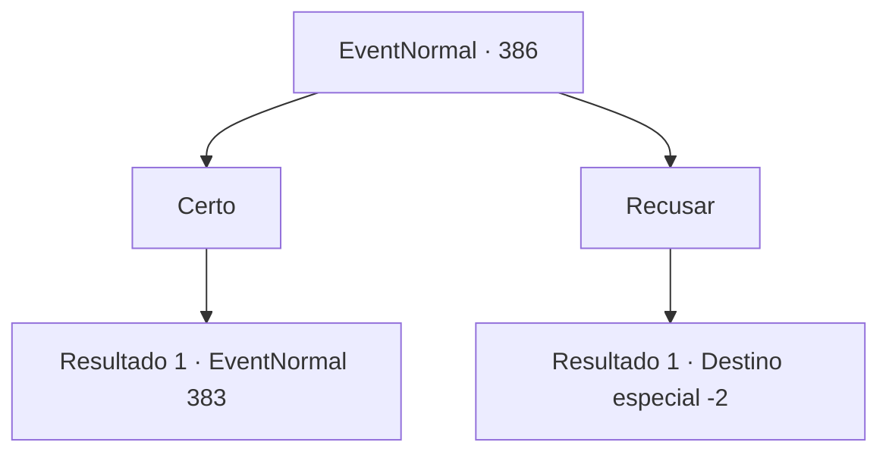

# Eventos normais · 386

[Índice da tabela](index.md) · [Índice geral](../index.md)

ID: `pt:EventNormal:386` · Fonte: `EventNormal4` · Versão: 1.2.47.

Mapeamento estático dos arquivos; a disponibilidade e a execução dependem do estado da run.

## Texto do evento

*Sem texto no arquivo.*

## Dados de entrada

```json
{
  "id": 386,
  "grade": 1,
  "place": "",
  "required": ""
}
```

## Mapa das escolhas



## Escolhas e resultados

### Escolha 1

Certo

Requisitos e outros campos da escolha:

```json
{
  "required": ""
}
```

#### Resultado 1.1

Você decide aceitar o pedido dela. A mulher agradece e lhe entrega o ouro prometido. Ela então lhe diz para levá-la até Silver Sturgeon, onde Vernon estará esperando. 

 Alguns minutos depois, você chega ao Silver Sturgeon com a esposa de Vernon. Vernon sai da cozinha, levando você e sua esposa para dentro da cozinha. Ele olha para você e sua esposa, e fala. 

 "Hm... Surpresa de ver vocês dois juntos."

 A esposa de Vernon de repente grita de raiva. 

 "VOCÊS! Você tem alguma idéia de como eu trabalho duro em nossa casa? E tudo que você faz é levantar SUSPEITAS?! O QUE VOCÊ TEM!!"

 Vernon olha em seus olhos em resposta. Ele está esperando sua resposta. 

Continuação registrada: [Evento 383](0383.md) na mesma tabela.

```json
{
  "required": "",
  "chance": "1",
  "nextEvent": 383,
  "type": 2,
  "reward": "0_4_100|0_3_-1"
}
```

### Escolha 2

Recusar

Requisitos e outros campos da escolha:

```json
{
  "required": ""
}
```

#### Resultado 2.1

Você deixa a mulher chorando e volta para o Silver Sturgeon. Diga a verdade a Vernon, que o palpite dele estava certo. Ele parece deprimido por um segundo, antes de enxugar as lágrimas dos olhos. 

 "*suspiro*... Sim. Eu vi isso chegando. O comportamento dela ultimamente... a casa bagunçada... até pelo que meu filho disse... Finalmente eu encaro a verdade, e parece que minha mente está clara novamente. Obrigado, aventureiro."

 Vernon pega um escudo que estava pendurado na parede e o entrega a você, dizendo que é sua recompensa. Ele também tira um anel do dedo e dá a você também. 

 "...Jogue fora, venda, faça como quiser. De qualquer forma, obrigado por ajudar."

 Ele volta a se sentar com uma expressão complicada, e você deixa Vernon, saindo da pousada.

Continuação registrada: [Destino especial `-2`](../destinos-especiais.md).

```json
{
  "required": "",
  "chance": "1",
  "nextEvent": -2,
  "type": 2,
  "reward": "0_3_3|3_209_1|3_46_1|5_238_4"
}
```

## Referências que chegam a este evento

- [Evento 385 · escolha 2 · resultado 1](0385.md#escolha-2)
- [Evento 385 · escolha 2 · resultado 3](0385.md#escolha-2)
