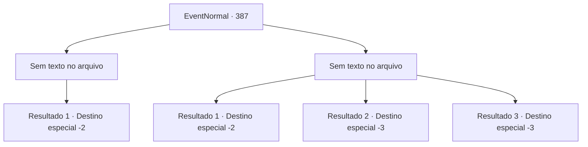

# Eventos normais · 387

[Índice da tabela](index.md) · [Índice geral](../index.md)

ID: `pt:EventNormal:387` · Fonte: `EventNormal4` · Versão: 1.2.47.

Mapeamento estático dos arquivos; a disponibilidade e a execução dependem do estado da run.

## Texto do evento

*Sem texto no arquivo.*

## Dados de entrada

```json
{
  "id": 387,
  "grade": 1,
  "place": "",
  "required": ""
}
```

## Mapa das escolhas



## Escolhas e resultados

### Escolha 1

*Sem texto no arquivo; o papel dessa opção depende da interface do jogo.*

Requisitos e outros campos da escolha:

```json
{
  "required": ""
}
```

#### Resultado 1.1

Você derrota o homem furioso e se aproxima de Vernon. Ele cambaleia de volta, segurando novas feridas da luta. A esposa de Vernon o verifica. 

 "H.. querida...? Você está bem..??"

 Vernon então começa a rir. 

 "Hehe.. claro. Eu me sinto... incrível, Helen. Não se atreva a colocar um dedo no meu corpo. Cuide do seu novo amante ali, deitado no chão. Eu não quero ver seu rosto miserável nunca mais."

 Depois de terminar, Vernon rasga uma parte de suas mangas, cobrindo suas feridas para parar o sangramento. Ele empurra sua agora ex-esposa para longe e sai da cabana. Ele olha para você e começa a falar. 

 "Estou bem. Isso não vai me matar. Sabe, sua esposa te esfaqueando pelas costas, e seu novo amante te esfaqueando com uma faca... negócios diários, apenas um dia normal, não? hahaha...!"

 Vernon tenta o seu melhor para rir com vontade. Ele lhe entrega algumas moedas de ouro, junto com um anel tirado de seus dedos. 

 "Dê para outra pessoa, venda, faça como quiser."

 Depois de terminar, Vernon manca de volta para sua pousada. Você vai para outro lugar, com sua recompensa por um trabalho bem feito.

Continuação registrada: [Destino especial `-2`](../destinos-especiais.md).

```json
{
  "required": "",
  "chance": "1",
  "nextEvent": -2,
  "type": 2,
  "reward": "3_46_1|5_238_4|0_4_30"
}
```

### Escolha 2

*Sem texto no arquivo; o papel dessa opção depende da interface do jogo.*

Requisitos e outros campos da escolha:

```json
{
  "required": ""
}
```

#### Resultado 2.1

Você mal escapa do homem empunhando a faca. Aparentemente ele está exausto da luta, já que ele não te persegue mais.

Continuação registrada: [Destino especial `-2`](../destinos-especiais.md).

```json
{
  "required": "1_0_2|1_1_2",
  "chance": "1",
  "nextEvent": -2,
  "type": 2,
  "reward": "5_238_9|0_0_-1|0_1_-1"
}
```

#### Resultado 2.2

Você é morto pelo estranho com a faca.

Continuação registrada: [Destino especial `-3`](../destinos-especiais.md).

```json
{
  "required": "2_0_2",
  "chance": "1",
  "nextEvent": -3,
  "type": 2,
  "reward": "0_0_-1|0_1_-1"
}
```

#### Resultado 2.3

Você é morto pelo estranho com a faca.

Continuação registrada: [Destino especial `-3`](../destinos-especiais.md).

```json
{
  "required": "2_1_2",
  "chance": "1",
  "nextEvent": -3,
  "type": 2,
  "reward": "0_0_-1|0_1_-1"
}
```

## Referências que chegam a este evento

- [Evento 379 · escolha 2 · resultado 1](0379.md#escolha-2)
