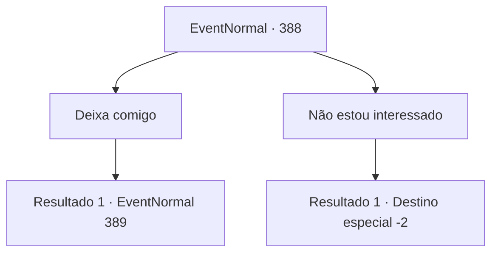

# Eventos normais · 388

[Índice da tabela](index.md) · [Índice geral](../index.md)

ID: `pt:EventNormal:388` · Fonte: `EventNormal4` · Versão: 1.2.47.

Mapeamento estático dos arquivos; a disponibilidade e a execução dependem do estado da run.

## Texto do evento

Enquanto você está passando por uma fazenda, você encontra um fazendeiro usando um chapéu de palha. Ele está coberto de suor colhendo suas uvas, e quando você caminha até ele, ele oferece algumas de suas uvas com um sorriso caloroso. Você alegremente pega as uvas, ouvindo-o falar. 

 "Droga, tenho certeza de que alguém está roubando meus produtos à noite. Isso está me deixando louco."

 O fazendeiro cuidadosamente pergunta se você pode tentar pegar o ladrão de uvas.

## Dados de entrada

```json
{
  "id": 388,
  "grade": 1,
  "place": "",
  "required": "5_240_0"
}
```

## Mapa das escolhas



## Escolhas e resultados

### Escolha 1

Deixa comigo

Requisitos e outros campos da escolha:

```json
{
  "required": ""
}
```

#### Resultado 1.1

Você diz com orgulho que vai pegar o ladrão para ele. Você espera o sol se pôr, mantendo-se atento ao culpado. Enquanto você está segurando um grande bocejo, você vê algo se movendo nos arbustos. Você se aproxima lentamente e vê um urso pardo entre as árvores, mastigando uvas. Seus olhos brilham fracamente enquanto piscam no escuro.

Continuação registrada: [Evento 389](0389.md) na mesma tabela.

```json
{
  "required": "",
  "chance": "1",
  "nextEvent": 389,
  "type": 2,
  "reward": ""
}
```

### Escolha 2

Não estou interessado

Requisitos e outros campos da escolha:

```json
{
  "required": ""
}
```

#### Resultado 2.1

Você balança a cabeça, expressando sinal de desinteresse. O agricultor fica triste ao ver isso, mas ele não pergunta novamente.

Continuação registrada: [Destino especial `-2`](../destinos-especiais.md).

```json
{
  "required": "",
  "chance": "1",
  "nextEvent": -2,
  "type": 2,
  "reward": "5_240_9"
}
```

## Referências que chegam a este evento

Nenhum `nextEvent` positivo da mesma tabela aponta para este nó. Isso não prova que seja inacessível: sorteio e estado de história podem selecioná-lo.

