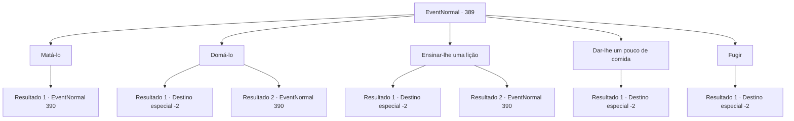

# Eventos normais · 389

[Índice da tabela](index.md) · [Índice geral](../index.md)

ID: `pt:EventNormal:389` · Fonte: `EventNormal4` · Versão: 1.2.47.

Mapeamento estático dos arquivos; a disponibilidade e a execução dependem do estado da run.

## Texto do evento

*Sem texto no arquivo.*

## Dados de entrada

```json
{
  "id": 389,
  "grade": 1,
  "place": "",
  "required": ""
}
```

## Mapa das escolhas



## Escolhas e resultados

### Escolha 1

Matá-lo

Requisitos e outros campos da escolha:

```json
{
  "required": ""
}
```

#### Resultado 1.1

Você percebe que o urso é aquele que está roubando as uvas. Você levanta sua arma. Sentindo a hostilidade, o urso larga a uva e revela seus dentes e garras afiados.

Continuação registrada: [Evento 390](0390.md) na mesma tabela.

```json
{
  "required": "",
  "chance": "1",
  "nextEvent": 390,
  "type": 2,
  "reward": "6_0_77",
  "place": 1
}
```

### Escolha 2

Domá-lo

Requisitos e outros campos da escolha:

```json
{
  "required": ""
}
```

#### Resultado 2.1

Você pega uma uva bonita das árvores, muito mais doce e fresca do que a que o urso está se alimentando. Quando você a coloca na frente do urso, ele cheira a uva com cuidado, se aproxima e começa a comer a uva. Uva por uva, você ensina o urso a patrulhar o pomar, circulando pela estrada. Enquanto você está ocupado domando o urso, a noite passa e a manhã vem novamente. 

 No dia seguinte, o fazendeiro olha para o urso com os olhos arregalados. 

 "Então, se eu alimentá-lo com três uvas todos os dias, o urso manterá minha fazenda segura?"

 Você acena com a cabeça, acariciando os braços do urso pardo. O urso assente também, como se entendesse o que ele acabou de dizer. Em seguida, ele começa a se mover pela fazenda de uvas. 

 "Uhm... T.. obrigado.. eu acho."

 O fazendeiro lhe entrega um de seus melhores vinhos de uva e segue o urso estupefato.

Continuação registrada: [Destino especial `-2`](../destinos-especiais.md).

```json
{
  "required": "",
  "chance": "1|0_12_1",
  "nextEvent": -2,
  "type": 0,
  "reward": "3_225_1|0_2_1|5_240_9"
}
```

#### Resultado 2.2

Você decide domar o urso. À medida que você tira uma uva madura e a coloca diante dela, ela cheira a uva com cuidado, se aproxima e começa a comer a uva. Mas quando você puxa a uva para trás, recuando lentamente, o urso pardo de repente revela seus dentes e rosna violentamente. Aparentemente, ele o vê como um concorrente por comida. Infelizmente, um duelo entre um humano e um urso acontece no meio de uma fazenda.

Continuação registrada: [Evento 390](0390.md) na mesma tabela.

```json
{
  "required": "",
  "chance": "14",
  "nextEvent": 390,
  "type": 1,
  "reward": "6_0_77",
  "place": 1
}
```

### Escolha 3

Ensinar-lhe uma lição

Requisitos e outros campos da escolha:

```json
{
  "required": ""
}
```

#### Resultado 3.1

Você dá um soco na cabeça do urso enquanto ele leva a uva à boca. O urso explode em lágrimas, agarrando sua cabeça com dor. Ele olha para você com cuidado e depois foge. No dia seguinte, você diz ao fazendeiro que a identidade do ladrão é um urso selvagem e que, como você lhe ensinou uma lição, ele não voltará mais. O fazendeiro sorri alegremente e lhe entrega uma garrafa de seu vinho de uva. 

 "Hahaha. Não pensei que isso fosse resolvido tão facilmente. Obrigado, aventureiro!"

 Com o vinho de recompensa em sua mochila, você sai feliz da fazenda.

Continuação registrada: [Destino especial `-2`](../destinos-especiais.md).

```json
{
  "required": "",
  "chance": "1|0_5_1",
  "nextEvent": -2,
  "type": 0,
  "reward": "3_225_1|0_2_1|5_240_9"
}
```

#### Resultado 3.2

Você dá um soco no nariz do urso. Claro, o urso não entende o que você está fazendo. Ele rosna violentamente antes de correr para você.

Continuação registrada: [Evento 390](0390.md) na mesma tabela.

```json
{
  "required": "",
  "chance": "22",
  "nextEvent": 390,
  "type": 1,
  "reward": "6_0_77",
  "place": 1
}
```

### Escolha 4

Dar-lhe um pouco de comida

Requisitos e outros campos da escolha:

```json
{
  "required": "23_0_1"
}
```

#### Resultado 4.1

Você joga algo que os ursos comem. O urso pardo a princípio não baixa a guarda, mas logo mastiga a comida e sai. Aparentemente sua fome foi saciada. No dia seguinte, você diz ao fazendeiro que a identidade do ladrão é um urso selvagem e que ele sairá tranquilamente se for alimentado. 

 "Eu não acho que garantir uma fonte segura de comida de urso será fácil... Mas suponho que seja melhor do que lutar contra o urso."

 Com uma garrafa de vinho de uva como recompensa, você sai feliz da fazenda.

Continuação registrada: [Destino especial `-2`](../destinos-especiais.md).

```json
{
  "required": "",
  "chance": "1",
  "nextEvent": -2,
  "type": 2,
  "reward": "3_225_1|0_2_1|25_0_1|5_240_9"
}
```

### Escolha 5

Fugir

Requisitos e outros campos da escolha:

```json
{
  "required": ""
}
```

#### Resultado 5.1

Avistando o urso na fazenda, você prende a respiração e se afasta silenciosamente, para não perturbar o urso. Ele olha para você, mastigando as uvas, e depois que você se distancia, ele não vem atrás de você.

Continuação registrada: [Destino especial `-2`](../destinos-especiais.md).

```json
{
  "required": "",
  "chance": "1",
  "nextEvent": -2,
  "type": 2,
  "reward": "5_240_9"
}
```

## Referências que chegam a este evento

- [Evento 388 · escolha 1 · resultado 1](0388.md#escolha-1)
