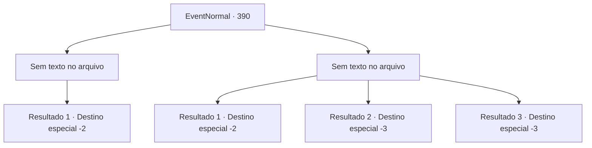

# Eventos normais · 390

[Índice da tabela](index.md) · [Índice geral](../index.md)

ID: `pt:EventNormal:390` · Fonte: `EventNormal4` · Versão: 1.2.47.

Mapeamento estático dos arquivos; a disponibilidade e a execução dependem do estado da run.

## Texto do evento

*Sem texto no arquivo.*

## Dados de entrada

```json
{
  "id": 390,
  "grade": 1,
  "place": "",
  "required": ""
}
```

## Mapa das escolhas



## Escolhas e resultados

### Escolha 1

*Sem texto no arquivo; o papel dessa opção depende da interface do jogo.*

Requisitos e outros campos da escolha:

```json
{
  "required": ""
}
```

#### Resultado 1.1

Você derrota o urso cheirando a uvas, então notifica o fazendeiro sobre a identidade do ladrão. Ele fica surpreso com a inesperada identidade do ladrão, mas agradece mesmo assim. Com uma garrafa de vinho de uva como recompensa, você sai feliz da fazenda.

Continuação registrada: [Destino especial `-2`](../destinos-especiais.md).

```json
{
  "required": "",
  "chance": "1",
  "nextEvent": -2,
  "type": 2,
  "reward": "3_225_1|0_2_1|5_240_9"
}
```

### Escolha 2

*Sem texto no arquivo; o papel dessa opção depende da interface do jogo.*

Requisitos e outros campos da escolha:

```json
{
  "required": ""
}
```

#### Resultado 2.1

Você não consegue resistir aos ataques do urso. Você usa sua inteligência para jogar uvas ao redor do urso para distraí-lo. Enquanto o urso se concentra nas uvas, você se afasta mancando, de volta à casa do fazendeiro. 

 "...Eu vejo. Um urso... vou precisar contratar um caçador profissional."

 O fazendeiro suspira depois de ouvir sua história. Ele ainda aprecia seu esforço e oferece um lugar para você passar a noite.

Continuação registrada: [Destino especial `-2`](../destinos-especiais.md).

```json
{
  "required": "1_0_2|1_1_2",
  "chance": "1",
  "nextEvent": -2,
  "type": 2,
  "reward": "0_0_-1|0_1_-1"
}
```

#### Resultado 2.2

Você sente seu crânio sendo esmagado pela enorme pata do urso. Você perece.

Continuação registrada: [Destino especial `-3`](../destinos-especiais.md).

```json
{
  "required": "2_0_2",
  "chance": "1",
  "nextEvent": -3,
  "type": 2,
  "reward": "0_0_-1|0_1_-1"
}
```

#### Resultado 2.3

Você sente seu crânio sendo esmagado pela enorme pata do urso. Você perece.

Continuação registrada: [Destino especial `-3`](../destinos-especiais.md).

```json
{
  "required": "2_1_2",
  "chance": "1",
  "nextEvent": -3,
  "type": 2,
  "reward": "0_0_-1|0_1_-1"
}
```

## Referências que chegam a este evento

- [Evento 389 · escolha 1 · resultado 1](0389.md#escolha-1)
- [Evento 389 · escolha 2 · resultado 2](0389.md#escolha-2)
- [Evento 389 · escolha 3 · resultado 2](0389.md#escolha-3)
