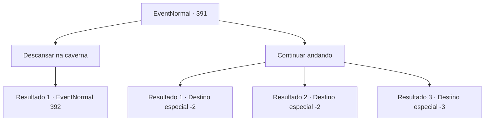

# Eventos normais · 391

[Índice da tabela](index.md) · [Índice geral](../index.md)

ID: `pt:EventNormal:391` · Fonte: `EventNormal4` · Versão: 1.2.47.

Mapeamento estático dos arquivos; a disponibilidade e a execução dependem do estado da run.

## Texto do evento

As terras montanhosas desoladas e rochosas parecem desprovidas até mesmo da menor sombra para se esconder do sol. Seus passos ficam cada vez mais lentos, exaustos pelo calor escaldante. Logo depois que você decide que precisa desesperadamente de uma pausa, uma enorme caverna aparece diante de você.

## Dados de entrada

```json
{
  "id": 391,
  "grade": 1,
  "place": "",
  "required": "5_277_0"
}
```

## Mapa das escolhas



## Escolhas e resultados

### Escolha 1

Descansar na caverna

Requisitos e outros campos da escolha:

```json
{
  "required": ""
}
```

#### Resultado 1.1

Você entra na caverna, procurando um lugar para se deitar e descansar. O interior é bem mais frio que o exterior, então você aproveita para refrescar o corpo aquecido. Enquanto você explora o interior, algo estranho chama sua atenção. Há uma estátua de pedra de um homem assustado no meio da caverna. Ao redor dessa estátua estão outras estátuas de pequenos animais, algumas quebradas em pedaços e algumas parcialmente mordidas.

Continuação registrada: [Evento 392](0392.md) na mesma tabela.

```json
{
  "required": "",
  "chance": "1",
  "nextEvent": 392,
  "type": 2,
  "reward": "5_277_9"
}
```

### Escolha 2

Continuar andando

Requisitos e outros campos da escolha:

```json
{
  "required": ""
}
```

#### Resultado 2.1

Você tira os olhos da caverna e apressa seus passos. O calor prejudica constantemente sua saúde, mas a marcha continua. Cerca de meio dia se passa. À medida que o sol se põe e o calor desaparece, você volta a andar mais rápido. Você se move pelas terras altas e procura uma vila próxima.

Continuação registrada: [Destino especial `-2`](../destinos-especiais.md).

```json
{
  "required": "",
  "chance": "1|0_13_1",
  "nextEvent": -2,
  "type": 0,
  "reward": "0_2_1|5_277_9"
}
```

#### Resultado 2.2

Você tira os olhos da caverna e apressa seus passos. O calor constantemente prejudica sua saúde, mas você simplesmente não pode ignorar que tipo de perigo pode habitar dentro da caverna. Acontece que essa decisão foi um erro. Cerca de meio dia depois, você sente tontura na cabeça e desmaia, inconsciente. 

 Quando você finalmente abre os olhos, alguns dias já se passaram. A senhora que está cuidando de você menciona que um aventureiro que por acaso passou pelo deserto o resgatou. Você se levanta da cama, agradece à senhora e volta à sua aventura.

Continuação registrada: [Destino especial `-2`](../destinos-especiais.md).

```json
{
  "required": "1_0_2",
  "chance": "13",
  "nextEvent": -2,
  "type": 1,
  "reward": "0_0_-1|5_277_9"
}
```

#### Resultado 2.3

Você tira os olhos da caverna e apressa seus passos. O calor constantemente prejudica sua saúde, mas você simplesmente não pode ignorar que tipo de perigo pode habitar dentro da caverna. Acontece que essa decisão foi um erro. Cerca de meio dia depois, você sente tontura na cabeça e desmaia, inconsciente. 

 Não há ninguém aqui neste planalto desolado que possa resgatá-lo.

Continuação registrada: [Destino especial `-3`](../destinos-especiais.md).

```json
{
  "required": "2_0_2",
  "chance": "13",
  "nextEvent": -3,
  "type": 1,
  "reward": "0_0_-1"
}
```

## Referências que chegam a este evento

Nenhum `nextEvent` positivo da mesma tabela aponta para este nó. Isso não prova que seja inacessível: sorteio e estado de história podem selecioná-lo.

