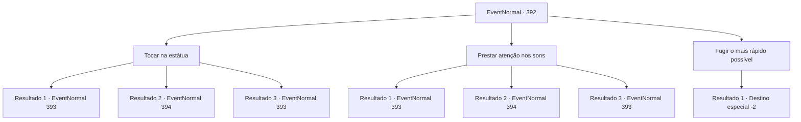

# Eventos normais · 392

[Índice da tabela](index.md) · [Índice geral](../index.md)

ID: `pt:EventNormal:392` · Fonte: `EventNormal4` · Versão: 1.2.47.

Mapeamento estático dos arquivos; a disponibilidade e a execução dependem do estado da run.

## Texto do evento

*Sem texto no arquivo.*

## Dados de entrada

```json
{
  "id": 392,
  "grade": 1,
  "place": "",
  "required": ""
}
```

## Mapa das escolhas



## Escolhas e resultados

### Escolha 1

Tocar na estátua

Requisitos e outros campos da escolha:

```json
{
  "required": ""
}
```

#### Resultado 1.1

Completamente hipnotizado pela estátua, você a toca. E então... 
 'HISSSSS.'
 Um som sinistro sai da parte de trás da estátua. Um basilisco, escondido nas rochas, aparece. Uma aparência de lagarto com oito pernas e ostentando seu tamanho enorme, o basilisco se move em sua direção, olhando para você. Você sente seu corpo se transformando em pedra pelo seu olhar, e parece que não há escapatória. Você solta um grito de guerra alto e avança até o basilisco.

Continuação registrada: [Evento 393](0393.md) na mesma tabela.

```json
{
  "required": "10_148_1|24_7_1",
  "chance": "1",
  "nextEvent": 393,
  "type": 2,
  "reward": "6_3_121",
  "place": 6
}
```

#### Resultado 1.2

Completamente hipnotizado pela estátua, você a toca. E então... 
 'HISSSS.'
 Um som sinistro sai da parte de trás da estátua. Um basilisco, escondido nas rochas, aparece. Uma aparência de lagarto com oito pernas e ostentando seu tamanho enorme, o basilisco usa seu olhar petrificante para você. Você traz apressadamente o 'Rosto de Medusa', bloqueando seu olhar. O movimento do basilisco é interrompido. Quando você se aproxima, já está transformado em pedra. Você chuta o basilisco com força e volta a examinar a estátua do homem assustado.

Continuação registrada: [Evento 394](0394.md) na mesma tabela.

```json
{
  "required": "8_148_1",
  "chance": "1",
  "nextEvent": 394,
  "type": 2,
  "reward": "0_2_1"
}
```

#### Resultado 1.3

Completamente hipnotizado pela estátua, você a toca. E então... 
 'HISSSS.'
 Um som sinistro sai da parte de trás da estátua. Um basilisco, escondido nas rochas, aparece. Uma aparência de lagarto com oito pernas e ostentando seu tamanho enorme, o basilisco se move em sua direção, olhando para você. Mas seu olhar não funciona em você. Parecendo um pouco surpreso, o basilisco caminha em sua direção.

Continuação registrada: [Evento 393](0393.md) na mesma tabela.

```json
{
  "required": "23_7_1",
  "chance": "1",
  "nextEvent": 393,
  "type": 2,
  "reward": "6_2_121",
  "place": 6
}
```

### Escolha 2

Prestar atenção nos sons

Requisitos e outros campos da escolha:

```json
{
  "required": "1_14_10"
}
```

#### Resultado 2.1

Você rapidamente saca sua arma, cauteloso ao seu redor. E então... 
 'HISSSS.'
 Um som sinistro sai da parte de trás da estátua. Um basilisco, escondido nas rochas, aparece. Uma aparência de lagarto com oito pernas e ostentando seu tamanho enorme, o basilisco se move em sua direção, olhando para você. Só então você percebe que esta caverna é o domínio do basilisco. Você rapidamente começa seu ataque.

Continuação registrada: [Evento 393](0393.md) na mesma tabela.

```json
{
  "required": "10_148_1|24_7_1",
  "chance": "1",
  "nextEvent": 393,
  "type": 2,
  "reward": "6_0_121",
  "place": 6
}
```

#### Resultado 2.2

Você rapidamente saca sua arma, cauteloso ao seu redor. E então...
 'HISSSS.'
 Um som sinistro sai da parte de trás da estátua. Um basilisco, escondido nas rochas, aparece. Uma aparência de lagarto com oito pernas e ostentando seu tamanho enorme, o basilisco se move em sua direção, olhando para você. Você traz apressadamente o 'Rosto de Medusa', bloqueando seu olhar. O movimento do basilisco é interrompido. Quando você se aproxima, já está transformado em pedra. Você chuta o basilisco com força e volta a examinar a estátua do homem assustado.

Continuação registrada: [Evento 394](0394.md) na mesma tabela.

```json
{
  "required": "8_148_1",
  "chance": "1",
  "nextEvent": 394,
  "type": 2,
  "reward": "0_2_1"
}
```

#### Resultado 2.3

Você rapidamente saca sua arma, cauteloso ao seu redor. E então...
 'HISSSS.'
 Um som sinistro sai da parte de trás da estátua. Um basilisco, escondido nas rochas, aparece. Uma aparência de lagarto com oito pernas e ostentando seu tamanho enorme, o basilisco se move em sua direção, olhando para você. Mas seu olhar não funciona em você. Parecendo um pouco surpreso, o basilisco caminha em sua direção.

Continuação registrada: [Evento 393](0393.md) na mesma tabela.

```json
{
  "required": "23_7_1",
  "chance": "1",
  "nextEvent": 393,
  "type": 2,
  "reward": "6_2_121",
  "place": 6
}
```

### Escolha 3

Fugir o mais rápido possível

Requisitos e outros campos da escolha:

```json
{
  "required": ""
}
```

#### Resultado 3.1

Depois de dar uma olhada na estátua, você decide dar o fora desta caverna. De repente... 
 Você ouve um som sinistro vindo da caverna ao se despedir. Você pensa consigo mesmo que deve ser o dono da caverna e se afasta apressadamente das terras altas.

Continuação registrada: [Destino especial `-2`](../destinos-especiais.md).

```json
{
  "required": "",
  "chance": "1",
  "nextEvent": -2,
  "type": 2,
  "reward": ""
}
```

## Referências que chegam a este evento

- [Evento 391 · escolha 1 · resultado 1](0391.md#escolha-1)
