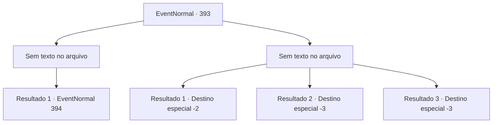

# Eventos normais · 393

[Índice da tabela](index.md) · [Índice geral](../index.md)

ID: `pt:EventNormal:393` · Fonte: `EventNormal4` · Versão: 1.2.47.

Mapeamento estático dos arquivos; a disponibilidade e a execução dependem do estado da run.

## Texto do evento

*Sem texto no arquivo.*

## Dados de entrada

```json
{
  "id": 393,
  "grade": 1,
  "place": "",
  "required": ""
}
```

## Mapa das escolhas



## Escolhas e resultados

### Escolha 1

*Sem texto no arquivo; o papel dessa opção depende da interface do jogo.*

Requisitos e outros campos da escolha:

```json
{
  "required": ""
}
```

#### Resultado 1.1

Você pega o que costumava ser o tatu (que o basilisco transformou em pedra) e amassa a cabeça do basilisco com ele. O basilisco é de fato um monstro perigoso que pode petrificar as criaturas que observa, mas não é páreo para você. Depois de recuperar o fôlego, você olha ao redor. Felizmente, a estátua do homem assustado parece limpa de feridas.

Continuação registrada: [Evento 394](0394.md) na mesma tabela.

```json
{
  "required": "",
  "chance": "1",
  "nextEvent": 394,
  "type": 2,
  "reward": ""
}
```

### Escolha 2

*Sem texto no arquivo; o papel dessa opção depende da interface do jogo.*

Requisitos e outros campos da escolha:

```json
{
  "required": ""
}
```

#### Resultado 2.1

Quanto mais você luta, mais você percebe que sua chance de vencer está diminuindo. A pele do basilisco é grossa e seu corpo está ficando cada vez mais sólido. Você percebe que a única opção agora é dar as costas e fugir do basilisco. Felizmente, o basilisco não o persegue fora da caverna. Ao ver o sol novamente, seu corpo também volta ao normal. Depois de recuperar o fôlego, você caminha apressadamente para longe das terras altas.

Continuação registrada: [Destino especial `-2`](../destinos-especiais.md).

```json
{
  "required": "1_0_2|1_1_2",
  "chance": "1",
  "nextEvent": -2,
  "type": 2,
  "reward": "0_0_-1|0_1_-1"
}
```

#### Resultado 2.2

Seu corpo se transforma completamente em pedra, incapaz de se mover. Mas sua consciência ainda está lá. Você vê e sente inteiramente o seu fim. O basilisco engole você inteiro. Esse é o fim de sua aventura - uma refeição de um basilisco.

Continuação registrada: [Destino especial `-3`](../destinos-especiais.md).

```json
{
  "required": "2_0_2",
  "chance": "1",
  "nextEvent": -3,
  "type": 2,
  "reward": "0_0_-1|0_1_-1"
}
```

#### Resultado 2.3

Seu corpo se transforma completamente em pedra, incapaz de se mover. Mas sua consciência ainda está lá. Você vê e sente inteiramente o seu fim. O basilisco engole você inteiro. Esse é o fim de sua aventura - uma refeição de um basilisco.

Continuação registrada: [Destino especial `-3`](../destinos-especiais.md).

```json
{
  "required": "2_1_2",
  "chance": "1",
  "nextEvent": -3,
  "type": 2,
  "reward": "0_0_-1|0_1_-1"
}
```

## Referências que chegam a este evento

- [Evento 392 · escolha 1 · resultado 1](0392.md#escolha-1)
- [Evento 392 · escolha 1 · resultado 3](0392.md#escolha-1)
- [Evento 392 · escolha 2 · resultado 1](0392.md#escolha-2)
- [Evento 392 · escolha 2 · resultado 3](0392.md#escolha-2)
