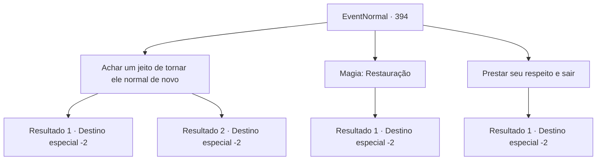

# Eventos normais · 394

[Índice da tabela](index.md) · [Índice geral](../index.md)

ID: `pt:EventNormal:394` · Fonte: `EventNormal4` · Versão: 1.2.47.

Mapeamento estático dos arquivos; a disponibilidade e a execução dependem do estado da run.

## Texto do evento

*Sem texto no arquivo.*

## Dados de entrada

```json
{
  "id": 394,
  "grade": 1,
  "place": "",
  "required": ""
}
```

## Mapa das escolhas



## Escolhas e resultados

### Escolha 1

Achar um jeito de tornar ele normal de novo

Requisitos e outros campos da escolha:

```json
{
  "required": ""
}
```

#### Resultado 1.1

Você pensa em uma maneira de não petrificar a estátua. Você se lembra de ter lido em um livro em algum lugar que a glândula digestiva de um basilisco pode transformar criaturas petrificadas de volta ao normal. Depois de espalhar a glândula digestiva por toda a estátua, você espera. Algum tempo passa. 

 "Eu, eu posso me mover de novo! Minhas pernas! Meus braços!"

 Livre da petrificação, o aventureiro começa a chorar. Você dá um tapinha nas costas dele, consolando-o, e sai da caverna com ele. 

 "Eu não tenho muito em mim agora, mas por favor, pegue isso!"

 Ele agradece várias vezes antes de sair. Você continua sua aventura com passos mais leves. 

Continuação registrada: [Destino especial `-2`](../destinos-especiais.md).

```json
{
  "required": "",
  "chance": "1|0_7_1",
  "nextEvent": -2,
  "type": 0,
  "reward": "0_3_1|0_4_20|3_190_1"
}
```

#### Resultado 1.2

Você pensa em uma maneira de não petrificar a estátua. Mas nada vem à sua mente. Você presta seu respeito com silêncio antes de sair.

Continuação registrada: [Destino especial `-2`](../destinos-especiais.md).

```json
{
  "required": "",
  "chance": "14",
  "nextEvent": -2,
  "type": 1,
  "reward": ""
}
```

### Escolha 2

Magia: Restauração

Requisitos e outros campos da escolha:

```json
{
  "required": "20_0_1|1_1_2"
}
```

#### Resultado 2.1

Você lança feitiço de restauração na estátua. Depois de algum tempo, o feitiço com sucesso transforma a estátua de volta ao humano. 

 "Eu, eu posso me mover de novo! Minhas pernas! Meus braços!"

 Livre da petrificação, o aventureiro começa a chorar. Você dá um tapinha nas costas dele, consolando-o, e sai da caverna com ele. 

 "Eu não tenho muito em mim agora, mas por favor, pegue isso!"

 Ele agradece várias vezes antes de sair. Você continua sua aventura com passos mais leves. 

Continuação registrada: [Destino especial `-2`](../destinos-especiais.md).

```json
{
  "required": "",
  "chance": "1",
  "nextEvent": -2,
  "type": 2,
  "reward": "0_3_1|0_1_-1|0_4_20|3_190_1"
}
```

### Escolha 3

Prestar seu respeito e sair

Requisitos e outros campos da escolha:

```json
{
  "required": ""
}
```

#### Resultado 3.1

Você presta seus respeitos ao aventureiro petrificado e vai embora.

Continuação registrada: [Destino especial `-2`](../destinos-especiais.md).

```json
{
  "required": "",
  "chance": "1",
  "nextEvent": -2,
  "type": 2,
  "reward": ""
}
```

## Referências que chegam a este evento

- [Evento 392 · escolha 1 · resultado 2](0392.md#escolha-1)
- [Evento 392 · escolha 2 · resultado 2](0392.md#escolha-2)
- [Evento 393 · escolha 1 · resultado 1](0393.md#escolha-1)
