# Eventos normais · 396

[Índice da tabela](index.md) · [Índice geral](../index.md)

ID: `pt:EventNormal:396` · Fonte: `EventNormal4` · Versão: 1.2.47.

Mapeamento estático dos arquivos; a disponibilidade e a execução dependem do estado da run.

## Texto do evento

*Sem texto no arquivo.*

## Dados de entrada

```json
{
  "id": 396,
  "grade": 1,
  "place": "",
  "required": ""
}
```

## Mapa das escolhas

```mermaid
flowchart TD
  E["EventNormal · 396"]
  C0["Dar a ele 5 ouros"]
  E --> C0
  R0_0["Resultado 1 · Destino especial -2"]
  C0 --> R0_0
  C1["Você vai me dizer ou vou ter que ser mais &#x27;persuasivo&#x27;?"]
  E --> C1
  R1_0["Resultado 1 · Destino especial -2"]
  C1 --> R1_0
  R1_1["Resultado 2 · Destino especial -2"]
  C1 --> R1_1
  R1_2["Resultado 3 · Destino especial -2"]
  C1 --> R1_2
  C2["Vá embora"]
  E --> C2
  R2_0["Resultado 1 · Destino especial -2"]
  C2 --> R2_0
```



## Escolhas e resultados

### Escolha 1

Dar a ele 5 ouros

Requisitos e outros campos da escolha:

```json
{
  "required": "1_4_5"
}
```

#### Resultado 1.1

Enquanto você entrega ao menino mais 5 de ouro, ele sorri e continua. 

 "Mas algumas pessoas disseram que essa 'bruxa' não é um humano, mas um monstro chamado 'bruxa'! Pelo que ouvi, uma bruxa parece uma avó muito velha e feia. Eu acho que você deve ter cuidado!"

 Depois de terminar, o menino sai às pressas da taverna com o ouro que você deu a ele em suas mãos. Você calmamente termina sua refeição e sai da taverna.

Continuação registrada: [Destino especial `-2`](../destinos-especiais.md).

```json
{
  "required": "",
  "chance": "1",
  "nextEvent": -2,
  "type": 2,
  "reward": "5_287_1|0_4_-5"
}
```

### Escolha 2

Você vai me dizer ou vou ter que ser mais 'persuasivo'?

Requisitos e outros campos da escolha:

```json
{
  "required": ""
}
```

#### Resultado 2.1

Você ameaça o menino com os punhos, exigindo que ele continue. Assustado, o menino rapidamente começa a falar. 

 "M-mas... algumas pessoas disseram que essa 'bruxa' não é um humano, mas um monstro chamado 'bruxa'... É isso! Isso é tudo que eu sei!"

 Depois de terminar, o menino pergunta se ele pode ir agora. Você grita com ele para se perder, engole seu copo de cerveja, termina sua refeição e sai da taverna.

Continuação registrada: [Destino especial `-2`](../destinos-especiais.md).

```json
{
  "required": "",
  "chance": "1|0_12_1",
  "nextEvent": -2,
  "type": 0,
  "reward": "5_287_1|0_3_-1"
}
```

#### Resultado 2.2

Você ameaça o menino com os punhos, exigindo que ele continue. Assustado, o menino rapidamente começa a falar. 

 "M-mas... algumas pessoas disseram que essa 'bruxa' não é um humano, mas um monstro chamado 'bruxa'... É isso! Isso é tudo que eu sei!"

 Depois de terminar, o menino pergunta se ele pode ir agora. Você grita com ele para se perder, engole seu copo de cerveja, termina sua refeição e sai da taverna.

Continuação registrada: [Destino especial `-2`](../destinos-especiais.md).

```json
{
  "required": "20_1_2",
  "chance": "1|0_12_1",
  "nextEvent": -2,
  "type": 0,
  "reward": "5_287_1|0_3_-1"
}
```

#### Resultado 2.3

Você ameaça o menino com seus punhos. Então, o menino mostra a língua para você e foge.

Continuação registrada: [Destino especial `-2`](../destinos-especiais.md).

```json
{
  "required": "",
  "chance": "15",
  "nextEvent": -2,
  "type": 1,
  "reward": "5_287_9"
}
```

### Escolha 3

Vá embora

Requisitos e outros campos da escolha:

```json
{
  "required": ""
}
```

#### Resultado 3.1

Enquanto você grita para o menino se perder, ele vai embora com um olhar triste no rosto. Você calmamente termina sua refeição e sai da taverna.

Continuação registrada: [Destino especial `-2`](../destinos-especiais.md).

```json
{
  "required": "",
  "chance": "1",
  "nextEvent": -2,
  "type": 2,
  "reward": "5_287_9"
}
```

## Referências que chegam a este evento

- [Evento 395 · escolha 1 · resultado 1](0395.md#escolha-1)
