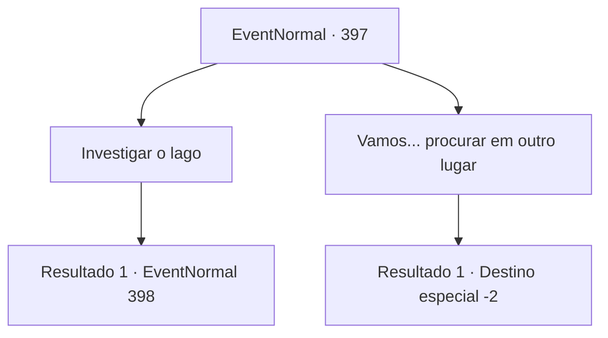

# Eventos normais · 397

[Índice da tabela](index.md) · [Índice geral](../index.md)

ID: `pt:EventNormal:397` · Fonte: `EventNormal4` · Versão: 1.2.47.

Mapeamento estático dos arquivos; a disponibilidade e a execução dependem do estado da run.

## Texto do evento

Depois de ouvir sobre o tesouro de uma bruxa na taverna, você vai investigar Witchchill Woods. A fonte de todos os rumores parece terrivelmente silenciosa. Não é à toa que há rumores sobre este lugar. Não importa quanto tempo você ande, tudo o que você pode ouvir é o som de seus passos. Você não pode ouvir um único pássaro cantando. À medida que você se move pela grama espessa, você chega a uma parte mais profunda da floresta. Então, um odor azedo e pungente ataca seu nariz. Você segue o cheiro e chega a um enorme lago. 

## Dados de entrada

```json
{
  "id": 397,
  "grade": 2,
  "place": "",
  "required": "5_287_1"
}
```

## Mapa das escolhas



## Escolhas e resultados

### Escolha 1

Investigar o lago

Requisitos e outros campos da escolha:

```json
{
  "required": ""
}
```

#### Resultado 1.1

Você dá um passeio ao redor do lago, observando-o cuidadosamente. Apesar do cheiro horrível que sai dela, a água é tão limpa que dá até para ver o fundo do lago. Mas dentro do lago há um cenário grotesco, decorado por pedaços de árvores mortas e juncos. Então, você vê algo fora do lugar no centro do lago. No fundo do lago está o que parece ser um baú do tesouro.

Continuação registrada: [Evento 398](0398.md) na mesma tabela.

```json
{
  "required": "",
  "chance": "1",
  "nextEvent": 398,
  "type": 2,
  "reward": ""
}
```

### Escolha 2

Vamos... procurar em outro lugar

Requisitos e outros campos da escolha:

```json
{
  "required": ""
}
```

#### Resultado 2.1

Você decide ignorar o lago e procurar em outro lugar. Navegar pelas partes mais profundas da floresta acaba sendo muito mais desafiador do que você esperava. Conforme você caminha pelos caminhos tortuosos, de repente você percebe que está na entrada da floresta novamente.

Continuação registrada: [Destino especial `-2`](../destinos-especiais.md).

```json
{
  "required": "",
  "chance": "1",
  "nextEvent": -2,
  "type": 2,
  "reward": "5_287_9"
}
```

## Referências que chegam a este evento

Nenhum `nextEvent` positivo da mesma tabela aponta para este nó. Isso não prova que seja inacessível: sorteio e estado de história podem selecioná-lo.

