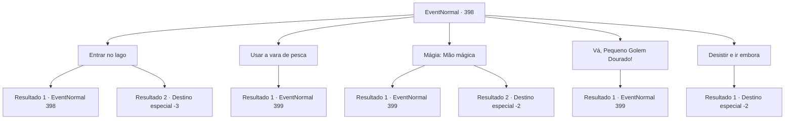

# Eventos normais · 398

[Índice da tabela](index.md) · [Índice geral](../index.md)

ID: `pt:EventNormal:398` · Fonte: `EventNormal4` · Versão: 1.2.47.

Mapeamento estático dos arquivos; a disponibilidade e a execução dependem do estado da run.

## Texto do evento

*Sem texto no arquivo.*

## Dados de entrada

```json
{
  "id": 398,
  "grade": 1,
  "place": "",
  "required": ""
}
```

## Mapa das escolhas



## Escolhas e resultados

### Escolha 1

Entrar no lago

Requisitos e outros campos da escolha:

```json
{
  "required": "5_287_1"
}
```

#### Resultado 1.1

Você tira a roupa e se estica, para entrar no lago você mesmo. À medida que você mergulha lentamente os pés dentro do lago, uma névoa branca sobe da água com uma dor aguda nos dedos dos pés. Só então você percebe que o lago é perigoso. Você rapidamente tira os pés da água. O baú do tesouro dentro do lago ainda está lá, como se estivesse zombando de sua tentativa. 

Continuação registrada: [Evento 398](0398.md) na mesma tabela.

```json
{
  "required": "1_0_2",
  "chance": "1",
  "nextEvent": 398,
  "type": 2,
  "reward": "0_0_-1|5_287_2"
}
```

#### Resultado 1.2

Você tira a roupa e se estica, para entrar no lago você mesmo. À medida que você mergulha lentamente os pés dentro do lago, uma névoa branca sobe da água com uma dor aguda nos dedos dos pés. Surpreso com a dor repentina, você perde o equilíbrio e cai no lago. O líquido do rio - você nem sabe mais se é água - morde seu corpo como um cardume de piranhas famintas.

Continuação registrada: [Destino especial `-3`](../destinos-especiais.md).

```json
{
  "required": "2_0_2",
  "chance": "1",
  "nextEvent": -3,
  "type": 2,
  "reward": "0_0_-1"
}
```

### Escolha 2

Usar a vara de pesca

Requisitos e outros campos da escolha:

```json
{
  "required": "8_43_1"
}
```

#### Resultado 2.1

Você joga sua vara de pescar no lago. O anzol voa para o lago, toca a água e imediatamente derrete. Então, com um farfalhar, uma bruxa de pele verde aparece. 

 "Keekeekee...!! Que tolice. Vocês humanos simplesmente não conseguem resistir a baús de tesouro."

 O monstro não está sozinho. Mais duas bruxas aparecem dos arbustos. Em um instante, você está cercado.

Continuação registrada: [Evento 399](0399.md) na mesma tabela.

```json
{
  "required": "",
  "chance": "1",
  "nextEvent": 399,
  "type": 0,
  "reward": "4_43_1|5_287_3"
}
```

### Escolha 3

Mágia: Mão mágica

Requisitos e outros campos da escolha:

```json
{
  "required": "20_0_1"
}
```

#### Resultado 3.1

Você lança a Mão Mágica em direção ao lago. A mão mágica segura firmemente o baú do tesouro na água. Você sente o peso em sua mão mágica e se concentra para puxar o baú do tesouro. O baú do tesouro emerge lentamente do lago. Você arrasta o baú e o abre. Dentro do baú do tesouro há gramíneas e fungos que você nunca viu antes, e uma adaga forjada com metal preto como breu. Você pega a adaga, inscrita com um símbolo semelhante a uma pena. Então, com um farfalhar, uma bruxa de pele verde aparece. 

 "Keekeekee...!! Que tolice. Vocês humanos simplesmente não conseguem resistir a baús de tesouro."

 O monstro não está sozinho. Mais duas bruxas aparecem dos arbustos. Em um instante, você está cercado.

Continuação registrada: [Evento 399](0399.md) na mesma tabela.

```json
{
  "required": "",
  "chance": "1|0_7_1|0_12_1",
  "nextEvent": 399,
  "type": 0,
  "reward": "3_234_1|5_287_3"
}
```

#### Resultado 3.2

Você lança a Mão Mágica em direção ao lago. A mão mágica segura firmemente o baú do tesouro na água. Você sente o peso em sua mão mágica e se concentra para puxar o baú do tesouro. Mas não importa o quanto você se concentre, não é suficiente suportar o peso do peito. Depois de fazer mais algumas tentativas, você desativa a magia e se afasta do lago.

Continuação registrada: [Destino especial `-2`](../destinos-especiais.md).

```json
{
  "required": "",
  "chance": "20",
  "nextEvent": -2,
  "type": 1,
  "reward": "5_287_9"
}
```

### Escolha 4

Vá, Pequeno Golem Dourado!

Requisitos e outros campos da escolha:

```json
{
  "required": "8_156_1|1_7_12"
}
```

#### Resultado 4.1

Você percebe que o lago é ácido e pensa em um mineral que é resistente ao ácido. Você então coloca seu Golden Tiny Golem no lago. O pequeno golem corajosamente entra no lago e faz o possível para arrastar o baú do tesouro para fora do lago. Você lava o golem com um pedaço de pano e verifica o conteúdo do baú do tesouro. Dentro do baú do tesouro há gramíneas e fungos que você nunca viu antes, e uma adaga forjada com metal preto como breu. Você pega a adaga, inscrita com um símbolo semelhante a uma pena. Então, com um farfalhar, uma bruxa de pele verde aparece. 

 "Keekeekee...!! Que tolice. Vocês humanos simplesmente não conseguem resistir a baús de tesouro."

 O monstro não está sozinho. Mais duas bruxas aparecem dos arbustos. Em um instante, você está cercado.

Continuação registrada: [Evento 399](0399.md) na mesma tabela.

```json
{
  "required": "",
  "chance": "1",
  "nextEvent": 399,
  "type": 2,
  "reward": "3_234_1|5_287_3"
}
```

### Escolha 5

Desistir e ir embora

Requisitos e outros campos da escolha:

```json
{
  "required": ""
}
```

#### Resultado 5.1

Incapaz de encontrar uma boa maneira de retirar o baú do tesouro, você se afasta do lago.

Continuação registrada: [Destino especial `-2`](../destinos-especiais.md).

```json
{
  "required": "",
  "chance": "1",
  "nextEvent": -2,
  "type": 2,
  "reward": "5_287_9"
}
```

## Referências que chegam a este evento

- [Evento 397 · escolha 1 · resultado 1](0397.md#escolha-1)
- [Evento 398 · escolha 1 · resultado 1](0398.md#escolha-1)
