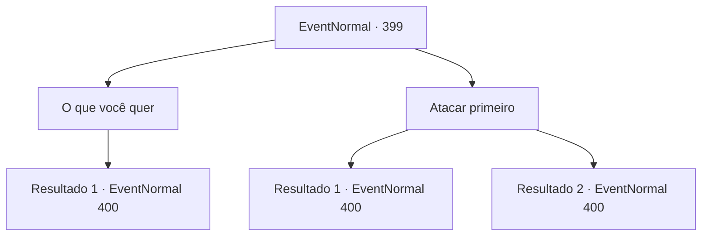

# Eventos normais · 399

[Índice da tabela](index.md) · [Índice geral](../index.md)

ID: `pt:EventNormal:399` · Fonte: `EventNormal4` · Versão: 1.2.47.

Mapeamento estático dos arquivos; a disponibilidade e a execução dependem do estado da run.

## Texto do evento

*Sem texto no arquivo.*

## Dados de entrada

```json
{
  "id": 399,
  "grade": 1,
  "place": "",
  "required": ""
}
```

## Mapa das escolhas



## Escolhas e resultados

### Escolha 1

O que você quer

Requisitos e outros campos da escolha:

```json
{
  "required": ""
}
```

#### Resultado 1.1

As bruxas respondem com uma risada, franzindo a testa em seus rostos enrugados. 

 "AHAHAHA!!! Queremos... SUA CARNE FRESCA E SABOROSA!!"

 Parece que não há saída civil para isso. Você decide deixar sua arma falar.

Continuação registrada: [Evento 400](0400.md) na mesma tabela.

```json
{
  "required": "",
  "chance": "1",
  "nextEvent": 400,
  "type": 2,
  "reward": "6_0_130",
  "place": 1
}
```

### Escolha 2

Atacar primeiro

Requisitos e outros campos da escolha:

```json
{
  "required": ""
}
```

#### Resultado 2.1

Você ataca uma das bruxas, empurrando-a para o lago. Jogado no lago ácido, ele solta um grito estridente e derrete. Agora você tem que lutar contra as outras bruxas, cujos rostos já estão cobertos de raiva.

Continuação registrada: [Evento 400](0400.md) na mesma tabela.

```json
{
  "required": "",
  "chance": "1|0_6_1",
  "nextEvent": 400,
  "type": 0,
  "reward": "6_2_130",
  "place": 1
}
```

#### Resultado 2.2

Você ataca uma das bruxas para empurrá-la para o lago. Mas é muito mais rápido do que você. Ele evita seu ataque. Agora você tem que lutar contra as bruxas, cujos rostos já estão cobertos de raiva.

Continuação registrada: [Evento 400](0400.md) na mesma tabela.

```json
{
  "required": "",
  "chance": "12",
  "nextEvent": 400,
  "type": 1,
  "reward": "6_3_130",
  "place": 1
}
```

## Referências que chegam a este evento

- [Evento 398 · escolha 2 · resultado 1](0398.md#escolha-2)
- [Evento 398 · escolha 3 · resultado 1](0398.md#escolha-3)
- [Evento 398 · escolha 4 · resultado 1](0398.md#escolha-4)
