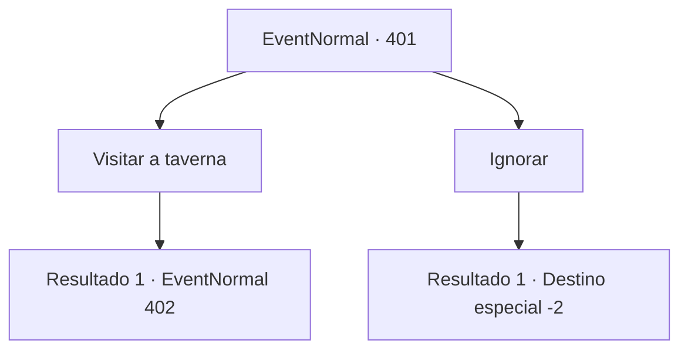

# Eventos normais · 401

[Índice da tabela](index.md) · [Índice geral](../index.md)

ID: `pt:EventNormal:401` · Fonte: `EventNormal4` · Versão: 1.2.47.

Mapeamento estático dos arquivos; a disponibilidade e a execução dependem do estado da run.

## Texto do evento

Você encontra uma solicitação no quadro de avisos de uma cidade.
 'Quem pensa que é bom em explorar masmorras, venha para a taverna.'

## Dados de entrada

```json
{
  "id": 401,
  "grade": 1,
  "place": "",
  "required": "5_288_0"
}
```

## Mapa das escolhas



## Escolhas e resultados

### Escolha 1

Visitar a taverna

Requisitos e outros campos da escolha:

```json
{
  "required": ""
}
```

#### Resultado 1.1

Você pega o pedido do conselho e vai para a taverna mais próxima. Os únicos clientes da taverna são um grupo de aventureiros. Provavelmente porque ainda não é a hora mais movimentada do dia. Quando você coloca o papel do pedido na mesa, um homem que se parece com o líder responde a você. 

 "Você receberá 20% de tudo que encontrarmos na masmorra. Se não conseguirmos nada, você não ganha nada. Você não gosta? Beba um pouco de cerveja e se perca."

 O homem olha para você depois de terminar, bebendo cerveja.

Continuação registrada: [Evento 402](0402.md) na mesma tabela.

```json
{
  "required": "",
  "chance": "1",
  "nextEvent": 402,
  "type": 2,
  "reward": "5_288_1"
}
```

### Escolha 2

Ignorar

Requisitos e outros campos da escolha:

```json
{
  "required": ""
}
```

#### Resultado 2.1

Você ignora o pedido e segue em frente.

Continuação registrada: [Destino especial `-2`](../destinos-especiais.md).

```json
{
  "required": "",
  "chance": "1",
  "nextEvent": -2,
  "type": 2,
  "reward": "5_288_9"
}
```

## Referências que chegam a este evento

Nenhum `nextEvent` positivo da mesma tabela aponta para este nó. Isso não prova que seja inacessível: sorteio e estado de história podem selecioná-lo.

