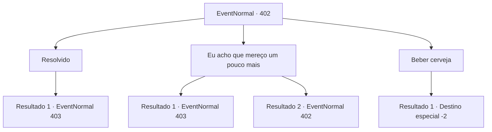

# Eventos normais · 402

[Índice da tabela](index.md) · [Índice geral](../index.md)

ID: `pt:EventNormal:402` · Fonte: `EventNormal4` · Versão: 1.2.47.

Mapeamento estático dos arquivos; a disponibilidade e a execução dependem do estado da run.

## Texto do evento

*Sem texto no arquivo.*

## Dados de entrada

```json
{
  "id": 402,
  "grade": 1,
  "place": "",
  "required": ""
}
```

## Mapa das escolhas



## Escolhas e resultados

### Escolha 1

Resolvido

Requisitos e outros campos da escolha:

```json
{
  "required": ""
}
```

#### Resultado 1.1

Enquanto você concorda com a cabeça, o homem sorri fracamente e fala. 

 "Bom. Meu nome é Kevin, e esses são os membros do meu grupo. Vamos dar o nosso melhor."

 Kevin aperta sua mão e apresenta os outros aventureiros. A alta e esbelta 'Efut', 'Jasmal', a careca, e 'Chartie', a única mulher do grupo. Eles parecem amigos de infância de longa data, pois conversas curtas levam a histórias de sua juventude.

 Dois dias depois, você vai para uma caverna com os membros do seu grupo. Kevin para os outros na frente da entrada e pede que você verifique se há armadilhas.

Continuação registrada: [Evento 403](0403.md) na mesma tabela.

```json
{
  "required": "",
  "chance": "1",
  "nextEvent": 403,
  "type": 2,
  "reward": ""
}
```

### Escolha 2

Eu acho que mereço um pouco mais

Requisitos e outros campos da escolha:

```json
{
  "required": "5_289_0"
}
```

#### Resultado 2.1

Você exige que ele aumente seu pagamento. O homem hesita um pouco, mas logo coloca uma bolsa de couro na mesa. 

 "40 ouro. Antecipadamente. É melhor você fazer o seu trabalho direito."

 Enquanto você pega a bolsa e acena com a cabeça, ele continua. 

 "Bom. Meu nome é Kevin, e esses são os membros do meu grupo. Vamos dar o nosso melhor."

 Kevin aperta sua mão e apresenta os outros aventureiros. A alta e esbelta 'Efut', 'Jasmal', a careca, e 'Chartie', a única mulher do grupo. Eles gentilmente levantam seus copos de cerveja para cumprimentá-lo. Você passa a noite bebendo com eles e concorda em encontrá-los na manhã seguinte. 

 O sol volta a nascer. Você e os outros membros do grupo chegam na frente de uma caverna. Kevin para os outros na entrada da caverna e pede que você verifique se há armadilhas.

Continuação registrada: [Evento 403](0403.md) na mesma tabela.

```json
{
  "required": "",
  "chance": "1|0_12_1",
  "nextEvent": 403,
  "type": 0,
  "reward": "0_4_40"
}
```

#### Resultado 2.2

Você exige que ele aumente seu pagamento. Mas ele balança a cabeça com firmeza e se recusa. 

 "Olha, já temos quatro pessoas no nosso grupo. Pagamos mais e não temos mais nada para nós."


Continuação registrada: [Evento 402](0402.md) na mesma tabela.

```json
{
  "required": "",
  "chance": "11",
  "nextEvent": 402,
  "type": 1,
  "reward": "5_289_1"
}
```

### Escolha 3

Beber cerveja

Requisitos e outros campos da escolha:

```json
{
  "required": ""
}
```

#### Resultado 3.1

Você ouve o que ele disse. Você pega o copo de cerveja de suas mãos e o bebe de um gole. Você então sai da taverna. Ele olha para você como se estivesse olhando para um lunático, mas você não se importa nem um pouco.

Continuação registrada: [Destino especial `-2`](../destinos-especiais.md).

```json
{
  "required": "",
  "chance": "1",
  "nextEvent": -2,
  "type": 2,
  "reward": "5_288_9"
}
```

## Referências que chegam a este evento

- [Evento 401 · escolha 1 · resultado 1](0401.md#escolha-1)
- [Evento 402 · escolha 2 · resultado 2](0402.md#escolha-2)
