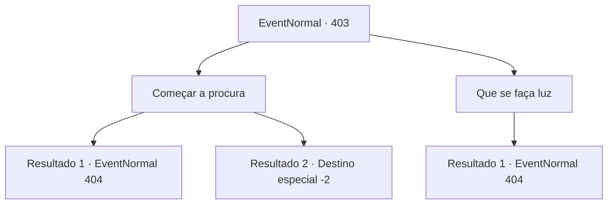

# Eventos normais · 403

[Índice da tabela](index.md) · [Índice geral](../index.md)

ID: `pt:EventNormal:403` · Fonte: `EventNormal4` · Versão: 1.2.47.

Mapeamento estático dos arquivos; a disponibilidade e a execução dependem do estado da run.

## Texto do evento

*Sem texto no arquivo.*

## Dados de entrada

```json
{
  "id": 403,
  "grade": 1,
  "place": "",
  "required": ""
}
```

## Mapa das escolhas



## Escolhas e resultados

### Escolha 1

Começar a procura

Requisitos e outros campos da escolha:

```json
{
  "required": ""
}
```

#### Resultado 1.1

Você caminha cuidadosamente para a frente, investigando a caverna. Está bem escuro lá dentro, mas seus olhos se adaptam à escuridão muito rapidamente. Kevin e os outros seguem você cuidadosamente para dentro da caverna.

Continuação registrada: [Evento 404](0404.md) na mesma tabela.

```json
{
  "required": "",
  "chance": "1|0_14_1",
  "nextEvent": 404,
  "type": 0,
  "reward": ""
}
```

#### Resultado 1.2

Você faz o seu melhor para investigar a caverna, mas está muito escuro lá. Quando você conta isso para Kevin, ele responde, descontente. 

 "Achei que pedi especificamente para pessoas que confiam em suas habilidades."

 Kevin balança a cabeça e te expulsa de sua festa. Eles continuam a investigação dentro da masmorra sozinhos. Você olha para as costas deles por um tempo e logo sai da caverna em silêncio.

Continuação registrada: [Destino especial `-2`](../destinos-especiais.md).

```json
{
  "required": "",
  "chance": "12",
  "nextEvent": -2,
  "type": 1,
  "reward": ""
}
```

### Escolha 2

Que se faça luz

Requisitos e outros campos da escolha:

```json
{
  "required": "23_3_1"
}
```

#### Resultado 2.1

Você faz uma pequena luz com suas ferramentas e verifica a caverna. Kevin e os outros seguem você cuidadosamente para dentro da caverna.

Continuação registrada: [Evento 404](0404.md) na mesma tabela.

```json
{
  "required": "",
  "chance": "1",
  "nextEvent": 404,
  "type": 2,
  "reward": ""
}
```

## Referências que chegam a este evento

- [Evento 402 · escolha 1 · resultado 1](0402.md#escolha-1)
- [Evento 402 · escolha 2 · resultado 1](0402.md#escolha-2)
