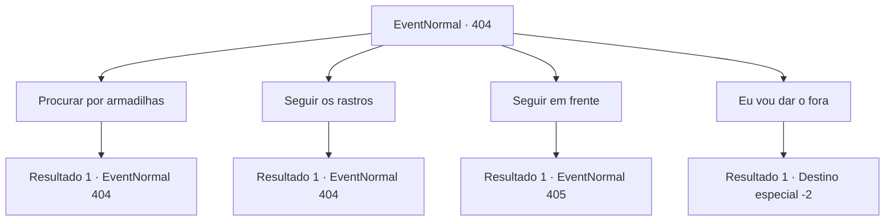

# Eventos normais · 404

[Índice da tabela](index.md) · [Índice geral](../index.md)

ID: `pt:EventNormal:404` · Fonte: `EventNormal4` · Versão: 1.2.47.

Mapeamento estático dos arquivos; a disponibilidade e a execução dependem do estado da run.

## Texto do evento

*Sem texto no arquivo.*

## Dados de entrada

```json
{
  "id": 404,
  "grade": 1,
  "place": "",
  "required": ""
}
```

## Mapa das escolhas



## Escolhas e resultados

### Escolha 1

Procurar por armadilhas

Requisitos e outros campos da escolha:

```json
{
  "required": "5_288_1"
}
```

#### Resultado 1.1

Você dá passos cuidadosos dentro da caverna, verificando se há armadilhas. Existem algumas armadilhas, mas felizmente estão todas quebradas para desarmados. Quando você conta isso para o seu grupo, Efut murmura para si mesmo baixinho. 

 "Talvez não sejamos os primeiros a vir aqui. De qualquer forma, vamos continuar."

 

Continuação registrada: [Evento 404](0404.md) na mesma tabela.

```json
{
  "required": "",
  "chance": "1",
  "nextEvent": 404,
  "type": 2,
  "reward": "5_288_2"
}
```

### Escolha 2

Seguir os rastros

Requisitos e outros campos da escolha:

```json
{
  "required": "5_288_2"
}
```

#### Resultado 2.1

Você caminha cuidadosamente para a frente, perseguindo pegadas de monstros. Talvez a sorte esteja do seu lado, afinal. Ao seguir os rastros, você descobre que os monstros já estão mortos. A maioria deles já perdeu a carne. Tudo o que resta são ossos e carne podre. Quando você relata isso para os membros do partido, Jasmal dá de ombros. 

 "Bem... eu acho que é conveniente, já que isso significa que nem temos que lutar contra eles."


Continuação registrada: [Evento 404](0404.md) na mesma tabela.

```json
{
  "required": "",
  "chance": "1",
  "nextEvent": 404,
  "type": 2,
  "reward": "5_288_3"
}
```

### Escolha 3

Seguir em frente

Requisitos e outros campos da escolha:

```json
{
  "required": "5_288_3"
}
```

#### Resultado 3.1

Enquanto você segue armadilhas e pegadas de monstros pela caverna, você encontra um caminho dividido. Kevin pensa um pouco e decide dividir a festa. 

 "Efut e Jasmal pegam a esquerda. Descanse, venha comigo para a direita."

 Mas apesar da tentativa de dividir o partido, desta vez, aparece um caminho de três vias. Kevin suspira e sugere que a única opção que resta agora é se separar novamente. Você anda sozinho por um tempo e descobre que há um baú de tesouro trancado no final do seu caminho.

Continuação registrada: [Evento 405](0405.md) na mesma tabela.

```json
{
  "required": "",
  "chance": "1",
  "nextEvent": 405,
  "type": 2,
  "reward": ""
}
```

### Escolha 4

Eu vou dar o fora

Requisitos e outros campos da escolha:

```json
{
  "required": ""
}
```

#### Resultado 4.1

Você diz a eles que vai voltar para fora. Eles parecem não entender você, mas você sai da masmorra mesmo assim.

Continuação registrada: [Destino especial `-2`](../destinos-especiais.md).

```json
{
  "required": "",
  "chance": "1",
  "nextEvent": -2,
  "type": 2,
  "reward": "5_288_9"
}
```

## Referências que chegam a este evento

- [Evento 403 · escolha 1 · resultado 1](0403.md#escolha-1)
- [Evento 403 · escolha 2 · resultado 1](0403.md#escolha-2)
- [Evento 404 · escolha 1 · resultado 1](0404.md#escolha-1)
- [Evento 404 · escolha 2 · resultado 1](0404.md#escolha-2)
