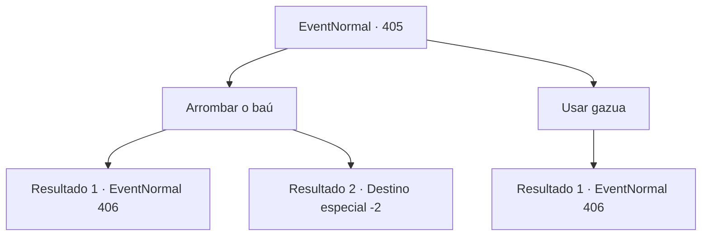

# Eventos normais · 405

[Índice da tabela](index.md) · [Índice geral](../index.md)

ID: `pt:EventNormal:405` · Fonte: `EventNormal4` · Versão: 1.2.47.

Mapeamento estático dos arquivos; a disponibilidade e a execução dependem do estado da run.

## Texto do evento

*Sem texto no arquivo.*

## Dados de entrada

```json
{
  "id": 405,
  "grade": 1,
  "place": "",
  "required": ""
}
```

## Mapa das escolhas



## Escolhas e resultados

### Escolha 1

Arrombar o baú

Requisitos e outros campos da escolha:

```json
{
  "required": ""
}
```

#### Resultado 1.1

Não há nada dentro do baú do tesouro quebrado. Você procura um pouco mais para descobrir se há algo escondido, mas tudo o que encontra são os passos de alguém que veio antes de você. Sem opções, você volta para encontrar outros membros do grupo. Então, Kevin e os outros chegam onde você está. 

 "Encontrou alguma coisa?"

 Kevin e os outros parecem cansados ​​ao relatarem que não encontraram nada de valor. Você balança a cabeça, apontando para o baú quebrado. Os aventureiros suspiram. Então, Chartie fala depois de dar uma olhada no baú quebrado. 

 "Aguentar. Como sabemos se você não está guardando os tesouros só para você e simplesmente não está nos contando?"

 Ouvindo suas palavras, os outros membros do grupo lançaram um olhar sinistro para você também. 

Continuação registrada: [Evento 406](0406.md) na mesma tabela.

```json
{
  "required": "",
  "chance": "1|0_5_2",
  "nextEvent": 406,
  "type": 0,
  "reward": ""
}
```

#### Resultado 1.2

Apesar de sua violência implacável, o baú do tesouro permanece fechado, selando seu conteúdo. Sem opções, você vai buscar os outros membros do grupo. Quando Kevin chega, seu rosto fica todo vermelho e grita com você. 

 "Caramba! Você nem sabe abrir um baú do tesouro, e teve a audácia de se juntar a nós?!"

 Mas Kevin e os outros membros também falham em abrir o baú do tesouro. O peito é muito pesado para ser carregado. O que significava que realmente não há como verificar o que está dentro. Kevin furiosamente chuta o baú do tesouro, reclamando que a viagem foi uma perda de tempo, e sai da masmorra com os outros. Você os segue para fora da caverna também.

Continuação registrada: [Destino especial `-2`](../destinos-especiais.md).

```json
{
  "required": "",
  "chance": "18",
  "nextEvent": -2,
  "type": 1,
  "reward": "5_288_9"
}
```

### Escolha 2

Usar gazua

Requisitos e outros campos da escolha:

```json
{
  "required": "8_41_1"
}
```

#### Resultado 2.1

Você usa um lockpick para abrir o baú do tesouro, mas não há nada dentro. Você procura um pouco mais para descobrir se há algo escondido, mas tudo o que encontra são os passos de alguém que veio antes de você. Sem opções, você decide voltar para os outros. Mas então, Kevin e os outros chegam onde você está. 

 "Encontrou alguma coisa?"

 Kevin e os outros parecem cansados ​​ao relatarem que não encontraram nada de valor. Você balança a cabeça, apontando para o baú do tesouro vazio. Os aventureiros suspiram. Então, Chartie fala depois de dar uma olhada no baú quebrado. 

 "Aguentar. Como sabemos se você não está guardando os tesouros só para você e simplesmente não está nos contando?"

 Ouvindo suas palavras, os outros membros do grupo lançaram um olhar sinistro para você também. 

Continuação registrada: [Evento 406](0406.md) na mesma tabela.

```json
{
  "required": "",
  "chance": "3",
  "nextEvent": 406,
  "type": 2,
  "reward": "4_41_1"
}
```

## Referências que chegam a este evento

- [Evento 404 · escolha 3 · resultado 1](0404.md#escolha-3)
