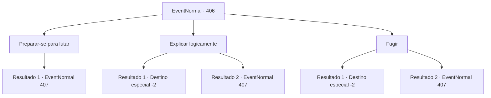

# Eventos normais · 406

[Índice da tabela](index.md) · [Índice geral](../index.md)

ID: `pt:EventNormal:406` · Fonte: `EventNormal4` · Versão: 1.2.47.

Mapeamento estático dos arquivos; a disponibilidade e a execução dependem do estado da run.

## Texto do evento

*Sem texto no arquivo.*

## Dados de entrada

```json
{
  "id": 406,
  "grade": 1,
  "place": "",
  "required": ""
}
```

## Mapa das escolhas



## Escolhas e resultados

### Escolha 1

Preparar-se para lutar

Requisitos e outros campos da escolha:

```json
{
  "required": ""
}
```

#### Resultado 1.1

Quando você saca sua arma, o rosto de Kevin fica vermelho de raiva quando suas mãos alcançam o machado na cintura. 

 "Ha! Tomei o seu por um aventureiro, mas acontece que você é um ladrão!"

 Cada aventureiro prepara sua arma e o cerca. Eles hesitam por um segundo antes de gritar todos de uma vez, atacando você.

Continuação registrada: [Evento 407](0407.md) na mesma tabela.

```json
{
  "required": "",
  "chance": "1",
  "nextEvent": 407,
  "type": 2,
  "reward": "6_0_61",
  "place": 7
}
```

### Escolha 2

Explicar logicamente

Requisitos e outros campos da escolha:

```json
{
  "required": ""
}
```

#### Resultado 2.1

Você faz uma refutação lógica para Chartie. Seus olhos ficam livres de suspeitas. Kevin coça a nuca, pedindo desculpas. 

 "Droga, me desculpe. Eu só... fiquei um pouco sensível demais. Pensar que viemos até aqui por nada."

 Você se separou do grupo, sem nenhum ouro ou item na mão.

Continuação registrada: [Destino especial `-2`](../destinos-especiais.md).

```json
{
  "required": "",
  "chance": "1|0_7_1",
  "nextEvent": -2,
  "type": 0,
  "reward": "0_2_1|5_288_10"
}
```

#### Resultado 2.2

Você tenta fazer uma refutação lógica para Chartie, mas eles não parecem estar ouvindo você. De repente, eles estão cercando você com suas armas. 

 "Ha! Nós não somos tão crédulos, você sabe!"

 A voz de Kevin funciona como uma deixa para a batalha. Os aventureiros gritam todos de uma vez e começam a atacar você.

Continuação registrada: [Evento 407](0407.md) na mesma tabela.

```json
{
  "required": "",
  "chance": "14",
  "nextEvent": 407,
  "type": 1,
  "reward": "6_0_61",
  "place": 7
}
```

### Escolha 3

Fugir

Requisitos e outros campos da escolha:

```json
{
  "required": ""
}
```

#### Resultado 3.1

Você foge do calabouço. Você nem se atreve a responder a Kevin. Kevin e os outros correm atrás de você, mas logo percebem que você é muito mais rápido que eles.

Continuação registrada: [Destino especial `-2`](../destinos-especiais.md).

```json
{
  "required": "",
  "chance": "1|0_6_1",
  "nextEvent": -2,
  "type": 0,
  "reward": "5_288_10"
}
```

#### Resultado 3.2

Você desiste de convencê-los e tenta fugir. Mas a arma de Kevin é muito mais rápida que você. 

 "Ha! Eu te considerei um aventureiro, mas acontece que você é um ladrão!"

 Cada aventureiro prepara sua arma e o cerca. Eles hesitam por um segundo antes de gritar todos de uma vez, atacando você.

Continuação registrada: [Evento 407](0407.md) na mesma tabela.

```json
{
  "required": "",
  "chance": "14",
  "nextEvent": 407,
  "type": 1,
  "reward": "6_0_61",
  "place": 7
}
```

## Referências que chegam a este evento

- [Evento 405 · escolha 1 · resultado 1](0405.md#escolha-1)
- [Evento 405 · escolha 2 · resultado 1](0405.md#escolha-2)
