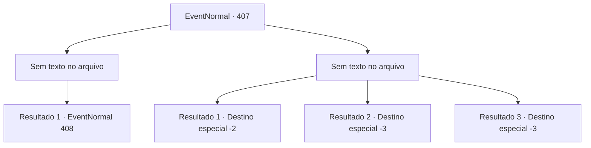

# Eventos normais · 407

[Índice da tabela](index.md) · [Índice geral](../index.md)

ID: `pt:EventNormal:407` · Fonte: `EventNormal4` · Versão: 1.2.47.

Mapeamento estático dos arquivos; a disponibilidade e a execução dependem do estado da run.

## Texto do evento

*Sem texto no arquivo.*

## Dados de entrada

```json
{
  "id": 407,
  "grade": 1,
  "place": "",
  "required": ""
}
```

## Mapa das escolhas



## Escolhas e resultados

### Escolha 1

*Sem texto no arquivo; o papel dessa opção depende da interface do jogo.*

Requisitos e outros campos da escolha:

```json
{
  "required": ""
}
```

#### Resultado 1.1

Você derrota o grupo de aventureiros. Então, Kevin se ajoelha diante de você e implora. 

 "W...nós sentimos muito. Apenas por favor, por favor, poupe nossas vidas ..!"


Continuação registrada: [Evento 408](0408.md) na mesma tabela.

```json
{
  "required": "",
  "chance": "1",
  "nextEvent": 408,
  "type": 2,
  "reward": "5_288_9"
}
```

### Escolha 2

*Sem texto no arquivo; o papel dessa opção depende da interface do jogo.*

Requisitos e outros campos da escolha:

```json
{
  "required": ""
}
```

#### Resultado 2.1


 "Isso... isso não pode ser isso."

 Depois de vasculhar sua mochila, os aventureiros percebem que, afinal, não há tesouro. Eles começam a debater sobre o paradeiro do tesouro, mas logo chegam à conclusão de que não havia tesouro nesta masmorra. Kevin percebe a verdade. Ele imediatamente pede desculpas a você e lhe entrega um pouco de seu ouro. Você pega o ouro e sai mancando da masmorra.

Continuação registrada: [Destino especial `-2`](../destinos-especiais.md).

```json
{
  "required": "1_0_2|1_1_2",
  "chance": "1",
  "nextEvent": -2,
  "type": 2,
  "reward": "0_0_-1|0_1_-1|0_4_50|5_288_10"
}
```

#### Resultado 2.2

Kevin, Efut, Jasmal e Chartie percebem que você não tem o tesouro com você. Mas é muito tarde. Quando eles percebem, você já é uma pessoa morta.

Continuação registrada: [Destino especial `-3`](../destinos-especiais.md).

```json
{
  "required": "2_0_2",
  "chance": "1",
  "nextEvent": -3,
  "type": 2,
  "reward": "0_0_-1|0_1_-1"
}
```

#### Resultado 2.3

Kevin, Efut, Jasmal e Chartie percebem que você não tem o tesouro com você. Mas é muito tarde. Quando eles percebem, você já é uma pessoa morta.

Continuação registrada: [Destino especial `-3`](../destinos-especiais.md).

```json
{
  "required": "2_1_2",
  "chance": "1",
  "nextEvent": -3,
  "type": 2,
  "reward": "0_0_-1|0_1_-1"
}
```

## Referências que chegam a este evento

- [Evento 406 · escolha 1 · resultado 1](0406.md#escolha-1)
- [Evento 406 · escolha 2 · resultado 2](0406.md#escolha-2)
- [Evento 406 · escolha 3 · resultado 2](0406.md#escolha-3)
