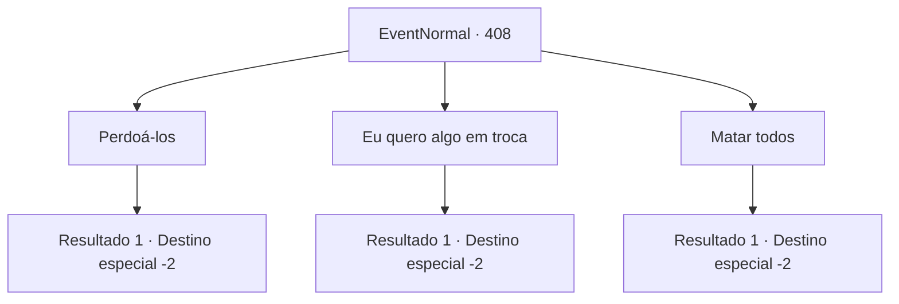

# Eventos normais · 408

[Índice da tabela](index.md) · [Índice geral](../index.md)

ID: `pt:EventNormal:408` · Fonte: `EventNormal4` · Versão: 1.2.47.

Mapeamento estático dos arquivos; a disponibilidade e a execução dependem do estado da run.

## Texto do evento

*Sem texto no arquivo.*

## Dados de entrada

```json
{
  "id": 408,
  "grade": 1,
  "place": "",
  "required": ""
}
```

## Mapa das escolhas



## Escolhas e resultados

### Escolha 1

Perdoá-los

Requisitos e outros campos da escolha:

```json
{
  "required": "1_3_10"
}
```

#### Resultado 1.1

Você os perdoa por seu mal-entendido. Eles não param de agradecê-lo quando saem da masmorra.

Continuação registrada: [Destino especial `-2`](../destinos-especiais.md).

```json
{
  "required": "",
  "chance": "1",
  "nextEvent": -2,
  "type": 2,
  "reward": "0_3_2"
}
```

### Escolha 2

Eu quero algo em troca

Requisitos e outros campos da escolha:

```json
{
  "required": ""
}
```

#### Resultado 2.1

Você diz que vai perdoá-los. Só que não de graça. Eles esvaziam seus bolsos, entregando a você ouro e alguns de seus equipamentos, e saem apressadamente da masmorra.

Continuação registrada: [Destino especial `-2`](../destinos-especiais.md).

```json
{
  "required": "",
  "chance": "1",
  "nextEvent": -2,
  "type": 2,
  "reward": "0_4_50|3_9_1|3_14_1|3_32_1"
}
```

### Escolha 3

Matar todos

Requisitos e outros campos da escolha:

```json
{
  "required": "2_3_-10"
}
```

#### Resultado 3.1

Você envia os aventureiros direto para a vida após a morte. Você saqueia seus corpos de ouro e equipamentos. Você joga seus cadáveres em uma armadilha próxima. Então você sai da masmorra como se nada tivesse acontecido.

Continuação registrada: [Destino especial `-2`](../destinos-especiais.md).

```json
{
  "required": "",
  "chance": "1",
  "nextEvent": -2,
  "type": 2,
  "reward": "0_4_50|3_9_1|3_14_1|3_32_1|0_3_-6"
}
```

## Referências que chegam a este evento

- [Evento 407 · escolha 1 · resultado 1](0407.md#escolha-1)
