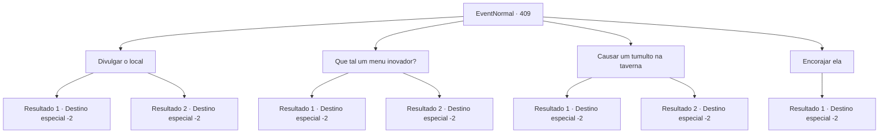

# Eventos normais · 409

[Índice da tabela](index.md) · [Índice geral](../index.md)

ID: `pt:EventNormal:409` · Fonte: `EventNormal4` · Versão: 1.2.47.

Mapeamento estático dos arquivos; a disponibilidade e a execução dependem do estado da run.

## Texto do evento

É uma tarde relaxante. Você chega a uma pequena cidade e entra em uma taverna. A dona da taverna se apresenta como 'Bianca' e traz cerveja para você depois de levá-lo à sua mesa. A taverna parece arrumada e agradável. A atmosfera é ótima, mas você é o único cliente lá. Está tão silencioso quanto uma igreja. Então, você ouve Bianca suspirando. Você nem perguntou, mas ela se aproxima de você e fala com você. 

 "Por favor! Você pode me ajudar? Você é o único freguês da minha taverna, mas aquele lugar ali está cheio de gente pela manhã!"

 Bianca aponta para uma fila de pessoas, que esperam na frente da taverna do outro lado da rua. 

 "Existe alguma maneira de trazer mais clientes para minha loja? Eu garanto que irei te pagar!"


## Dados de entrada

```json
{
  "id": 409,
  "grade": 1,
  "place": "",
  "required": "5_290_0"
}
```

## Mapa das escolhas



## Escolhas e resultados

### Escolha 1

Divulgar o local

Requisitos e outros campos da escolha:

```json
{
  "required": ""
}
```

#### Resultado 1.1

Depois de terminar sua cerveja, você sai para as ruas e anuncia a taverna da Bianca. As pessoas na rua são fisgadas pelo seu anúncio. Demonstrando interesse, eles começam a se dirigir para a taverna de Bianca. Logo, a taverna se torna movimentada com clientes. Bianca agradece, suando. 

 "Ufa, não me lembro quando foi a última vez que trabalhei tanto! Muito obrigado! Este é um presente de agradecimento, por favor, pegue!"

 Ela lhe dá uma parte do ouro que fez com sua ajuda. Você pega e sai da taverna.

Continuação registrada: [Destino especial `-2`](../destinos-especiais.md).

```json
{
  "required": "",
  "chance": "1|0_12_1",
  "nextEvent": -2,
  "type": 0,
  "reward": "0_2_1|0_4_50|5_290_1"
}
```

#### Resultado 1.2

Depois de terminar sua cerveja, você sai para as ruas e anuncia a taverna da Bianca. Mas as pessoas na rua continuam com suas vidas, sem prestar atenção em você. Você sente o olhar de Bianca cutucando suas costas. Você sai rapidamente da área.

Continuação registrada: [Destino especial `-2`](../destinos-especiais.md).

```json
{
  "required": "",
  "chance": "13",
  "nextEvent": -2,
  "type": 1,
  "reward": "5_290_9"
}
```

### Escolha 2

Que tal um menu inovador?

Requisitos e outros campos da escolha:

```json
{
  "required": ""
}
```

#### Resultado 2.1

Depois de terminar sua cerveja, você sugere que Bianca crie um novo cardápio. Bianca parece concordar com sua ideia. 

 "Ok. Então, você poderia, por favor, fazer um brainstorming comigo? Um ótimo cardápio que atrairá muitos novos clientes?"

 Você concorda com a cabeça e vai até a cozinha dela.

 Meio dia passa. Depois de uma longa pesquisa e uma série de tentativas e erros, você e Bianca finalmente criam 'Spicy Wyvern Wings', feito com peru. Vocês dois começam a anunciar o novo cardápio na rua. Mostrando interesse nas Spicy Wyvern Wings, alguns deles começam a se dirigir para a taverna de Bianca. Logo, a taverna se torna movimentada com clientes. Bianca agradece, suando. 

 "Ufa, não me lembro quando foi a última vez que trabalhei tanto! Muito obrigado! Este é um presente de agradecimento, por favor, pegue!"

 Ela lhe dá uma parte do ouro que fez com sua ajuda. Você pega e sai da taverna.

Continuação registrada: [Destino especial `-2`](../destinos-especiais.md).

```json
{
  "required": "",
  "chance": "1|0_7_1",
  "nextEvent": -2,
  "type": 0,
  "reward": "0_2_1|0_4_50|5_290_1"
}
```

#### Resultado 2.2

Depois de terminar sua cerveja, você sugere que Bianca crie um novo cardápio. Bianca parece concordar com sua ideia. 

 "Ok. Então, você poderia, por favor, fazer um brainstorming comigo? Um ótimo cardápio que atrairá muitos novos clientes?"

 Você concorda com a cabeça e vai até a cozinha dela.

 Meio dia passa. Depois de uma longa pesquisa e uma série de tentativas e erros, você e Bianca finalmente inventam salsichas assadas. Vocês dois começam a anunciar o novo cardápio na rua. Mas as pessoas na rua continuam com suas vidas, sem prestar atenção em vocês dois. 

 "Eca. Eu deveria fechar para o dia."

 Você sai da taverna de Bianca.

Continuação registrada: [Destino especial `-2`](../destinos-especiais.md).

```json
{
  "required": "",
  "chance": "13",
  "nextEvent": -2,
  "type": 1,
  "reward": "5_290_9"
}
```

### Escolha 3

Causar um tumulto na taverna

Requisitos e outros campos da escolha:

```json
{
  "required": ""
}
```

#### Resultado 3.1

Depois de terminar sua cerveja, você corre para a outra taverna e causa um tumulto. Os trabalhadores de lá fazem o possível para detê-lo, mas não o fazem. Infelizmente, os clientes começam a ir para outras tavernas, tentando fugir da confusão. Isso inclui a taverna da Bianca.

 Tarde da noite naquele dia, Bianca se aproxima cuidadosamente de você. 

 "Isto não é o que eu tinha em mente... De qualquer forma, aqui está o corte prometido."

 Ela lhe entrega o ouro e desaparece como uma sombra. Você anda pelas ruas escuras e sai da cidade.

Continuação registrada: [Destino especial `-2`](../destinos-especiais.md).

```json
{
  "required": "",
  "chance": "1|0_5_1",
  "nextEvent": -2,
  "type": 0,
  "reward": "0_2_1|0_3_-1|0_4_50|5_290_1"
}
```

#### Resultado 3.2

Depois de terminar sua cerveja, você corre para a outra taverna e causa um tumulto. Mas os trabalhadores de lá fazem um ótimo trabalho no gerenciamento de suas ações. Eles agem como se estivessem tentando convencê-lo, mas alguns deles já notificaram os guardas. Você sai rapidamente da taverna, fugindo dos guardas da cidade.

Continuação registrada: [Destino especial `-2`](../destinos-especiais.md).

```json
{
  "required": "",
  "chance": "13",
  "nextEvent": -2,
  "type": 1,
  "reward": "5_290_9|0_3_-1"
}
```

### Escolha 4

Encorajar ela

Requisitos e outros campos da escolha:

```json
{
  "required": ""
}
```

#### Resultado 4.1

Você incentiva Bianca e volta para suas aventuras.

Continuação registrada: [Destino especial `-2`](../destinos-especiais.md).

```json
{
  "required": "",
  "chance": "1",
  "nextEvent": -2,
  "type": 2,
  "reward": "5_290_9"
}
```

## Referências que chegam a este evento

Nenhum `nextEvent` positivo da mesma tabela aponta para este nó. Isso não prova que seja inacessível: sorteio e estado de história podem selecioná-lo.

