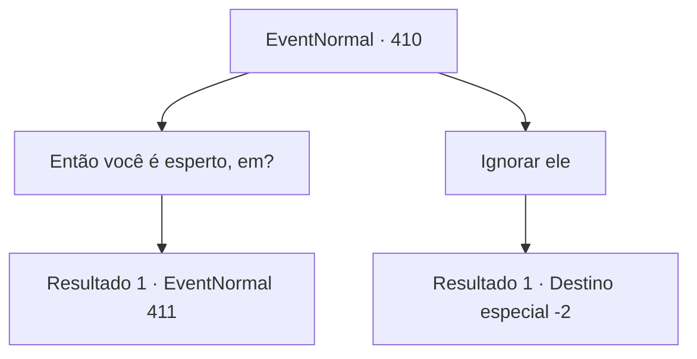

# Eventos normais · 410

[Índice da tabela](index.md) · [Índice geral](../index.md)

ID: `pt:EventNormal:410` · Fonte: `EventNormal4` · Versão: 1.2.47.

Mapeamento estático dos arquivos; a disponibilidade e a execução dependem do estado da run.

## Texto do evento

Você encontra um estudioso dando uma palestra em uma praça da cidade. Depois de se apresentar como 'Edric', o estudioso continua com um livro grosso bem apertado em seus braços. 

 "Dediquei minha vida inteira à nobre busca do conhecimento. O conselho acadêmico me concedeu o título de Guardião do Conhecimento."

 Mas quanto mais ele fala, sua 'palestra' lentamente se transforma em autopromoção e logo em criticar e zombar dos outros. Edric anuncia que os nobres são podres por dentro, os mercadores são vermes cegos ao dinheiro e os aventureiros são idiotas com músculos onde seus cérebros deveriam estar. 

 "Se alguém quiser me desafiar para uma batalha de conhecimento, vá em frente. Eu vou te ensinar que sua quantidade de conhecimento é um lago raso comparado ao meu oceano. HAHAHA!"


## Dados de entrada

```json
{
  "id": 410,
  "grade": 1,
  "place": "",
  "required": "5_291_0"
}
```

## Mapa das escolhas



## Escolhas e resultados

### Escolha 1

Então você é esperto, em?

Requisitos e outros campos da escolha:

```json
{
  "required": ""
}
```

#### Resultado 1.1

Você anda pela multidão e o desafia para um duelo. Edric examina você de cima a baixo e começa a rir. 

 "Um aventureiro se oferece para ser humilhado publicamente. Desafio aceito! Escolha seu tema."

 Ele dá um tapinha na barba, mostrando um forte sinal de confiança.

Continuação registrada: [Evento 411](0411.md) na mesma tabela.

```json
{
  "required": "",
  "chance": "1",
  "nextEvent": 411,
  "type": 2,
  "reward": "5_291_1"
}
```

### Escolha 2

Ignorar ele

Requisitos e outros campos da escolha:

```json
{
  "required": ""
}
```

#### Resultado 2.1

Você faz o seu melhor para ignorá-lo e ir embora.

Continuação registrada: [Destino especial `-2`](../destinos-especiais.md).

```json
{
  "required": "",
  "chance": "1",
  "nextEvent": -2,
  "type": 2,
  "reward": "5_291_10"
}
```

## Referências que chegam a este evento

Nenhum `nextEvent` positivo da mesma tabela aponta para este nó. Isso não prova que seja inacessível: sorteio e estado de história podem selecioná-lo.

