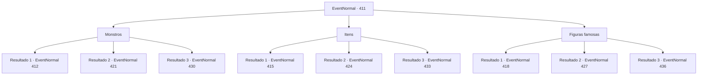

# Eventos normais · 411

[Índice da tabela](index.md) · [Índice geral](../index.md)

ID: `pt:EventNormal:411` · Fonte: `EventNormal4` · Versão: 1.2.47.

Mapeamento estático dos arquivos; a disponibilidade e a execução dependem do estado da run.

## Texto do evento

*Sem texto no arquivo.*

## Dados de entrada

```json
{
  "id": 411,
  "grade": 1,
  "place": "",
  "required": ""
}
```

## Mapa das escolhas



## Escolhas e resultados

### Escolha 1

Monstros

Requisitos e outros campos da escolha:

```json
{
  "required": ""
}
```

#### Resultado 1.1

Você escolhe monstros como tema do duelo. Edric zomba e continua. 

 "Monstros, hein? Eu vou te fazer três perguntas. Se você puder responder a todas elas corretamente, admitirei a derrota."

 Depois de limpar a garganta, Edric olha para você e pergunta. 

 "Primeira pergunta. Qual é a altura média dos gigantes do gelo?"


Continuação registrada: [Evento 412](0412.md) na mesma tabela.

```json
{
  "required": "",
  "chance": "1",
  "nextEvent": 412,
  "type": 2,
  "reward": ""
}
```

#### Resultado 1.2

Você escolhe monstros como tema do duelo. Edric zomba e continua. 

 "Monstros, hein? Eu vou te fazer três perguntas. Se você puder responder a todas elas corretamente, admitirei a derrota."

 Depois de limpar a garganta, Edric olha para você e pergunta. 

 "Primeira pergunta. Qual é a classificação correta de um sasquatch?"


Continuação registrada: [Evento 421](0421.md) na mesma tabela.

```json
{
  "required": "",
  "chance": "1",
  "nextEvent": 421,
  "type": 2,
  "reward": ""
}
```

#### Resultado 1.3

Você escolhe monstros como tema do duelo. Edric zomba e continua. 

 "Monstros, hein? Eu vou te fazer três perguntas. Se você puder responder a todas elas corretamente, admitirei a derrota."

 Depois de limpar a garganta, Edric olha para você e pergunta. 

 "Primeira pergunta. As asas de Wyvern são o resultado da evolução do quê?"


Continuação registrada: [Evento 430](0430.md) na mesma tabela.

```json
{
  "required": "",
  "chance": "1",
  "nextEvent": 430,
  "type": 2,
  "reward": ""
}
```

### Escolha 2

Itens

Requisitos e outros campos da escolha:

```json
{
  "required": ""
}
```

#### Resultado 2.1

Você escolhe itens como tema do duelo. Edric zomba e continua. 

 "Itens, hein? Eu vou te fazer três perguntas. Se você puder responder a todas elas corretamente, admitirei a derrota."

 Depois de limpar a garganta, Edric olha para você e pergunta. 

 "Primeira pergunta. Qual é a cor de um elixir da sálvia?"


Continuação registrada: [Evento 415](0415.md) na mesma tabela.

```json
{
  "required": "",
  "chance": "1",
  "nextEvent": 415,
  "type": 2,
  "reward": ""
}
```

#### Resultado 2.2

Você escolhe itens como tema do duelo. Edric zomba e continua. 

 "Itens, hein? Eu vou te fazer três perguntas. Se você puder responder a todas elas corretamente, admitirei a derrota."

 Depois de limpar a garganta, Edric olha para você e pergunta. 

 "Primeira pergunta. Quanto vale um arco curto?"


Continuação registrada: [Evento 424](0424.md) na mesma tabela.

```json
{
  "required": "",
  "chance": "1",
  "nextEvent": 424,
  "type": 2,
  "reward": ""
}
```

#### Resultado 2.3

Você escolhe itens como tema do duelo. Edric zomba e continua. 

 "Itens, hein? Eu vou te fazer três perguntas. Se você puder responder a todas elas corretamente, admitirei a derrota."

 Depois de limpar a garganta, Edric olha para você e pergunta. 

 "Primeira pergunta. Qual é o comprimento médio da corda vendida na loja de um aventureiro?"


Continuação registrada: [Evento 433](0433.md) na mesma tabela.

```json
{
  "required": "",
  "chance": "1",
  "nextEvent": 433,
  "type": 2,
  "reward": ""
}
```

### Escolha 3

Figuras famosas

Requisitos e outros campos da escolha:

```json
{
  "required": ""
}
```

#### Resultado 3.1

Você escolhe figuras famosas como tema do duelo. Edric zomba e continua. 

 "Figuras famosas, hein? Eu vou te fazer três perguntas. Se você puder responder a todas elas corretamente, admitirei a derrota."

 Depois de limpar a garganta, Edric olha para você e pergunta. 

 "Primeira pergunta. O lendário aventureiro Wang Gol começou a se aventurar quando tinha quantos anos?"


Continuação registrada: [Evento 418](0418.md) na mesma tabela.

```json
{
  "required": "",
  "chance": "1",
  "nextEvent": 418,
  "type": 2,
  "reward": ""
}
```

#### Resultado 3.2

Você escolhe figuras famosas como tema do duelo. Edric zomba e continua. 

 "Figuras famosas, hein? Eu vou te fazer três perguntas. Se você puder responder a todas elas corretamente, admitirei a derrota."

 Depois de limpar a garganta, Edric olha para você e pergunta. 

 "Primeira pergunta. Qual é o nome do irmão da atual Rainha Élfica?"


Continuação registrada: [Evento 427](0427.md) na mesma tabela.

```json
{
  "required": "",
  "chance": "1",
  "nextEvent": 427,
  "type": 2,
  "reward": ""
}
```

#### Resultado 3.3

Você escolhe figuras famosas como tema do duelo. Edric zomba e continua. 

 "Figuras famosas, hein? Eu vou te fazer três perguntas. Se você puder responder a todas elas corretamente, admitirei a derrota."

 Depois de limpar a garganta, Edric olha para você e pergunta. 

 "Primeira pergunta. Você conhece o lendário bruxo DailyKim, certo? Qual é o nome do cajado que ele usou?"


Continuação registrada: [Evento 436](0436.md) na mesma tabela.

```json
{
  "required": "",
  "chance": "1",
  "nextEvent": 436,
  "type": 2,
  "reward": ""
}
```

## Referências que chegam a este evento

- [Evento 410 · escolha 1 · resultado 1](0410.md#escolha-1)
