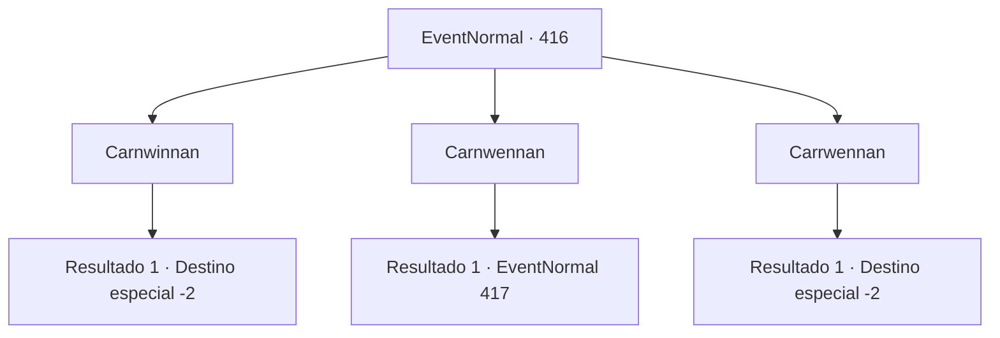

# Eventos normais · 416

[Índice da tabela](index.md) · [Índice geral](../index.md)

ID: `pt:EventNormal:416` · Fonte: `EventNormal4` · Versão: 1.2.47.

Mapeamento estático dos arquivos; a disponibilidade e a execução dependem do estado da run.

## Texto do evento

*Sem texto no arquivo.*

## Dados de entrada

```json
{
  "id": 416,
  "grade": 1,
  "place": "",
  "required": ""
}
```

## Mapa das escolhas



## Escolhas e resultados

### Escolha 1

Carnwinnan

Requisitos e outros campos da escolha:

```json
{
  "required": ""
}
```

#### Resultado 1.1

Você responde, Carnwinnan. Ao ouvir sua resposta, Edric ri de você e começa a criticar novamente. 

 "Você nem sabe algo básico assim, algum você se atreve a me desafiar para um duelo? Gente, temos aquele aventureiro sem cérebro aqui! HAHA!"

 A multidão começa a rir também, zombando de você. Você foge apressadamente da cena, fugindo do riso direcionado a você.

Continuação registrada: [Destino especial `-2`](../destinos-especiais.md).

```json
{
  "required": "",
  "chance": "1",
  "nextEvent": -2,
  "type": 2,
  "reward": "5_291_10"
}
```

### Escolha 2

Carnwennan

Requisitos e outros campos da escolha:

```json
{
  "required": ""
}
```

#### Resultado 2.1

Você responde, Carnwennan. Edric fica surpreso de verdade desta vez. Ele franze a testa. 

 "Hmph. Corrija novamente... Tudo bem."

 Edric cruza os braços e faz a última pergunta. 

 "Haha! Você nunca vai acertar este! Última pergunta! Nomeie os quatro elementos simbolizados pelas quatro peças de joalheria que decoram um bastão de platina!"


Continuação registrada: [Evento 417](0417.md) na mesma tabela.

```json
{
  "required": "",
  "chance": "1",
  "nextEvent": 417,
  "type": 2,
  "reward": ""
}
```

### Escolha 3

Carrwennan

Requisitos e outros campos da escolha:

```json
{
  "required": ""
}
```

#### Resultado 3.1

Você responde, Carrwennan. Ao ouvir sua resposta, Edric ri de você e começa a criticar novamente. 

 "Você nem sabe algo básico assim, algum você se atreve a me desafiar para um duelo? Gente, temos aquele aventureiro sem cérebro aqui! HAHA!"

 A multidão começa a rir também, zombando de você. Você foge apressadamente da cena, fugindo do riso direcionado a você.

Continuação registrada: [Destino especial `-2`](../destinos-especiais.md).

```json
{
  "required": "",
  "chance": "1",
  "nextEvent": -2,
  "type": 2,
  "reward": "5_291_10"
}
```

## Referências que chegam a este evento

- [Evento 415 · escolha 2 · resultado 1](0415.md#escolha-2)
