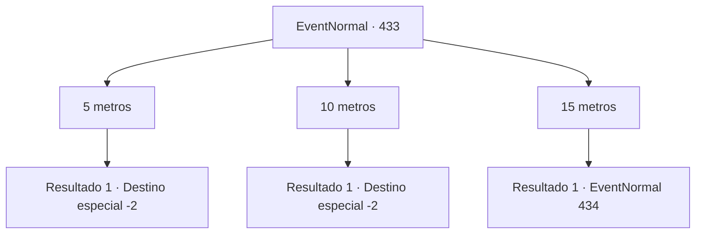

# Eventos normais · 433

[Índice da tabela](index.md) · [Índice geral](../index.md)

ID: `pt:EventNormal:433` · Fonte: `EventNormal4` · Versão: 1.2.47.

Mapeamento estático dos arquivos; a disponibilidade e a execução dependem do estado da run.

## Texto do evento

*Sem texto no arquivo.*

## Dados de entrada

```json
{
  "id": 433,
  "grade": 1,
  "place": "",
  "required": ""
}
```

## Mapa das escolhas



## Escolhas e resultados

### Escolha 1

5 metros

Requisitos e outros campos da escolha:

```json
{
  "required": ""
}
```

#### Resultado 1.1

Você responde, 5 metros. Ao ouvir sua resposta, Edric ri de você e começa a criticar novamente. 

 "Você nem sabe algo básico assim, algum você se atreve a me desafiar para um duelo? Gente, temos aquele aventureiro sem cérebro aqui! HAHA!"

 A multidão começa a rir também, zombando de você. Você foge apressadamente da cena, fugindo do riso direcionado a você.

Continuação registrada: [Destino especial `-2`](../destinos-especiais.md).

```json
{
  "required": "",
  "chance": "1",
  "nextEvent": -2,
  "type": 2,
  "reward": "5_291_10"
}
```

### Escolha 2

10 metros

Requisitos e outros campos da escolha:

```json
{
  "required": ""
}
```

#### Resultado 2.1

Você responde, 10 metros. Ao ouvir sua resposta, Edric ri de você e começa a criticar novamente. 

 "Você nem sabe algo básico assim, algum você se atreve a me desafiar para um duelo? Gente, temos aquele aventureiro sem cérebro aqui! HAHA!"

 A multidão começa a rir também, zombando de você. Você foge apressadamente da cena, fugindo do riso direcionado a você.

Continuação registrada: [Destino especial `-2`](../destinos-especiais.md).

```json
{
  "required": "",
  "chance": "1",
  "nextEvent": -2,
  "type": 2,
  "reward": "5_291_10"
}
```

### Escolha 3

15 metros

Requisitos e outros campos da escolha:

```json
{
  "required": ""
}
```

#### Resultado 3.1

Você responde, 15 metros. Edric parece surpreso, mas logo ri novamente. 

 "Hmph. Você está certo. Mas isso é apenas um aquecimento, então não fique muito animado."

 Edric dá um sorriso maligno e continua. 

 "Segunda questão. Quais são as estatísticas necessárias para empunhar efetivamente uma foice de corrente?"


Continuação registrada: [Evento 434](0434.md) na mesma tabela.

```json
{
  "required": "",
  "chance": "1",
  "nextEvent": 434,
  "type": 2,
  "reward": ""
}
```

## Referências que chegam a este evento

- [Evento 411 · escolha 2 · resultado 3](0411.md#escolha-2)
