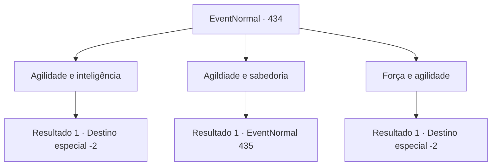

# Eventos normais · 434

[Índice da tabela](index.md) · [Índice geral](../index.md)

ID: `pt:EventNormal:434` · Fonte: `EventNormal4` · Versão: 1.2.47.

Mapeamento estático dos arquivos; a disponibilidade e a execução dependem do estado da run.

## Texto do evento

*Sem texto no arquivo.*

## Dados de entrada

```json
{
  "id": 434,
  "grade": 1,
  "place": "",
  "required": ""
}
```

## Mapa das escolhas



## Escolhas e resultados

### Escolha 1

Agilidade e inteligência

Requisitos e outros campos da escolha:

```json
{
  "required": ""
}
```

#### Resultado 1.1

Você responde, agilidade e inteligência. Ao ouvir sua resposta, Edric ri de você e começa a criticar novamente. 

 "Você nem sabe algo básico assim, algum você se atreve a me desafiar para um duelo? Gente, temos aquele aventureiro sem cérebro aqui! HAHA!"

 A multidão começa a rir também, zombando de você. Você foge apressadamente da cena, fugindo do riso direcionado a você.

Continuação registrada: [Destino especial `-2`](../destinos-especiais.md).

```json
{
  "required": "",
  "chance": "1",
  "nextEvent": -2,
  "type": 2,
  "reward": "5_291_10"
}
```

### Escolha 2

Agildiade e sabedoria

Requisitos e outros campos da escolha:

```json
{
  "required": ""
}
```

#### Resultado 2.1

Você responde, agilidade e sabedoria. Edric fica surpreso de verdade desta vez. Ele franze a testa. 

 "Hmph. Corrija novamente... Tudo bem."

 Edric cruza os braços e faz a última pergunta. 

 "Haha! Você nunca vai acertar este! Última pergunta! O que significam os símbolos em um Amuleto Lemegeton?"


Continuação registrada: [Evento 435](0435.md) na mesma tabela.

```json
{
  "required": "",
  "chance": "1",
  "nextEvent": 435,
  "type": 2,
  "reward": ""
}
```

### Escolha 3

Força e agilidade

Requisitos e outros campos da escolha:

```json
{
  "required": ""
}
```

#### Resultado 3.1

Você responde, força e agilidade. Ao ouvir sua resposta, Edric ri de você e começa a criticar novamente. 

 "Você nem sabe algo básico assim, algum você se atreve a me desafiar para um duelo? Gente, temos aquele aventureiro sem cérebro aqui! HAHA!"

 A multidão começa a rir também, zombando de você. Você foge apressadamente da cena, fugindo do riso direcionado a você.

Continuação registrada: [Destino especial `-2`](../destinos-especiais.md).

```json
{
  "required": "",
  "chance": "1",
  "nextEvent": -2,
  "type": 2,
  "reward": "5_291_10"
}
```

## Referências que chegam a este evento

- [Evento 433 · escolha 3 · resultado 1](0433.md#escolha-3)
