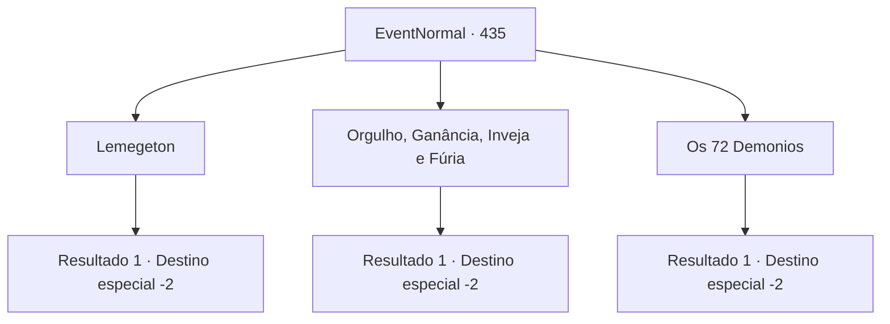

# Eventos normais · 435

[Índice da tabela](index.md) · [Índice geral](../index.md)

ID: `pt:EventNormal:435` · Fonte: `EventNormal4` · Versão: 1.2.47.

Mapeamento estático dos arquivos; a disponibilidade e a execução dependem do estado da run.

## Texto do evento

*Sem texto no arquivo.*

## Dados de entrada

```json
{
  "id": 435,
  "grade": 1,
  "place": "",
  "required": ""
}
```

## Mapa das escolhas



## Escolhas e resultados

### Escolha 1

Lemegeton

Requisitos e outros campos da escolha:

```json
{
  "required": ""
}
```

#### Resultado 1.1

Você responde, Lemegeton. Ao ouvir sua resposta, Edric ri de você e começa a criticar novamente. 

 "Ha! Vejo que você estuda há um tempo, mas é claro que um aventureiro é um aventureiro, afinal! ERRADO! HAHAHA!"

 A multidão começa a rir também, zombando de você. Você foge apressadamente da cena, fugindo do riso direcionado a você.

Continuação registrada: [Destino especial `-2`](../destinos-especiais.md).

```json
{
  "required": "",
  "chance": "1",
  "nextEvent": -2,
  "type": 2,
  "reward": "5_291_10"
}
```

### Escolha 2

Orgulho, Ganância, Inveja e Fúria

Requisitos e outros campos da escolha:

```json
{
  "required": ""
}
```

#### Resultado 2.1

Você responde, orgulho, ganância, inveja e ira. Ao ouvir sua resposta, Edric ri de você e começa a criticar novamente. 

 "Ha! Vejo que você estuda há um tempo, mas é claro que um aventureiro é um aventureiro, afinal! ERRADO! HAHAHA!"

 A multidão começa a rir também, zombando de você. Você foge apressadamente da cena, fugindo do riso direcionado a você.

Continuação registrada: [Destino especial `-2`](../destinos-especiais.md).

```json
{
  "required": "",
  "chance": "1",
  "nextEvent": -2,
  "type": 2,
  "reward": "5_291_10"
}
```

### Escolha 3

Os 72 Demonios 

Requisitos e outros campos da escolha:

```json
{
  "required": ""
}
```

#### Resultado 3.1

Você responde, os 72 demônios. O rosto de Edric fica vermelho quando ele morde os lábios. Ele responde baixinho. 

 "...C..correto."

 As pessoas que estavam assistindo o duelo começam a aplaudir e aplaudir. Você acena para eles como um gladiador vitorioso. Você gosta da sensação de triunfo. Edric deixa cair o livro que estava segurando enquanto foge. Você pega, pega como um espólio de guerra e vai embora com confiança. 

Continuação registrada: [Destino especial `-2`](../destinos-especiais.md).

```json
{
  "required": "",
  "chance": "1",
  "nextEvent": -2,
  "type": 2,
  "reward": "0_2_1|3_201_1|5_291_1"
}
```

## Referências que chegam a este evento

- [Evento 434 · escolha 2 · resultado 1](0434.md#escolha-2)
