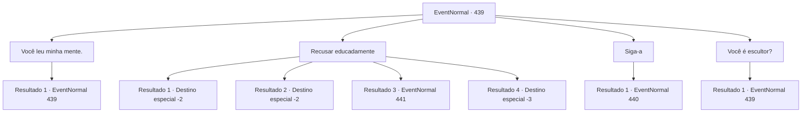

# Eventos normais · 439

[Índice da tabela](index.md) · [Índice geral](../index.md)

ID: `pt:EventNormal:439` · Fonte: `EventNormal4` · Versão: 1.2.47.

Mapeamento estático dos arquivos; a disponibilidade e a execução dependem do estado da run.

## Texto do evento

Depois de uma jornada desafiadora pelas montanhas agrestes, você chega à cidade costeira 'Belo', localizada sob o 'Mt. Bellask'. O lugar é um paraíso artístico, com uma variedade de esculturas de neve e gelo ostentando sua beleza. Você passa correndo por eles, procurando um lugar para aquecer seu corpo. Mas uma escultura de um jovem chama sua atenção. |drawing_icemasterpiece| Só poderia ser descrito como uma beleza deslumbrante. O suficiente para fazer você parar e olhar para ele. 

 "Ahhh... É como... essa escultura tem uma alma em si..."

 Um escultor ao seu lado segurando um martelo suspira com admiração enquanto olha para a escultura também. Então, uma senhora aparece por trás da escultura. Ela solta o cinzel de suas mãos e fala. 

 "Ah, um aventureiro. Diga, talvez você precise de um banho quente, para protegê-lo desse frio...?"

 

## Dados de entrada

```json
{
  "id": 439,
  "grade": 1,
  "place": "",
  "required": "5_296_0"
}
```

## Mapa das escolhas



## Escolhas e resultados

### Escolha 1

Você leu minha mente.

Requisitos e outros campos da escolha:

```json
{
  "required": "5_297_0"
}
```

#### Resultado 1.1

Ela responde com um sorriso tímido. 

 "Eu posso dizer. Mt. Bellask é um lugar difícil de se mover... o frio, o caminho sinuoso e perigoso... Todo visitante estrangeiro chega coberto de flocos de neve... haha. Se importa se eu te guiar até nossa pousada?"


Continuação registrada: [Evento 439](0439.md) na mesma tabela.

```json
{
  "required": "",
  "chance": "1",
  "nextEvent": 439,
  "type": 2,
  "reward": "5_297_1"
}
```

### Escolha 2

Recusar educadamente

Requisitos e outros campos da escolha:

```json
{
  "required": "5_297_1"
}
```

#### Resultado 2.1

Você recusa a proposta dela e vai embora. O vento frio toca seu corpo, mas não incomoda tanto assim.

Continuação registrada: [Destino especial `-2`](../destinos-especiais.md).

```json
{
  "required": "",
  "chance": "1|0_13_1",
  "nextEvent": -2,
  "type": 0,
  "reward": "5_296_9"
}
```

#### Resultado 2.2

Você recusa a proposta dela e vai embora. O vento frio toca seu corpo, mas não incomoda tanto assim.

Continuação registrada: [Destino especial `-2`](../destinos-especiais.md).

```json
{
  "required": "20_8_2",
  "chance": "1|0_13_1",
  "nextEvent": -2,
  "type": 0,
  "reward": "5_296_9"
}
```

#### Resultado 2.3

Você recusa a proposta dela e vai embora. Mas você logo fica inconsciente quando o vento frio toca seu corpo. Você desmaia de uma queda repentina de temperatura corporal. Depois de muito tempo, você acorda e encontra-se acamado. 

 "...Eu não deveria ter deixado você ir assim."

 Quando você olha em volta, você encontra a senhora com o cinzel de antes. Ao lado dela está uma mulher mais velha. 

 "Está tudo bem, Laurent. Você ainda salvou a vida deste aventureiro. Quando nosso hóspede acordar... você já sabe o que fazer, certo? Vou aquecer a água."

 A mulher de meia-idade sai da sala e Laurent se aproxima de você. 

 "Obrigado Senhor. O estalajadeiro me disse para tratá-lo bem."

 Ela se levanta e gesticula para que você a siga. 

Continuação registrada: [Evento 441](0441.md) na mesma tabela.

```json
{
  "required": "1_0_2",
  "chance": "18",
  "nextEvent": 441,
  "type": 1,
  "reward": "0_0_-1"
}
```

#### Resultado 2.4

Você recusa a proposta dela e vai embora. Mas você logo fica inconsciente quando o vento frio toca seu corpo. Você desmaia de uma queda repentina de temperatura corporal.

Continuação registrada: [Destino especial `-3`](../destinos-especiais.md).

```json
{
  "required": "2_0_2",
  "chance": "18",
  "nextEvent": -3,
  "type": 1,
  "reward": "0_0_-1"
}
```

### Escolha 3

Siga-a

Requisitos e outros campos da escolha:

```json
{
  "required": "5_297_1"
}
```

#### Resultado 3.1

Você segue a senhora até uma pequena pousada. Quando vocês dois passam pela porta de madeira rangendo, uma mulher de meia-idade que parece ser a estalajadeira os cumprimenta. 

 "Bem-vindo bem vindo. Temos quartos limpos e água de banho quente. Todo seu para o dia por 10 de ouro."


Continuação registrada: [Evento 440](0440.md) na mesma tabela.

```json
{
  "required": "",
  "chance": "1",
  "nextEvent": 440,
  "type": 2,
  "reward": ""
}
```

### Escolha 4

Você é escultor?

Requisitos e outros campos da escolha:

```json
{
  "required": "5_298_0"
}
```

#### Resultado 4.1

Ela responde balançando a cabeça. 

 "Um escultor?! Estou lisonjeado... Não, sou apenas um mero empregado de uma pousada."

 Ela te explica, que Belo sempre foi uma cidade nevada. Aparentemente, o povo de Belo desenvolveu a tradição de comemorar um dia especialmente nevado decorando as ruas com esculturas de neve e gelo. 

 "...Uh, estou falando demais. Você parece frio. Se importa se eu te guiar até nossa pousada?"


Continuação registrada: [Evento 439](0439.md) na mesma tabela.

```json
{
  "required": "",
  "chance": "1",
  "nextEvent": 439,
  "type": 2,
  "reward": "5_298_1"
}
```

## Referências que chegam a este evento

- [Evento 439 · escolha 1 · resultado 1](0439.md#escolha-1)
- [Evento 439 · escolha 4 · resultado 1](0439.md#escolha-4)
