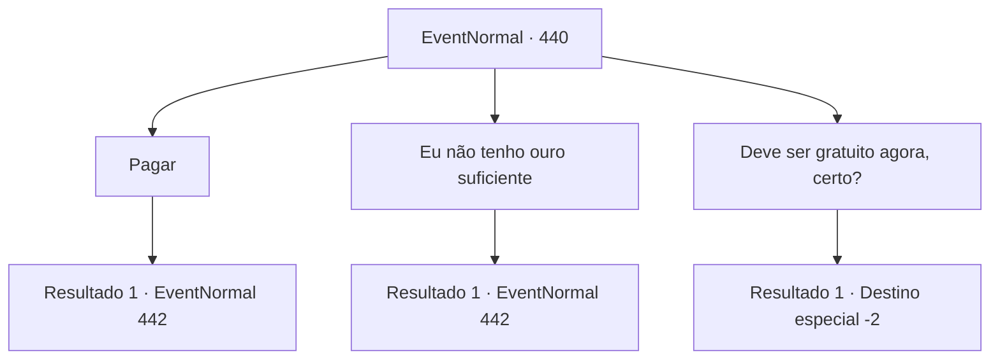

# Eventos normais · 440

[Índice da tabela](index.md) · [Índice geral](../index.md)

ID: `pt:EventNormal:440` · Fonte: `EventNormal4` · Versão: 1.2.47.

Mapeamento estático dos arquivos; a disponibilidade e a execução dependem do estado da run.

## Texto do evento

*Sem texto no arquivo.*

## Dados de entrada

```json
{
  "id": 440,
  "grade": 1,
  "place": "",
  "required": ""
}
```

## Mapa das escolhas



## Escolhas e resultados

### Escolha 1

Pagar

Requisitos e outros campos da escolha:

```json
{
  "required": "1_4_10"
}
```

#### Resultado 1.1

Você dá a taxa para a mulher de meia-idade. 

 "Laurente? Guie nosso cliente para uma sala vazia."

 Aparentemente, a senhora que o trouxe até aqui se chama Laurent. Laurent recebe uma chave do estalajadeiro e leva você a um quarto no final do corredor. Ela lhe entrega a chave, dizendo que não há nada como uma sauna quente para se aquecer. Você vai para o seu quarto, desfaz as malas e vai para a sauna. 

 A sauna é grande o suficiente para cinco ou seis pessoas, talvez mais. No canto da sala há uma pilha de pedras sendo aquecidas. Enquanto você se veste adequadamente para a sauna e se senta, Laurent entra na sauna com uma chaleira cheia de água. Você percebe que as mãos dela estão cobertas de cicatrizes.

Continuação registrada: [Evento 442](0442.md) na mesma tabela.

```json
{
  "required": "",
  "chance": "1",
  "nextEvent": 442,
  "type": 2,
  "reward": "0_4_-10"
}
```

### Escolha 2

Eu não tenho ouro suficiente

Requisitos e outros campos da escolha:

```json
{
  "required": ""
}
```

#### Resultado 2.1

Você diz a ela que não tem ouro suficiente para pagar a taxa. A mulher de meia-idade cruza os braços e responde. 

 "Hm... Vai haver uma nevasca séria hoje à noite... Oh bem. Talvez possamos fazer algum espaço em nosso depósito. Você deveria passar a noite lá."

 Ela então pega uma chave e entrega para a senhora. 

 "Laurente? Guie nosso cliente."

 Aparentemente, a senhora que o trouxe até aqui se chama Laurent. Laurent recebe a chave do estalajadeiro e leva você para baixo, para o depósito no porão. Ela lhe entrega a chave, dizendo que não há nada como uma sauna quente para se aquecer. Você vai para o seu quarto, desfaz as malas e vai para a sauna. 

 A sauna é grande o suficiente para cinco ou seis pessoas, talvez mais. No canto da sala há uma pilha de pedras sendo aquecidas. Enquanto você se veste adequadamente para a sauna e se senta, Laurent entra na sauna com uma chaleira cheia de água. Você percebe que as mãos dela estão cobertas de cicatrizes.

Continuação registrada: [Evento 442](0442.md) na mesma tabela.

```json
{
  "required": "",
  "chance": "1",
  "nextEvent": 442,
  "type": 2,
  "reward": ""
}
```

### Escolha 3

Deve ser gratuito agora, certo?

Requisitos e outros campos da escolha:

```json
{
  "required": "2_3_-14"
}
```

#### Resultado 3.1

Você saca sua arma e ameaça o estalajadeiro. Ela recua com medo e lhe entrega uma chave. 

 "...Pegue o quarto no final do corredor."

 Você pega a chave e segue para a sala mencionada. O quarto é mais do que suficiente para uma pessoa. Você olha pela janela e percebe que está começando a nevar. Fortemente. Você pensa consigo mesmo, que foi uma sorte sua chegar a esta pousada. 

 A manhã chega e você sai da pousada rejuvenescido. O rosto do estalajadeiro não parece tão feliz, mas você não poderia se importar menos.

Continuação registrada: [Destino especial `-2`](../destinos-especiais.md).

```json
{
  "required": "",
  "chance": "1",
  "nextEvent": -2,
  "type": 2,
  "reward": "0_3_-1|0_0_1|0_1_1|5_296_9"
}
```

## Referências que chegam a este evento

- [Evento 439 · escolha 3 · resultado 1](0439.md#escolha-3)
