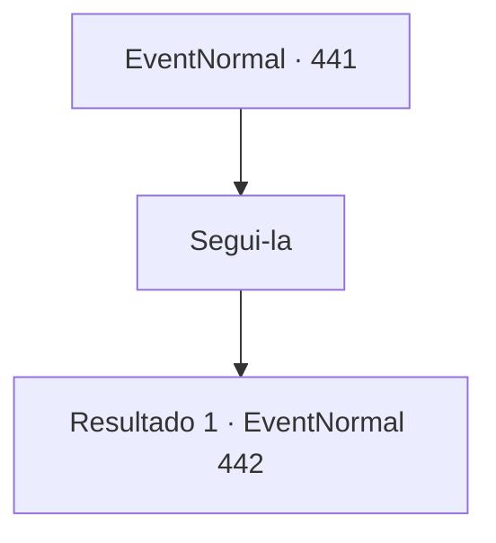

# Eventos normais · 441

[Índice da tabela](index.md) · [Índice geral](../index.md)

ID: `pt:EventNormal:441` · Fonte: `EventNormal4` · Versão: 1.2.47.

Mapeamento estático dos arquivos; a disponibilidade e a execução dependem do estado da run.

## Texto do evento

*Sem texto no arquivo.*

## Dados de entrada

```json
{
  "id": 441,
  "grade": 1,
  "place": "",
  "required": ""
}
```

## Mapa das escolhas



## Escolhas e resultados

### Escolha 1

Segui-la

Requisitos e outros campos da escolha:

```json
{
  "required": ""
}
```

#### Resultado 1.1

Ela leva você para a sauna. 

 "Aqui, roupas para a sauna. Coloque-os e entre. Você deve aquecer seu corpo."

 Você pega as roupas e entra na sauna. A sauna é grande o suficiente para cinco ou seis pessoas, talvez mais. No canto da sala há uma pilha de pedras sendo aquecidas. Enquanto você se veste adequadamente para a sauna e se senta, Laurent entra na sauna com uma chaleira cheia de água. Você percebe que as mãos dela estão cobertas de cicatrizes.

Continuação registrada: [Evento 442](0442.md) na mesma tabela.

```json
{
  "required": "",
  "chance": "1",
  "nextEvent": 442,
  "type": 2,
  "reward": ""
}
```

## Referências que chegam a este evento

- [Evento 439 · escolha 2 · resultado 3](0439.md#escolha-2)
