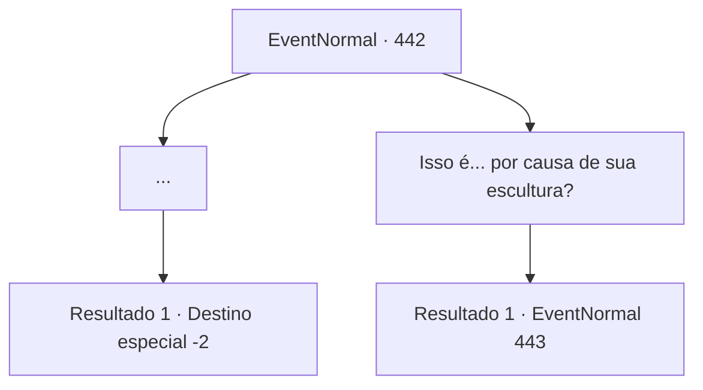

# Eventos normais · 442

[Índice da tabela](index.md) · [Índice geral](../index.md)

ID: `pt:EventNormal:442` · Fonte: `EventNormal4` · Versão: 1.2.47.

Mapeamento estático dos arquivos; a disponibilidade e a execução dependem do estado da run.

## Texto do evento

*Sem texto no arquivo.*

## Dados de entrada

```json
{
  "id": 442,
  "grade": 1,
  "place": "",
  "required": ""
}
```

## Mapa das escolhas



## Escolhas e resultados

### Escolha 1

...

Requisitos e outros campos da escolha:

```json
{
  "required": ""
}
```

#### Resultado 1.1

Ela despeja a água nas pedras aquecidas. Vapor branco sai, aquecendo a sala. 

 "Por favor sinta-se em casa."

 Laurent sai da sauna e você descansa confortavelmente. Você sente o cansaço de suas aventuras ser lavado. 

 A manhã chega e você sai da pousada rejuvenescido. Laurent te acompanha lá fora, e você acena para ela também.

Continuação registrada: [Destino especial `-2`](../destinos-especiais.md).

```json
{
  "required": "",
  "chance": "1",
  "nextEvent": -2,
  "type": 2,
  "reward": "0_0_1|0_1_1|5_296_9"
}
```

### Escolha 2

Isso é... por causa de sua escultura?

Requisitos e outros campos da escolha:

```json
{
  "required": ""
}
```

#### Resultado 2.1

Laurent responde, olhando para a mão coberta de cicatriz. 

 "Ah sim. Fazer esculturas acabou sendo uma atividade difícil."

 Ela despeja a água nas pedras aquecidas. Vapor branco sai, aquecendo a sala. Ela então se senta ao seu lado e começa a falar. 

 "Eu tenho um irmão próximo. Um irmão. Crescemos sem pai, e ele cumpriu esse papel para mim. ...O último inverno foi especialmente rigoroso. Nossa mãe pegou febre e ficou de cama, e meu irmão... ele saiu para o mato, dizendo que voltaria com um remédio."

 Cada palavra que ela diz parece estar cheia de nostalgia. 

 "Comecei a esculpir, como forma de expressar meu desejo... de vê-lo voltar em segurança. Porque essa é a única coisa que posso fazer por ele agora. Orando aos deuses."


Continuação registrada: [Evento 443](0443.md) na mesma tabela.

```json
{
  "required": "",
  "chance": "1",
  "nextEvent": 443,
  "type": 2,
  "reward": ""
}
```

## Referências que chegam a este evento

- [Evento 440 · escolha 1 · resultado 1](0440.md#escolha-1)
- [Evento 440 · escolha 2 · resultado 1](0440.md#escolha-2)
- [Evento 441 · escolha 1 · resultado 1](0441.md#escolha-1)
