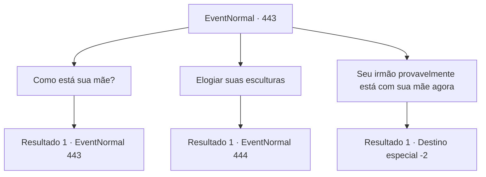

# Eventos normais · 443

[Índice da tabela](index.md) · [Índice geral](../index.md)

ID: `pt:EventNormal:443` · Fonte: `EventNormal4` · Versão: 1.2.47.

Mapeamento estático dos arquivos; a disponibilidade e a execução dependem do estado da run.

## Texto do evento

*Sem texto no arquivo.*

## Dados de entrada

```json
{
  "id": 443,
  "grade": 1,
  "place": "",
  "required": ""
}
```

## Mapa das escolhas



## Escolhas e resultados

### Escolha 1

Como está sua mãe?

Requisitos e outros campos da escolha:

```json
{
  "required": "5_299_0"
}
```

#### Resultado 1.1

Você pergunta como está a mãe dela. Ela responde baixinho. 

 "Ela... faleceu há três meses. Ela nunca pararia de chamar o nome dele... seu filho. Eu gostaria que nevasse antes de ela morrer. Pelo menos ela poderia tê-lo visto em forma de escultura."


Continuação registrada: [Evento 443](0443.md) na mesma tabela.

```json
{
  "required": "",
  "chance": "1",
  "nextEvent": 443,
  "type": 2,
  "reward": "5_299_1"
}
```

### Escolha 2

Elogiar suas esculturas

Requisitos e outros campos da escolha:

```json
{
  "required": "5_299_1"
}
```

#### Resultado 2.1

Você para brevemente e decide mudar de assunto. Você elogia as esculturas dela. Laurent então responde com um leve sorriso. 

 "Obrigada. Passei muito tempo nisso... Os Deuses vão reconhecer meu esforço, certo?"

 Laurent olha pela janela por um tempo antes de continuar. 

 "Isso pode... soar estranho, mas você se sente... meu irmão."


Continuação registrada: [Evento 444](0444.md) na mesma tabela.

```json
{
  "required": "",
  "chance": "1",
  "nextEvent": 444,
  "type": 2,
  "reward": ""
}
```

### Escolha 3

Seu irmão provavelmente está com sua mãe agora

Requisitos e outros campos da escolha:

```json
{
  "required": "2_3_-14|5_299_1"
}
```

#### Resultado 3.1

Você diz a ela que se um jovem saiu da cidade e não voltou por três meses, isso provavelmente significa que ele não voltará para sempre. Então a expressão de Laurent fica séria e responde. 

 "...Não diga isso. Traz azar. Vejo que falei demais. Agora, se você me der licença."

 Ela larga a chaleira e sai da sauna. Depois que Laurent sai, você descansa confortavelmente na sauna. Você sente o cansaço de suas aventuras ser lavado. Você volta para o seu quarto depois do tempo na sauna e vai para a cama. 

 A manhã chega e você sai da pousada rejuvenescido. O estalajadeiro se despede. Você faz o mesmo.

Continuação registrada: [Destino especial `-2`](../destinos-especiais.md).

```json
{
  "required": "",
  "chance": "1",
  "nextEvent": -2,
  "type": 2,
  "reward": "0_0_1|0_1_1|5_296_9"
}
```

## Referências que chegam a este evento

- [Evento 442 · escolha 2 · resultado 1](0442.md#escolha-2)
- [Evento 443 · escolha 1 · resultado 1](0443.md#escolha-1)
