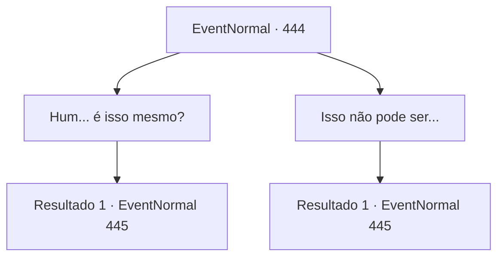

# Eventos normais · 444

[Índice da tabela](index.md) · [Índice geral](../index.md)

ID: `pt:EventNormal:444` · Fonte: `EventNormal4` · Versão: 1.2.47.

Mapeamento estático dos arquivos; a disponibilidade e a execução dependem do estado da run.

## Texto do evento

*Sem texto no arquivo.*

## Dados de entrada

```json
{
  "id": 444,
  "grade": 1,
  "place": "",
  "required": ""
}
```

## Mapa das escolhas



## Escolhas e resultados

### Escolha 1

Hum... é isso mesmo?

Requisitos e outros campos da escolha:

```json
{
  "required": ""
}
```

#### Resultado 1.1

Quando você atende, ela responde com uma voz mais enérgica. 

 "Sim! Claro, existem diferenças em alguns detalhes, mas a aura geral que você emite é quase idêntica. Então... estou feliz. Porque parece que estou com meu amado irmão mais uma vez. Ah, estou falando demais. Aqui, a chaleira está cheia de água. Então, quando você achar que a temperatura está caindo, despeje na pilha de pedras ali."

 Ela também avisa para não derramar muita água de uma só vez e depois sai da sauna. Depois que Laurent sai, você descansa confortavelmente na sauna. Você sente o cansaço de suas aventuras ser lavado. Você volta para o seu quarto depois do tempo na sauna e vai para a cama.

Continuação registrada: [Evento 445](0445.md) na mesma tabela.

```json
{
  "required": "",
  "chance": "1",
  "nextEvent": 445,
  "type": 2,
  "reward": ""
}
```

### Escolha 2

Isso não pode ser...

Requisitos e outros campos da escolha:

```json
{
  "required": ""
}
```

#### Resultado 2.1

Quando você atende, ela responde com uma voz mais enérgica. 

 "Claro, existem diferenças em alguns detalhes, mas a aura geral que você emite é quase idêntica. Então... estou feliz. Porque parece que estou com meu amado irmão mais uma vez. Ah, estou falando demais. Aqui, a chaleira está cheia de água. Então, quando você achar que a temperatura está caindo, despeje na pilha de pedras ali."

 Ela também avisa para não derramar muita água de uma só vez e depois sai da sauna. Depois que Laurent sai, você descansa confortavelmente na sauna. Você sente o cansaço de suas aventuras ser lavado. Você volta para o seu quarto depois do tempo na sauna e vai para a cama.

Continuação registrada: [Evento 445](0445.md) na mesma tabela.

```json
{
  "required": "",
  "chance": "1",
  "nextEvent": 445,
  "type": 2,
  "reward": ""
}
```

## Referências que chegam a este evento

- [Evento 443 · escolha 2 · resultado 1](0443.md#escolha-2)
