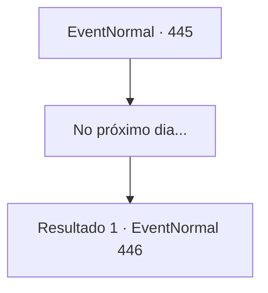

# Eventos normais · 445

[Índice da tabela](index.md) · [Índice geral](../index.md)

ID: `pt:EventNormal:445` · Fonte: `EventNormal4` · Versão: 1.2.47.

Mapeamento estático dos arquivos; a disponibilidade e a execução dependem do estado da run.

## Texto do evento

*Sem texto no arquivo.*

## Dados de entrada

```json
{
  "id": 445,
  "grade": 1,
  "place": "",
  "required": ""
}
```

## Mapa das escolhas



## Escolhas e resultados

### Escolha 1

No próximo dia...

Requisitos e outros campos da escolha:

```json
{
  "required": ""
}
```

#### Resultado 1.1

Quando você acorda, você se sente revigorado e bem. Talvez seja por causa do banho quente. Quando você termina de arrumar suas coisas, Laurent se aproxima e fala com você. 

 "Ah, bem na hora do café da manhã. Você deveria comer, antes de voltar."

 A mesa é adornada com rodas de queijo, pratos vazios e dois conjuntos de facas. Enquanto você se senta, Laurent vem até a mesa com uma panela cheia de aveia e enche os pratos. Ela empurra os pratos para o seu lado e se senta também. O calor da comida abre o apetite. 

 "Eu quero saber. O que fez você começar sua vida como um aventureiro."


Continuação registrada: [Evento 446](0446.md) na mesma tabela.

```json
{
  "required": "",
  "chance": "1",
  "nextEvent": 446,
  "type": 2,
  "reward": ""
}
```

## Referências que chegam a este evento

- [Evento 444 · escolha 1 · resultado 1](0444.md#escolha-1)
- [Evento 444 · escolha 2 · resultado 1](0444.md#escolha-2)
