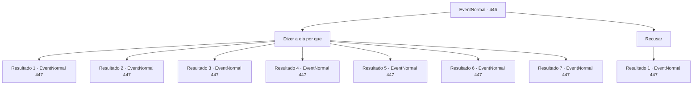

# Eventos normais · 446

[Índice da tabela](index.md) · [Índice geral](../index.md)

ID: `pt:EventNormal:446` · Fonte: `EventNormal4` · Versão: 1.2.47.

Mapeamento estático dos arquivos; a disponibilidade e a execução dependem do estado da run.

## Texto do evento

*Sem texto no arquivo.*

## Dados de entrada

```json
{
  "id": 446,
  "grade": 1,
  "place": "",
  "required": ""
}
```

## Mapa das escolhas



## Escolhas e resultados

### Escolha 1

Dizer a ela por que

Requisitos e outros campos da escolha:

```json
{
  "required": ""
}
```

#### Resultado 1.1

Você se lembra daquele dia de sua vida. Aquela visão inesquecível. O dia em que o herói do país foi saudado pela multidão. Depois de ouvir sua história, Laurent sorri e continua. 

 "Eu vejo. Que coragem... Uma vez eu pensei em me aventurar, na verdade. Quando me cansei de não fazer nada além de esperar. Eu sempre quis sair para o mundo e buscar meu irmão."

 Ela olha pela janela e continua. 

 "Mas até agora, o medo de eu não estar lá quando ele finalmente voltar me impediu de fazer isso. Aventureiro... se você conhecer meu irmão, por favor, diga a ele que ainda estou esperando?"


Continuação registrada: [Evento 447](0447.md) na mesma tabela.

```json
{
  "required": "5_215_1",
  "chance": "1",
  "nextEvent": 447,
  "type": 2,
  "reward": ""
}
```

#### Resultado 1.2

Você se lembra daquele dia de sua vida. O dia em que você foi expulso, em vez do verdadeiro culpado. Toda vez que você pensa naquele momento, você sente suas entranhas tremendo de raiva e frustração. Depois de ouvir sua história, Laurent faz uma expressão severa e fala. 

 "Eu vejo. Que coragem... Uma vez eu pensei em me aventurar, na verdade. Quando me cansei de não fazer nada além de esperar. Eu sempre quis sair para o mundo e buscar meu irmão."

 Ela olha pela janela e continua. 

 "Mas até agora, o medo de eu não estar lá quando ele finalmente voltar me impediu de fazer isso. Aventureiro... se você conhecer meu irmão, por favor, diga a ele que ainda estou esperando?"


Continuação registrada: [Evento 447](0447.md) na mesma tabela.

```json
{
  "required": "5_216_1",
  "chance": "1",
  "nextEvent": 447,
  "type": 2,
  "reward": ""
}
```

#### Resultado 1.3

Você diz a ela como você começou a se aventurar para encontrar e salvar a princesa Esit. Depois de ouvir sua história, Laurent sorri e continua. 

 "Eu vejo. Que coragem... Uma vez eu pensei em me aventurar, na verdade. Quando me cansei de não fazer nada além de esperar. Eu sempre quis sair para o mundo e buscar meu irmão."

 Ela olha pela janela e continua. 

 "Mas até agora, o medo de eu não estar lá quando ele finalmente voltar me impediu de fazer isso. Aventureiro... se você conhecer meu irmão, por favor, diga a ele que ainda estou esperando?"


Continuação registrada: [Evento 447](0447.md) na mesma tabela.

```json
{
  "required": "5_153_1",
  "chance": "1",
  "nextEvent": 447,
  "type": 2,
  "reward": ""
}
```

#### Resultado 1.4

Você se lembra do rosto de Anton e sua irmãzinha. Você também conta a ela todas as coisas que aconteceram entre você e Anton... a cadeia de ódio. Depois de ouvir sua história, Laurent faz uma expressão severa e fala. 

 "Eu vejo. Que coragem... Uma vez eu pensei em me aventurar, na verdade. Quando me cansei de não fazer nada além de esperar. Eu sempre quis sair para o mundo e buscar meu irmão."

 Ela olha pela janela e continua. 

 "Mas até agora, o medo de eu não estar lá quando ele finalmente voltar me impediu de fazer isso. Aventureiro... se você conhecer meu irmão, por favor, diga a ele que ainda estou esperando?"


Continuação registrada: [Evento 447](0447.md) na mesma tabela.

```json
{
  "required": "5_242_1",
  "chance": "1",
  "nextEvent": 447,
  "type": 2,
  "reward": ""
}
```

#### Resultado 1.5

Você se lembra do rosto de sua família. Você diz a ela que estava indo em uma aventura para se vingar. Depois de ouvir sua história, Laurent faz uma expressão séria e fala: 

 "Entendo. Que coragem... Na verdade, eu também já pensei em me aventurar. Quando me cansei de não fazer nada além de esperar. Eu sempre quis sair para o mundo e buscar meu irmão."

 Ela olha pela janela e continua. 

 "Mas até agora, o medo de eu não estar lá quando ele finalmente voltar me impediu de fazer isso. Aventureiro... se você encontrar meu irmão, você pode, por favor, dizer a ele que ainda estou o esperando?"


Continuação registrada: [Evento 447](0447.md) na mesma tabela.

```json
{
  "required": "5_432_1",
  "chance": "1",
  "nextEvent": 447,
  "type": 2,
  "reward": ""
}
```

#### Resultado 1.6

Você diz que começou uma aventura para encontrar o Professor Naverr. Depois de ouvir sua história, Laurent faz uma expressão séria e fala: 

 "Entendo. Que coragem... Na verdade, eu também já pensei em me aventurar. Quando me cansei de não fazer nada além de esperar. Eu sempre quis sair para o mundo e buscar meu irmão."

 Ela olha pela janela e continua. 

 "Mas até agora, o medo de eu não estar lá quando ele finalmente voltar me impediu de fazer isso. Aventureiro... se você encontrar meu irmão, você pode, por favor, dizer a ele que ainda estou o esperando?"


Continuação registrada: [Evento 447](0447.md) na mesma tabela.

```json
{
  "required": "5_699_1",
  "chance": "1",
  "nextEvent": 447,
  "type": 2,
  "reward": ""
}
```

#### Resultado 1.7

Você revela que está em uma aventura para reconstruir Briovich. Então Laurent massageia seus ombros e diz, 

 "É mesmo? Você deve estar carregando um fardo pesado..."

 Após um breve silêncio, ela continua. 

 "Na verdade, eu mesma já pensei em partir em uma aventura. Foi quando me cansei de não fazer nada além de esperar. Eu sempre quis sair pelo mundo e procurar meu irmão por conta própria."

 Ela olha pela janela e continua. 

 "Mas, até agora, o medo de eu não estar aqui quando ele finalmente voltar me impediu de fazer isso. Aventureiro... se encontrar meu irmão, poderia por favor dizer a ele que ainda estou esperando?"


Continuação registrada: [Evento 447](0447.md) na mesma tabela.

```json
{
  "required": "5_976_1",
  "chance": "1",
  "nextEvent": 447,
  "type": 2,
  "reward": ""
}
```

### Escolha 2

Recusar

Requisitos e outros campos da escolha:

```json
{
  "required": ""
}
```

#### Resultado 2.1

Sem dizer nada, você joga o mingau de aveia para a boca. Laurent examina cuidadosamente seu comportamento e logo se desculpa. 

 "Eu... eu sinto muito. Eu não deveria ter perguntado."

 Segue-se um longo silêncio, enquanto o som de talheres de mesa enche o ambiente. Laurent é o primeiro a quebrar esse silêncio. 

 "Aventureiro... se você enccontar meu irmão, por favor, diga a ele que ainda estou esperando?"

 

Continuação registrada: [Evento 447](0447.md) na mesma tabela.

```json
{
  "required": "",
  "chance": "1",
  "nextEvent": 447,
  "type": 2,
  "reward": ""
}
```

## Referências que chegam a este evento

- [Evento 445 · escolha 1 · resultado 1](0445.md#escolha-1)
