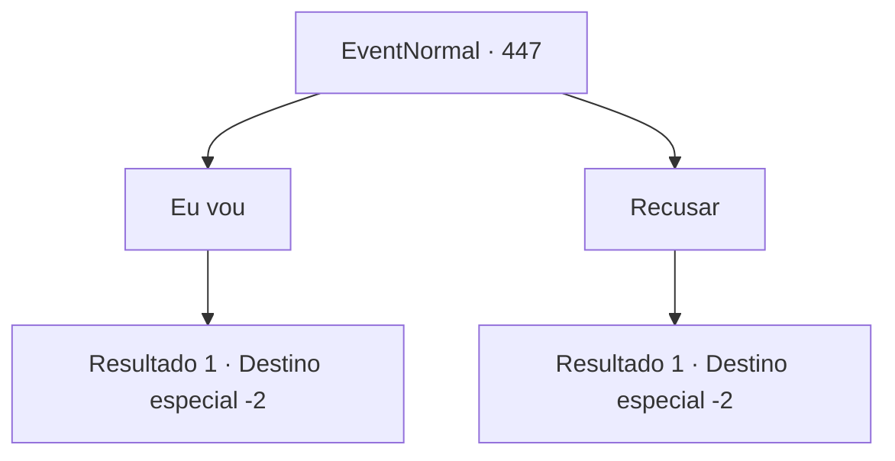

# Eventos normais · 447

[Índice da tabela](index.md) · [Índice geral](../index.md)

ID: `pt:EventNormal:447` · Fonte: `EventNormal4` · Versão: 1.2.47.

Mapeamento estático dos arquivos; a disponibilidade e a execução dependem do estado da run.

## Texto do evento

*Sem texto no arquivo.*

## Dados de entrada

```json
{
  "id": 447,
  "grade": 1,
  "place": "",
  "required": ""
}
```

## Mapa das escolhas



## Escolhas e resultados

### Escolha 1

Eu vou

Requisitos e outros campos da escolha:

```json
{
  "required": ""
}
```

#### Resultado 1.1

Laurent responde com um sorriso e conta sobre seu irmão. 

 "Seu nome é 'Rahiv'. Ele é cerca de uma mão mais alto do que eu, tem cabelos castanhos curtos e sardas no rosto. Agora, então... se você o vir, diga a ele que sua irmã ainda está esperando. Por favor."

 Ela pede para você esperar e vai para o depósito do porão. Ela volta com uma garrafa de vinho de uva. 

 "Este é o vinho especial da nossa cidade. Pense nisso como meu pagamento."

 Você sai da pousada com a garrafa de vinho.

Continuação registrada: [Destino especial `-2`](../destinos-especiais.md).

```json
{
  "required": "",
  "chance": "1",
  "nextEvent": -2,
  "type": 2,
  "reward": "5_296_1|3_225_1"
}
```

### Escolha 2

Recusar

Requisitos e outros campos da escolha:

```json
{
  "required": ""
}
```

#### Resultado 2.1

Você recusa educadamente. Ela não exige mais, mas não consegue esconder a decepção de seu rosto. Ela tenta dizer algo, mas você a deixa para trás e sai da pousada antes que ela possa fazer isso.

Continuação registrada: [Destino especial `-2`](../destinos-especiais.md).

```json
{
  "required": "",
  "chance": "1",
  "nextEvent": -2,
  "type": 2,
  "reward": "5_296_9"
}
```

## Referências que chegam a este evento

- [Evento 446 · escolha 1 · resultado 1](0446.md#escolha-1)
- [Evento 446 · escolha 1 · resultado 2](0446.md#escolha-1)
- [Evento 446 · escolha 1 · resultado 3](0446.md#escolha-1)
- [Evento 446 · escolha 1 · resultado 4](0446.md#escolha-1)
- [Evento 446 · escolha 1 · resultado 5](0446.md#escolha-1)
- [Evento 446 · escolha 1 · resultado 6](0446.md#escolha-1)
- [Evento 446 · escolha 1 · resultado 7](0446.md#escolha-1)
- [Evento 446 · escolha 2 · resultado 1](0446.md#escolha-2)
